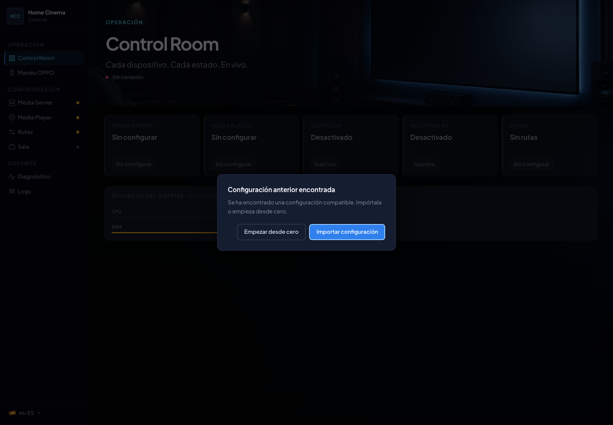
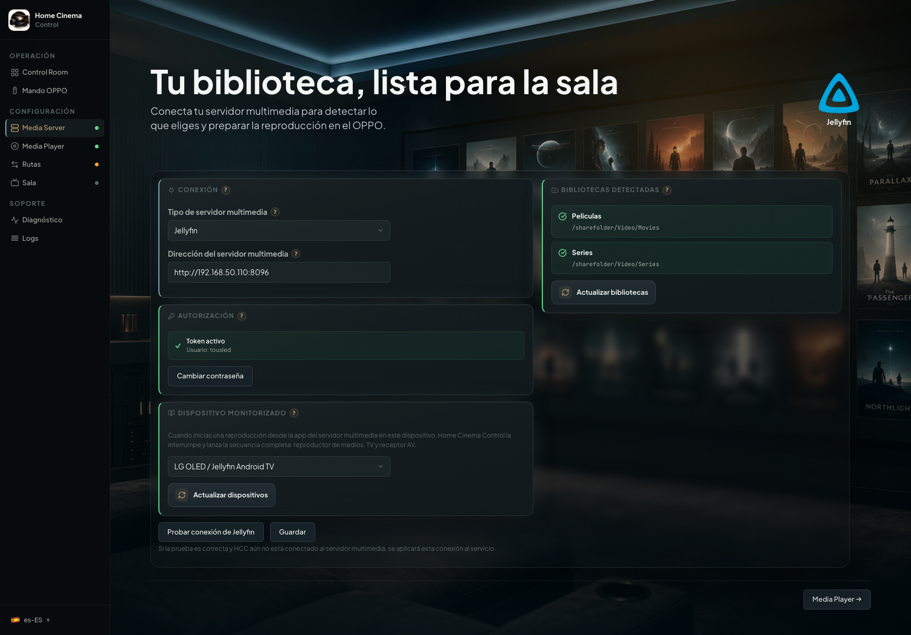
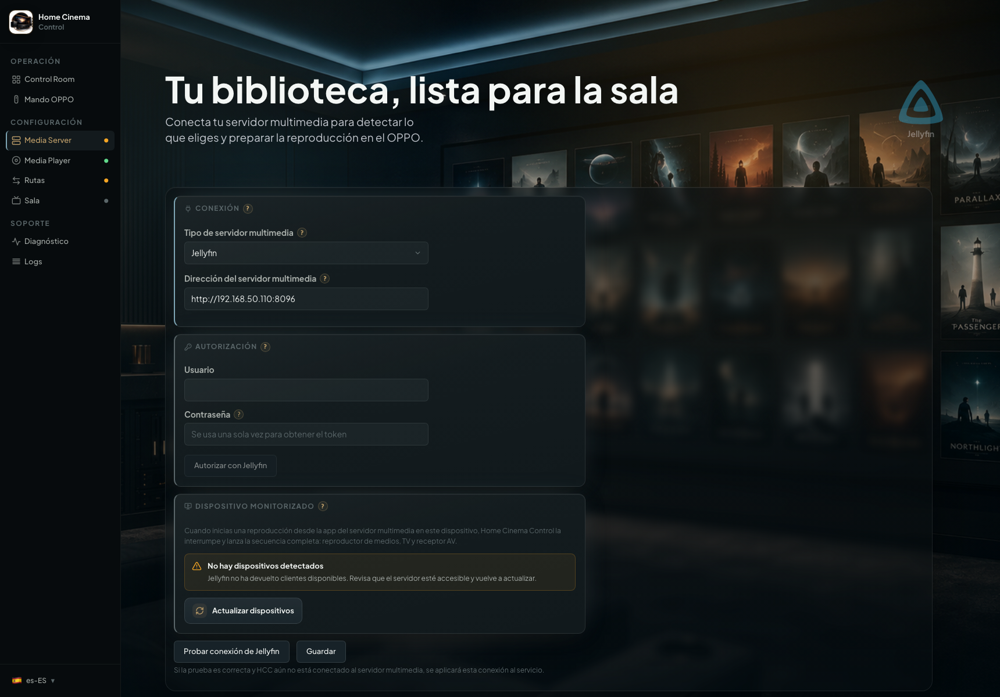
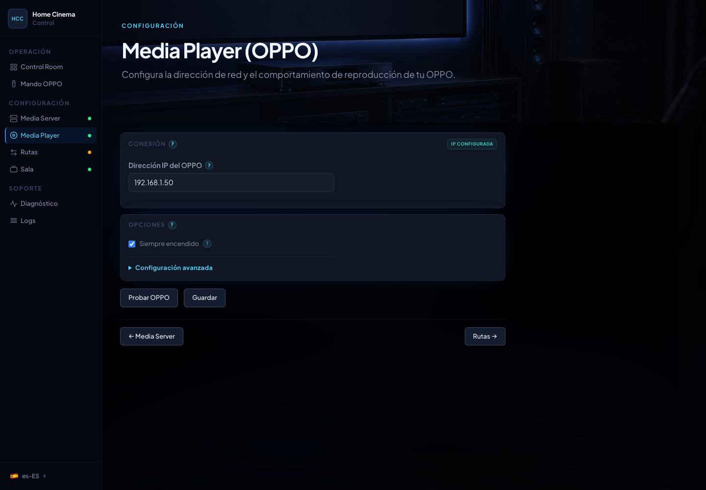
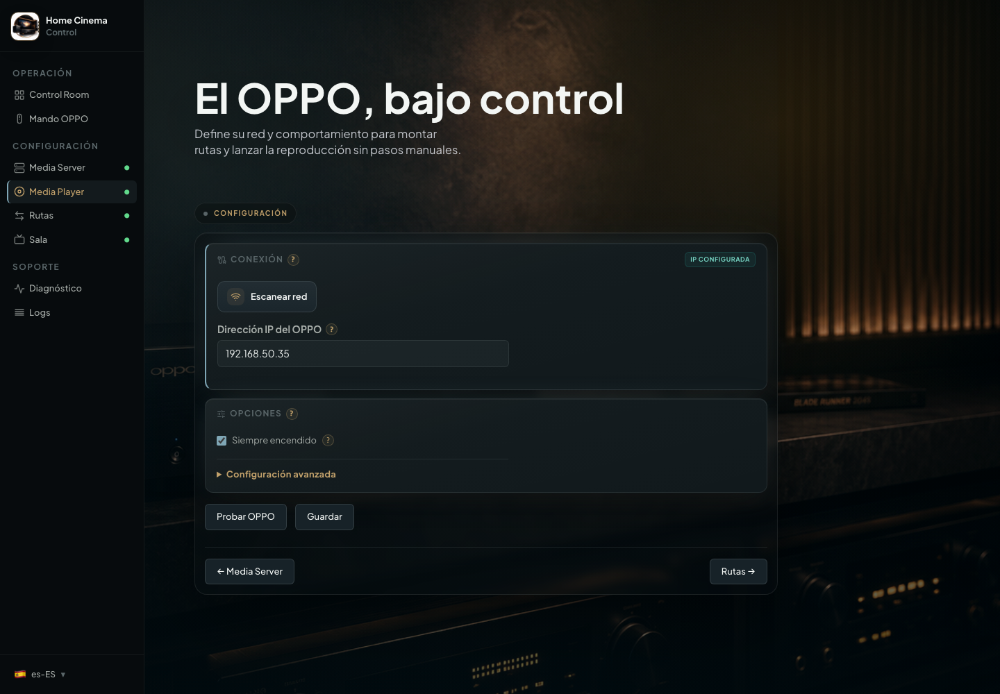
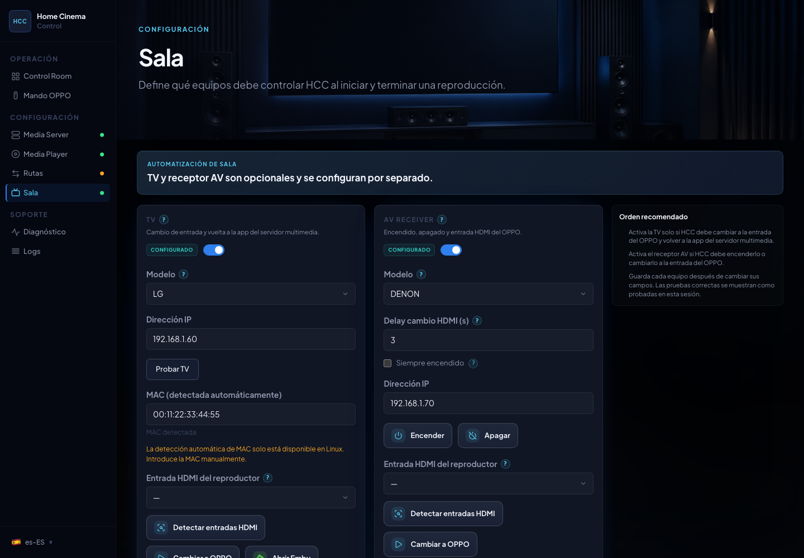
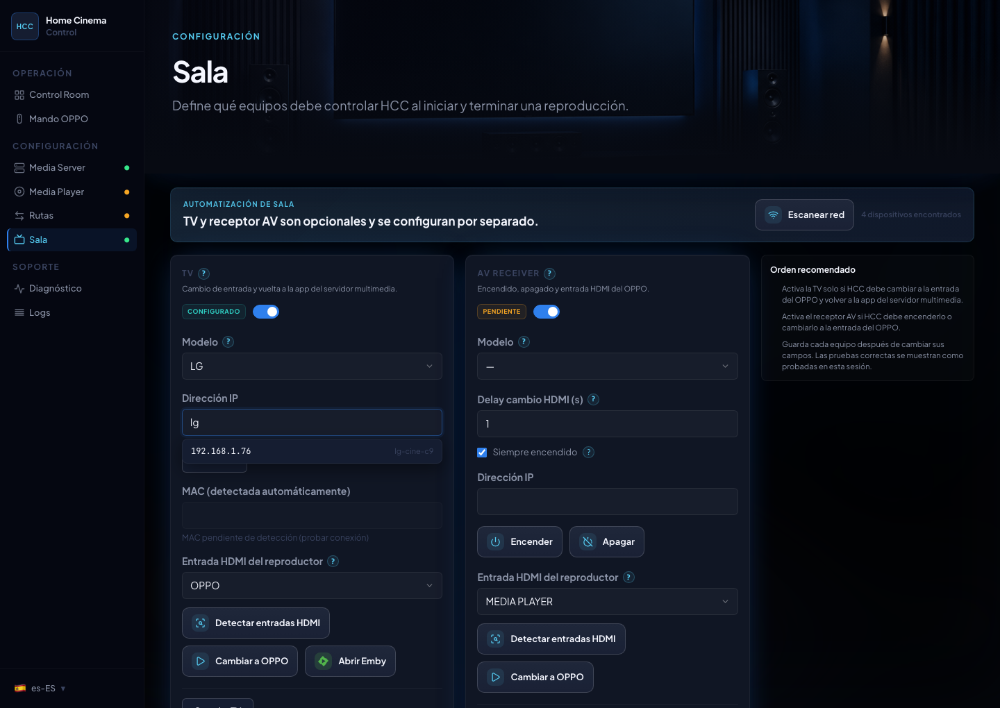

# Home Cinema Control Installation And Setup

[Español](INSTALL.md) · [README](README.en.md)

This guide covers Docker deployment and the HCC web setup flow. It focuses on the problems that usually make
Emby/Jellyfin/NAS/OPPO/TV/AV installations hard to debug: path mapping, IP discovery, NFS/SMB mounts, CEC/ARC
interference, and raw logs without context.

For NAS-specific screenshots and OPPO/Chinoppo player preparation, use the AVPasion Xnoppo community tutorial as an
external reference:

https://foro.avpasion.com/t/xnoppo-lo-mejor-de-emby-en-tu-oppo-203-205-y-chinoppo-clones-m9702-m9201-m9203-m9205.2779/page-21#post-73867

Use that guide for NAS permissions, shares, and player-side setup. Use this guide for HCC.

## What do you want to do?

You do not need to read the whole guide. Start with the option that matches your situation:

- **Install HCC for the first time:** go to [Install HCC](#2-install-hcc). For most installations, use
  [Docker Compose](#3-docker-compose-installation).
- **Update HCC:** go directly to [Updating HCC](#13-updating-hcc). Do not delete the volume, and run Compose from the
  folder that contains `compose.yaml`.
- **Use Portainer, Synology, or Unraid:**
  follow [Installing with Portainer or another web UI](#31-installing-with-portainer-or-another-web-ui).
- **HCC lost its configuration or looks like a fresh installation:**
  see [Migration or fresh setup](#4-migration-or-fresh-setup).
  If the volume was deleted, HCC cannot automatically rebuild the data that was inside it.
- **The installation works but playback fails:** start with [Diagnostics](#10-diagnostics), then
  check [Frequent issues](#14-frequent-issues).
- **Check advanced options:** use the [Advanced reference](#15-advanced-reference) when you need to pin a version, roll
  back, or understand storage.

If you are not sure which option to choose, use Docker Compose. Keep its folder and never delete the
`home-cinema-control-config` volume: it contains HCC's configuration, credentials, and paths.

## Contents

1. [Before you start](#1-before-you-start)
2. [Install HCC](#2-install-hcc)
3. [Docker Compose installation](#3-docker-compose-installation)
4. [Migration or fresh setup](#4-migration-or-fresh-setup)
5. [Connect Emby or Jellyfin](#5-media-server-emby-or-jellyfin)
6. [Connect the OPPO/Chinoppo](#6-media-player)
7. [Configure media paths](#7-media-paths-the-important-part)
8. [Configure the room](#8-room-setup)
9. [Connect Home Assistant](#9-connect-hcc-to-home-assistant)
10. [Check status](#10-diagnostics)
11. [Read the logs](#11-readable-logs)
12. [Validate first playback](#12-first-playback-validation)
13. [Update HCC](#13-updating-hcc)
14. [Frequent issues](#14-frequent-issues)
15. [Advanced reference](#15-advanced-reference)

> **Important:** HCC's configuration is stored in the Docker volume
> `home-cinema-control-config`. Do not delete it when updating or removing the container. Removing the container is
> safe; removing the volume deletes your configuration and secrets.

## 1. Before You Start

| Requirement                | Notes                                                     |
|----------------------------|-----------------------------------------------------------|
| Docker                     | Linux recommended. Host networking is required.           |
| Emby or Jellyfin           | Either one, reachable from HCC.                           |
| OPPO/Chinoppo player       | Must expose the OPPO MediaControl API.                    |
| NAS or shared media folder | Must be visible to both your media server and the player. |
| NFS or SMB/CIFS            | Selected per path mapping in HCC.                         |
| TV and AV receiver         | Optional. HCC can run without them.                       |

Recommendations:

- Reserve fixed IPs for your media server, NAS, player, TV, and AV receiver.
- Create the libraries in Emby or Jellyfin first. HCC does not invent libraries; it reads the ones already configured
  on your server. For Emby, see [Library Setup](https://emby.media/support/articles/Library-Setup.html) and
  [Quick Start](https://emby.media/support/articles/Quick-Start.html). For Jellyfin, see
  [Adding Media Libraries](https://jellyfin.org/docs/general/server/libraries/).
- Share the NAS folders through NFS or SMB/CIFS and confirm the player can browse them from its own network browser.
- Decide which libraries HCC should intercept.
- If your AV receiver switches back to TV Audio after HCC selects the player input, review HDMI CEC/ARC. In some setups,
  disabling CEC/ARC on the AVR is the stable fix.

## 2. Install HCC

For most people, [Docker Compose](#3-docker-compose-installation) is the simplest option: it keeps all data in a named
volume and makes updates easier. If you use Portainer, follow the same option from **Stacks**.

The `docker run` option below is for people who are already comfortable with Docker commands. Do not mix the two
methods:
choose one and keep its update instructions for later.

## 2.1 Quick Start With Docker

You can start HCC directly with `docker run`:

```bash
docker volume create home-cinema-control-config

docker run -d \
  --name home-cinema-control \
  --network host \
  --cap-add NET_RAW \
  --restart unless-stopped \
  -e TZ=Europe/Madrid \
  -e PYTHONUNBUFFERED=1 \
  -e HCC_CONFIG_FILE=/config/config.json \
  -e HCC_SECRETS_FILE_PATH=/config/secrets.json \
  -v home-cinema-control-config:/config \
  ghcr.io/tousled/home-cinema-control:latest
```

Open `http://<your-host>:8090`.

Host networking is required so HCC can reach Emby, the player, TV, AVR, and network discovery tools directly.

## 3. Docker Compose installation

This is the recommended option. Docker Compose must find `compose.yaml`, so keep the file in its own folder and always
run the commands from that same folder.

1. Create a folder for HCC, for example `home-cinema-control`.
2. Create a file named exactly `compose.yaml` inside it and paste this content:

```yaml
services:
  home-cinema-control:
    image: ghcr.io/tousled/home-cinema-control:${HCC_VERSION:-latest}
    container_name: home-cinema-control
    network_mode: host
    cap_add:
      - NET_RAW
    restart: unless-stopped
    environment:
      TZ: Europe/Madrid
      PYTHONUNBUFFERED: "1"
      HCC_CONFIG_FILE: /config/config.json
      HCC_SECRETS_FILE_PATH: /config/secrets.json
      HCC_TELEMETRY_ENDPOINT_URL: ${HCC_TELEMETRY_ENDPOINT_URL:-}
      HCC_TELEMETRY_INGEST_KEY: ${HCC_TELEMETRY_INGEST_KEY:-}
    volumes:
      - home-cinema-control-config:/config

volumes:
  home-cinema-control-config:
    name: home-cinema-control-config
```

You do not need to create `HCC_VERSION`: Compose uses `latest` unless that variable is already defined in the environment or an `.env` file.
The telemetry variables can also remain empty.

3. Open a terminal in that folder. Check that you are in the right place: `compose.yaml` should appear when you list the
   files.

If the folder is somewhere else, enter it before running the commands. For example:

```bash
cd /path/to/home-cinema-control
ls compose.yaml
```

The second command must show `compose.yaml`. If it says that the file does not exist, stop: you are in another folder.

4. Start HCC:

```bash
docker compose pull
docker compose up -d
```

Open `http://<your-host>:8090`.

For future updates, return to this folder and follow [Updating HCC](#13-updating-hcc). Do not run `docker compose` from
another folder: Docker may not find this service.

`network_mode: host` is required: HCC talks directly to Emby/Jellyfin, the OPPO/Chinoppo, TV, AVR, and discovery
tools like `arp-scan`.

### 3.1 Installing with Portainer or another web UI

In Portainer: **Stacks → Add stack**, give it a name such as `home-cinema-control`, and paste the `compose.yaml` above
into the editor. Do not add environment variables: the file already uses `latest`, the latest stable release. To update,
open this same stack and click **Update the stack**; if you see **Re-pull image**, enable it.

To pin a specific version (release candidates included), add `HCC_VERSION` as a stack environment variable, e.g.
`HCC_VERSION=1.4.2-rc.1`. The Compose example uses `${HCC_VERSION:-latest}` to select the image tag. This is Docker Compose variable interpolation; if your YAML hardcodes `:latest`, `HCC_VERSION` will not change the downloaded image. Without it, Portainer uses
`latest` (the latest stable release). To update, change that value and redeploy by re-pulling the image, not by
rebuilding from the Dockerfile.

Other web UIs (Synology Container Manager, Unraid, etc.) should work the same way if they let you set environment
variables for the stack — same logic applies.

In Synology Container Manager, Unraid, or another web UI, look for the equivalent **Stack** or **Compose** option and
keep using this same file. Do not create a new container each time: it must continue using the
`home-cinema-control-config` volume.

## 4. Migration Or Fresh Setup

If HCC looks empty after an update and you did not intend to start over, **do not complete the setup yet**. Return to
the
original stack or folder and check that it still uses the `home-cinema-control-config` volume. If that volume still
exists,
the configuration should return when the correct container starts. If the volume was deleted, you can only recover the
configuration from a Docker or host backup.

If HCC finds a compatible older configuration, it shows a migration screen.

<p align="center">
  
</p>

HCC now saves setup by section and keeps secrets in `/config/secrets.json`.

If this is instead a brand-new install (no prior HCC configuration) and you're coming from the predecessor
XNOPPO/Chinoppo project, HCC offers a second, separate prompt: import your old XNOPPO `config.json` instead of
setting everything up from scratch. Pick the file, and HCC migrates OPPO/TV/AV/paths the same way the regular
migration does, moves your Emby server URL into the new config shape, and — if the server is reachable at that
moment — logs in with the old file's username/password to obtain a real token. If it can't reach the server, the
provider is still added but left unauthenticated, and the Media Server sidebar indicator turns orange so you know to
finish connecting it from its own screen. If you don't have an XNOPPO `config.json`, or would rather not import it,
choose "Configure from scratch" and follow the normal wizard.

<!-- TODO: screenshot of the XNOPPO import modal on a fresh install -->

## 5. Media Server: Emby or Jellyfin

Pick the provider (Emby or Jellyfin), then configure its URL, authentication, and the client/device HCC should
monitor. Screenshots in this guide show Emby, but the flow is the same with Jellyfin.

<p align="center">
  
</p>

The page header shows the selected provider logo, for example Emby or Jellyfin, so you can immediately recognize which
integration you are configuring. The logo is muted while the provider still needs authorization or connection setup, and
becomes more prominent once that provider is authorized. The server URL, user, and detailed readiness information stay
in
the configuration panels instead of being repeated in the header.

<p align="center">
  
</p>

This screen avoids manual token editing, reloads the media server's devices, and prepares library discovery for path
mapping.

### 5.1 Recommended Emby setup for Blu-ray and DVD ISOs

This setup is **optional** and HCC works without it. If your library contains Blu-ray or DVD ISO files, we recommend
installing **IsoMounter** from Emby's plugin catalog, restarting Emby, and refreshing the library or existing ISO items.

The plugin lets Emby inspect the disc contents and return its audio and subtitle streams. This helps the Emby screen
show a selector with the available tracks before or during playback. HCC also reads that information when available and
keeps a compatible fallback when the plugin is not installed.

The language is shown only when Emby returns it in the stream metadata. If Emby cannot identify it, the available
technical description is shown instead — for example, `DTS-HD MA 5.1` for audio or `PGSSUB` for subtitles — but
the language such as `ES`, `CAT`, `GA`, or `JA` cannot be displayed reliably. Playback and track changes still work.

If you use Jellyfin, the account you authorize HCC with must be an **administrator** for device and library reload
to work — see [Frequent Issues](#14-frequent-issues).

## 6. Media Player

Configure the OPPO/Chinoppo IP address and test the MediaControl API.

<p align="center">
  
</p>

When `arp-scan` is available inside the container, HCC shows **Scan network** and suggests detected LAN IP addresses
under the IP field.

<p align="center">
  
</p>

The search filters by IP, name, or vendor when that information is available. To search by names like `oppo`, `lg`, or
`denon`, configure device names, DHCP reservations, or local DNS in your router. If your network does not return names,
you can still search or type the IP address directly.

## 7. Media Paths: The Important Part

This is the critical setup step because it solves the real problem: Emby knows where the movie lives on the server, but
the OPPO/Chinoppo needs to reach that same movie as a NAS network share.

Think of HCC as a path translator:

```text
Emby sees:        /volume1/Video/Movies/Dune (2021).mkv
OPPO over NFS:    volume1/Video/Movies/Dune (2021).mkv
OPPO over SMB:    Video/Movies/Dune (2021).mkv
HCC saves:        this library uses this OPPO path and this protocol
```

If Emby has **Shared network folder** configured, it can report an alternate network path during playback instead of
the library path. HCC automatically translates it back to Emby's canonical path before applying the OPPO mapping, so
you do not need a second mapping for the alternate path. Jellyfin does not currently expose an equivalent field in its
API; map the canonical path returned in its `Locations`.

Do not guess these paths. NAS vendors, NFS, and SMB do not always expose the same names. HCC starts from the active
provider's libraries, asks for the equivalent player-visible path, and tests it before a real viewing session. The
screen shows an Emby/Jellyfin badge so you can tell which server you are mapping.

<p align="center">
  
</p>

### 7.1 Create Emby Libraries First

Before opening HCC, Emby should already have scanned libraries: Movies, TV Shows, Concerts, or whatever you use. In
Emby,
a library groups one or more physical folders. HCC detects those libraries and paths, but it does not create the library
for you.

Typical Emby path:

```text
Emby Dashboard -> Library -> Add Media Library
```

Emby's official [Library Setup](https://emby.media/support/articles/Library-Setup.html) covers this step. Its
[Quick Start](https://emby.media/support/articles/Quick-Start.html) also recommends separating media by type, such as
Movies, TV Shows, or Music.

When done, go to HCC and use **Reload libraries** in Media Paths. If a library does not appear, fix Emby first instead
of typing paths blindly.

### 7.2 Choose Which Libraries HCC Should Intercept

Not everything in Emby has to go through the OPPO. You can leave music, documentaries, tests, or lightweight libraries
on the normal Emby playback path.

The screen shows detected libraries and lets you enable only the ones you want HCC to control. The rest keep playing
through the normal Emby flow.

<p align="center">
  
</p>

### 7.3 Prepare NFS Or SMB/CIFS On The NAS

HCC does not configure NAS permissions. The OPPO/Chinoppo must be able to browse the share from its own network menu.

For NFS:

- enable NFS on the NAS;
- export the media folder;
- allow access from the player IP;
- check read permissions;
- confirm from the OPPO that the share appears and you can browse to the library folder.

For SMB/CIFS:

- enable SMB on the NAS;
- share the media folder;
- create or choose a user with read permission;
- save username and password in HCC if the share is not guest-accessible;
- confirm from the OPPO that you can browse to the folder.

When you use SMB/CIFS, HCC keeps credentials in the same Media Paths screen so you do not have to jump between screens
or edit files.

<p align="center">
  
</p>

For Synology, QNAP, Windows, Unraid, or M9702/M920x screenshots, use the AVPasion thread linked at the top of this
guide. HCC documents the HCC side; the exact NAS setup depends on your platform.

### 7.4 Find The Path As The OPPO Sees It

This step prevents most failures. Do not copy only the Emby path. Open the OPPO/Chinoppo network browser and note how
the folder appears there.

Common examples:

| Emby may see            | OPPO may see                |
|-------------------------|-----------------------------|
| `/volume1/Video/Movies` | NFS: `volume1/Video/Movies` |
| `/volume1/Video/Movies` | SMB: `Video/Movies`         |
| `/mnt/media/Movies`     | SMB: `NAS/Movies`           |
| `D:\Movies` on Windows  | SMB: `Server/Movies`        |

If you are unsure whether to use NFS or SMB, start with the protocol that already works manually from the player. You
can
add another mapping with another protocol later if a specific library needs it.

### 7.5 Create And Test The Mapping In HCC

In **Media Paths**, work library by library:

1. Click **Reload libraries** to load the current Emby libraries.
2. Select the library you want HCC to intercept.
3. Review the **server path** HCC read from Emby.
4. Choose `nfs` or `cifs` for that library.
5. Enter or select the **OPPO path** exactly as the player sees it.
6. If you use SMB with a user, fill in SMB credentials.
7. Click **Test path**.
8. Save when the route is verified.

HCC joins mappings as paths rather than literal text: the **OPPO path** may or may not end with `/`, and Windows-style
Emby paths such as `Z:\` are normalized automatically. For example, `//192.168.1.149/Z` plus
`HD-Olimpo/Movie` produces `//192.168.1.149/Z/HD-Olimpo/Movie`.

<p align="center">
  
</p>

State meanings:

| State    | What to do                                                                    |
|----------|-------------------------------------------------------------------------------|
| Verified | The player mounted this route successfully.                                   |
| Pending  | Something changed and the route needs another test.                           |
| Review   | The mapping exists, but related setup changed. Test again.                    |
| Error    | HCC could not mount the route. Read the suggestion and filter logs by errors. |

<p align="center">
  
</p>

### 7.6 When To Use Manual Mode

Manual mode exists for real edge cases, not as a return to the old workflow:

- Emby does not return the expected folder;
- a library combines multiple physical folders;
- the NAS exposes different names through NFS and SMB;
- you want a test route before touching the main library;
- you are migrating from an older setup and want to review each mapping.

The important improvement is that manual mode is no longer “type something and hope”: you can test the mount, read the
diagnostic, and save only when you know which route works.

<p align="center">
  
</p>

### 7.7 Mapping Concepts

| Field       | Meaning                                                         |
|-------------|-----------------------------------------------------------------|
| Server path | Physical path reported by Emby for the library.                 |
| OPPO path   | NFS or SMB/CIFS path visible from the player's network browser. |
| Protocol    | `nfs` or `cifs`, selected for each mapping.                     |
| Verified    | HCC has confirmed that the player can mount the path.           |

HCC does not silently switch between SMB and NFS. A mapping configured as SMB is tested and played over SMB; a mapping
configured as NFS uses NFS.

HCC checks complete directory names: `/media/Movies` matches `/media/Movies/Alien.mkv`, but not
`/media/Movies-Old/Alien.mkv`. If paths are nested, such as `/media/Movies` and `/media/Movies/4K`, HCC uses the most
specific one. That exact path must be verified; HCC does not try a broader path or send an unverified route to the OPPO.
When playback is blocked, the Status screen explains which path is missing or needs to be tested and saved.

If an item has multiple versions, HCC uses the version the user selected in Emby or Jellyfin. The server identifies that
version with `MediaSourceId`; HCC finds the matching path in `MediaSources` and applies the mapping to that path instead
of always assuming the primary version's path. If the server does not return an exact match, HCC keeps the primary item
path as a compatible fallback.

### 7.8 Why This Step Matters

Emby or Jellyfin and the OPPO may refer to the same content with different paths. The path known by the media server
is not always the path the player can open from the network.

A verified mapping tells HCC exactly:

- which folder the OPPO must mount;
- which protocol it must use;
- which libraries should go through the player;
- which configuration worked before a real playback starts.

That is why each mapping should be tested and verified. If a route fails, the problem stays focused on the NAS,
protocol, or permissions instead of appearing later as an ambiguous playback failure.

## 8. Room Setup

TV and AV receiver control are optional and configured separately.

<p align="center">
  
</p>

The same network scan helps locate the TV and AV receiver when you configure **Room Setup**.

<p align="center">
  
</p>

If TV or AV is disabled, HCC does not include it in the playback flow. If CEC/ARC forces the receiver back to TV Audio,
disable CEC/ARC on the AVR or adjust HDMI settings before relying on automation.

On LG webOS, first-time use shows the normal on-TV pairing prompt. After updating HCC or the TV, you may need to accept
pairing again.

For Trinnov Altitude processors, HCC uses source/profile numbers instead of HDMI input names. The Trinnov protocol
requires HCC and the processor to be on the same subnet. Enter the IP address and use **Detect MAC** so HCC can try to
fill the MAC from the network scan; Trinnov power actions stay locked until that MAC is available.

To configure Trinnov, select **TRINNOV**, enter the IP address, detect or type the MAC address, click **Detect HDMI
inputs**, and choose the source/profile where the OPPO is connected.

HDMI input detection, "Switch to OPPO", "Detect apps" and "Open Emby/Jellyfin" stay locked until "Test connection"
confirms the TV responds — there is no point probing a TV that isn't reachable. "Open Emby/Jellyfin" additionally
requires that app to have been detected on the TV; if it isn't among the detected apps, HCC tells you so you can pick
it manually in case it shows under a different name. Switching the TV model clears the form fields (IP, MAC, detected
inputs, …), unless you switch back to the model you already have saved, in which case its configuration is restored.

### Sony BRAVIA: enabling the Pre-Shared Key (PSK)

Sony TVs (2013 or later) are controlled over Sony's official local REST API, authenticated with a Pre-Shared Key —
no cloud account, unlike LG's on-screen pairing dialog there is no popup to accept; you set this once on the TV
itself: **Settings → Network & Internet → Home Network Setup → IP Control**, turn on **Authentication**, choose
**Pre-Shared Key**, and enter any string. Use that same key in HCC's Room Setup screen alongside the TV's IP. Sony
so Room Setup includes a one-time "Detect apps" step that lists the TV's installed apps so you can pick your media
server's.

*(Screenshots of the Sony settings menu are pending — they require a real Sony TV.)*

## 9. Connect HCC to Home Assistant

With this integration, HCC tells Home Assistant when it detects playback, starts it, pauses, resumes, or stops. Home
Assistant then
decides
what to do: turn on lights, activate a scene, send an alert, or simply record the event. HCC does not create automations
on
its own; you choose the reaction in Home Assistant.

<p align="center">
  
</p>

### 9.1 Create the automation in Home Assistant

In Home Assistant, create an automation with a **Webhook** trigger. You can copy this complete example. It only writes
each
change to the Home Assistant logbook, so you can verify the connection before adding lights, scenes, or notifications.

```yaml
alias: HCC - playback events
triggers:
  - trigger: webhook
    webhook_id: replace-this-with-a-long-random-id
    allowed_methods:
      - POST
    local_only: true
conditions:
  - condition: template
    value_template: >-
      {{ trigger.json.event | default('') in ['detected', 'started', 'paused', 'resumed', 'stopped'] }}
actions:
  - choose:
      - conditions:
          - condition: template
            value_template: "{{ trigger.json.event == 'detected' }}"
        sequence:
          - action: logbook.log
            data:
              name: HCC
              message: "Playback detected: {{ trigger.json.title | default('') }}"
      - conditions:
          - condition: template
            value_template: "{{ trigger.json.event == 'started' }}"
        sequence:
          - action: logbook.log
            data:
              name: HCC
              message: "Playback started: {{ trigger.json.title | default('') }}"
      - conditions:
          - condition: template
            value_template: "{{ trigger.json.event == 'paused' }}"
        sequence:
          - action: logbook.log
            data:
              name: HCC
              message: "Playback paused: {{ trigger.json.title | default('') }}"
      - conditions:
          - condition: template
            value_template: "{{ trigger.json.event == 'resumed' }}"
        sequence:
          - action: logbook.log
            data:
              name: HCC
              message: "Playback resumed: {{ trigger.json.title | default('') }}"
      - conditions:
          - condition: template
            value_template: "{{ trigger.json.event == 'stopped' }}"
        sequence:
          - action: logbook.log
            data:
              name: HCC
              message: "Playback stopped: {{ trigger.json.title | default('') }}"
mode: queued
```

The text `replace-this-with-a-long-random-id` is only an example. Replace it with a new identifier and keep it private.
This
identifier is the code that allows HCC to send events to this automation, so treat it like a password.

Keep `local_only: true` when HCC and Home Assistant are on your local network. This prevents Home Assistant from
accepting
this webhook from the Internet. HCC sends the data with the `POST` method.

For general automation concepts, see
the [official Home Assistant documentation](https://www.home-assistant.io/docs/automation/).
For trigger options, see
the [official Webhook documentation](https://www.home-assistant.io/docs/automation/trigger/#webhook-trigger).

### 9.2 Configure HCC

In HCC's **Home Assistant** screen:

1. Enable **Send HCC events to Home Assistant**.
2. Enter your Home Assistant address, for example `http://homeassistant.local:8123`. Enter only the base address; do not
   add
   `/api/webhook`.
3. Enter the same code in **Webhook ID** that you used in the automation.
4. Click **Save**.
5. Click **Restart HCC** in the link below the button to apply the configuration.

You normally do not need to change the timeout under **Advanced settings**. Use it only if Home Assistant takes longer
than
usual to respond.

### 9.3 Check that it works

HCC sends five playback events:

- `detected`: HCC detected valid playback on the monitored device and accepted the handoff.
- `started`: playback has started.
- `paused`: playback is paused.
- `resumed`: playback has resumed.
- `stopped`: playback has ended or was stopped.

The event data looks like this:

```json
{
  "event": "started",
  "event_id": "57438c115b84467dafcf843368d9bef6",
  "session_id": "33feec42b11b48799f749bf6534e371c",
  "media_type": "movie",
  "title": "Interstellar",
  "source": "emby",
  "player": "oppo"
}
```

`event` tells you what happened. `event_id` identifies that delivery and `session_id` groups events from the same
playback.
The title, server, and player fields are included when HCC has that information.

To test the setup, start playback from the device monitored by HCC and check the Home Assistant **Logbook**. The HCC
screen
also shows the latest real delivery. Before the first event it shows pending; HCC does not send an artificial test
request.

If Home Assistant does not respond, HCC records the error and playback continues. If you change the address or webhook
ID,
the status returns to pending until HCC successfully sends an event with the new configuration.

If HCC cannot load this screen, it shows an actionable error with a **Try again** button instead of filling the form
with
values that may not be yours.

## 10. Diagnostics

The Status screen shows readiness, playback state, latest failure, version status, and support summary.

<p align="center">
  
</p>

Use it to understand whether the issue is Emby, path mapping, OPPO mount, optional room control, or deployment/update.
A "Send diagnostics" button builds an automatically redacted report (no IPs, credentials, or paths), lets you review
and edit it, then copies it to your clipboard and opens a new GitHub issue for you to paste it into and submit
yourself — nothing is sent in the background or without you seeing it first.
The version panel shows the installed version in Docker tag form, such as `1.1.1-rc.1`. When an update webhook is
configured, HCC records the current version before asking the deployment platform to redeploy and shows the available
information for rolling back if needed.

Telemetry is optional and disabled by default. If enabled, HCC sends minimal anonymous data to understand adoption and
prioritize development: active installation, version, language, Emby/Jellyfin provider, OPPO/TV/AV usage, NFS/SMB, and
playback attempt, started, finished, pre-handoff rejection, and failed events. Playback events carry random anonymous
event/attempt IDs plus the provider, normalized failure component, and diagnostic code so repeated failures can be
analyzed per installation. If the
telemetry backend is unavailable, HCC temporarily stores those anonymous events in `/config/telemetry_queue.json` and
retries later. It does not send paths, IPs, tokens, URLs, server names, libraries, titles, media-server IDs, logs,
scripts, or custom commands. See
the [public telemetry documentation](https://github.com/tousled/home-cinema-control/blob/main/docs/telemetry.md).

## 11. Readable Logs

The Logs screen renders structured logs with severity and filtering.

<p align="center">
  
</p>

The console shows the latest 100 visible lines by default. You can switch to larger ranges or the full log, filter by
severity, and copy exactly the shown lines to the clipboard, which is useful when sharing support details from a phone.
Downloads still include the full log.

This makes support easier than sharing raw unfiltered logs.

## 12. First Playback Validation

Once the setup screens are saved and verified, test one movie from an intercepted library. Do not only check that the
player starts; check the full cycle.

| Test                                | What it confirms                                                  |
|-------------------------------------|-------------------------------------------------------------------|
| Play from the monitored Emby client | HCC intercepts only the intended device.                          |
| Selected NFS/SMB mount              | The library uses the configured protocol without silent fallback. |
| Pause and resume                    | Emby and OPPO do not drift into different states.                 |
| Seek from Emby                      | The player responds to basic interactive commands.                |
| Audio/subtitle changes              | Track selection is not mapped through the wrong indexes.          |
| Stop and natural end                | Emby keeps watched/resume state and HCC cleans up the session.    |
| Return to app or expected input     | TV/AV finish in the expected state when configured.               |
| Intentional failure check           | The latest failure shows component, reason, and next action.      |

Real hardware validation still matters: original OPPO players, Chinoppo clones, firmware, NAS, TV, and AVR combinations
can behave differently. If something fails, copy the support summary from **Diagnostics** and filter logs by warnings or
errors.

## 13. Updating HCC

**What you will achieve:** update the HCC image while keeping your configuration, credentials, and media paths.

The image and the configuration are different things. An update replaces the image and recreates the container; the
volume or host mount that points to `/config` must remain exactly the same.

> **Do not delete the volume.** Do not run `docker compose down -v`, `docker volume rm`, or remove the volume from
> Portainer or Docker Desktop during an update. Removing the container can be part of some methods, but removing the
> volume deletes the configuration.

Before you start:

1. Open HCC and note the version shown in **Diagnostics**.
2. Identify your method: **Docker Compose**, **Portainer**, or a NAS container manager.
3. Check that a copy of the volume or the directory containing `/config` exists. HCC has no button to export and restore
   its configuration; use your NAS/host backup or snapshot system.
4. If you cannot identify the volume or configuration directory, stop here. Do not create a new container.

### 13.1 Update with Docker Compose

Use this procedure if HCC was started from a `compose.yaml` file.

1. **Find the existing installation.** If the container is running, execute:

   ```bash
   docker inspect home-cinema-control --format '{{ index .Config.Labels "com.docker.compose.project.working_dir" }}'
   ```

   The result should be the folder containing HCC's Compose file. If no folder is shown, search for `compose.yaml` in
   the host or NAS file manager. Do not create another file to test.

2. **Enter that folder and check the file.** Replace the path with the one you found:

   ```bash
   cd /path/to/home-cinema-control
   ls compose.yaml
   ```

   The second command must show `compose.yaml`. If it says that the file does not exist, you are in another folder and
   must stop.

3. **Check persistent storage.** The file must keep this volume:

   ```yaml
   services:
     home-cinema-control:
       volumes:
         - home-cinema-control-config:/config

   volumes:
     home-cinema-control-config:
       name: home-cinema-control-config
   ```

   If your installation uses a host folder instead of a named volume, keep that same folder. Do not replace it with a
   new one.

4. **Check the version.** The recommended image is:

   ```yaml
   image: ghcr.io/tousled/home-cinema-control:${HCC_VERSION:-latest}
   ```

   You do not need to create `HCC_VERSION`. If `HCC_VERSION` is not defined in the environment or `.env`, Compose uses `latest`. If you see a fixed
   image such as `ghcr.io/tousled/home-cinema-control:1.3.0`, replace it with the line above. If a `.env` file contains
   `HCC_VERSION=1.3.0`, remove that line or change its value to `latest`.

5. **Pull and start the new image from that same folder:**

   ```bash
   docker compose pull
   docker compose up -d
   ```

   `docker pull` by itself only downloads an image; it does not update the running container.

6. **Check the result.** Run:

   ```bash
   docker compose ps
   ```

   The service should be running. Open HCC, confirm that your configuration is still present, and check the new version
   in **Diagnostics**.

If something fails, do not delete the volume or run `down -v`. Review the latest messages with
`docker compose logs --tail=100 home-cinema-control` and go back only if you know the tag that worked before.

### 13.2 Update with Portainer

Use this procedure if HCC appears under **Stacks** in Portainer.

1. Open Portainer and go to **Stacks**.
2. Find the existing HCC stack, usually named `home-cinema-control`. Open that stack; do not click **Add stack**.
3. Review the stack editor. It must keep the `home-cinema-control` service and the
   `home-cinema-control-config:/config` volume. If Portainer shows that the volume will be removed, cancel.
4. Review the image. Use `ghcr.io/tousled/home-cinema-control:${HCC_VERSION:-latest}` or
   `ghcr.io/tousled/home-cinema-control:latest`. If it shows `:1.3.0`, replace it with one of these options.
5. If an `HCC_VERSION` variable contains `1.3.0`, remove it or change its value to `latest`. You do not need to add any
   variable for a normal update.
6. If your NAS can create a snapshot or volume backup, do that before updating. Portainer does not automatically create
   a
   backup as part of an update.
7. Click **Update the stack**. Enable **Re-pull image** if Portainer shows that option. Do not choose an option that
   deletes the volume or create a second stack with another name.
8. Wait for the stack to finish and open HCC. The configuration should be unchanged and **Diagnostics** should show the
   new version.

If HCC does not respond, review the container logs in Portainer. Keep the existing stack and volume; do not delete them
to start over.

### 13.3 Update from a NAS manager

Use Synology Container Manager, Unraid, or another manager only if it lets you edit or redeploy the same Compose/Stack
project.

1. Open HCC's existing project or application, not the screen for creating a new application.
2. Check that it keeps the same Compose file, service, and volume or host mount at `/config`.
3. Change an image tagged `:1.3.0` to `:latest`, or remove the variable that pins it.
4. Use **Update**, **Redeploy**, **Recreate**, or the equivalent action, and enable image pulling if offered.
5. Confirm that the project still uses the same volume and check HCC and its version.

Button names vary by manager. If you cannot confirm that `/config` will be preserved, stop and use that manager's
documentation or ask for help before removing anything.

### 13.4 If you installed with `docker run`

This is an advanced procedure. First check that the container uses the right volume:

```bash
docker inspect home-cinema-control --format '{{range .Mounts}}{{println .Name .Source "->" .Destination}}{{end}}'
```

It should show `home-cinema-control-config` pointing to `/config`, or the same host folder used during installation.
Pull the new image and recreate only the container with exactly the same mount. Do not delete the volume. If you no
longer have the original command, do not improvise one; reinstall with Compose using the guide above.

### 13.5 If the update failed

- If HCC keeps its configuration, open **Diagnostics** and review the version and latest failure.
- If HCC looks new, do not complete the setup wizard: return to the original stack or Compose project and check
  `/config`.
- If the volume still exists, start the correct container with that volume.
- If the volume was deleted, only a host/NAS backup or snapshot can restore the configuration.
- If you need to go back and know the previous version, use its tag in Compose. `HCC_VERSION` is intended for this
  advanced case; it is not required to update to `latest`.

## 14. Frequent Issues

### Jellyfin: devices and libraries don't show up when you click "Reload"

- The Jellyfin account you authorize HCC with must be an **administrator**. Jellyfin restricts the device list
  (`/Devices`) and the library/virtual-folder list (`/Library/VirtualFolders`) to elevated accounts — a regular
  account gets a 403 error loading them, even though login itself (authorizing, playing, reporting progress) works
  normally.
- If Jellyfin returns `401` or `403` while reloading devices or libraries, update HCC and re-authorize Jellyfin from
  **Media Server**.
- If you only have one Jellyfin user, it's almost certainly already the administrator and there's nothing to change.
  If HCC uses a secondary account, grant it administrator rights from the Jellyfin dashboard.

### HCC cannot reach the player

- Check the OPPO/Chinoppo IP address.
- Check `network_mode: host`.
- Check firewall rules.
- Wake the player and test again.

### NFS mount fails

- Verify that the NFS export exists.
- Confirm the player can browse it manually.
- Physically restart the player if its browser works but the mount remains stuck.

### SMB returns `id_error`

- Check share name, username, password, and permissions.
- If your NAS/player combination needs SMB session preparation, check that the credentials are saved in HCC and test
  the path again.
- If `id_error` repeats, avoid pressing "Test path" many times in a row: some OPPO/Chinoppo players degrade their
  control API after too many failed SMB mounts. Physically restart the player before testing again.
- If that library is already verified through NFS and SMB keeps failing, use NFS for that mapping.
- Do not expect fallback to NFS: fix SMB or explicitly change that mapping to NFS.

### SMB times out on long folder names or names with special characters

Some OPPO/Chinoppo players time out mounting an SMB folder whose name is very long or includes
parentheses, brackets, or a `+` sign (common in release-style names for movies and TV episodes, e.g.
`The Veil red de mentiras (2024) S01 [PACK][DSNP WEB-DL 1080p AVC ES DD+ 5.1][HDO]`). The same content,
in the same NAS folder, mounts and plays fine over NFS, and over SMB too once the folder/file name is
shortened or simplified. If one specific library keeps timing out over SMB while your other SMB
libraries work fine, suspect the name length/characters first, before checking the network or the NAS:

- Switch that specific mapping to NFS if your NAS exposes it (the fastest way to keep watching that
  content).
- Or rename the folder/file to something shorter without parentheses/brackets if you want to keep
  using SMB.

### The AVR changes input by itself

- Review CEC/ARC.
- Disable CEC/ARC on the AVR if it forces TV Audio.
- Increase HDMI switch delay if the receiver needs more time after standby.

## 15. Advanced Reference

### Image tags

- `latest`: the latest stable release. This is the recommended option for most installations.
- `1.4.2` or similar: a manually pinned stable release. It only updates when you change the tag.
- `1.4.2-rc.1` or similar: a release candidate. Do not use it for a normal installation unless you want to test it.

### `HCC_VERSION`

The `compose.yaml` uses `${HCC_VERSION:-latest}`. This means Compose uses `latest` when it finds no value in the `.env`
file or environment. You do not need to create this variable for a normal HCC installation or update.

You can use `HCC_VERSION` to pin a known version or temporarily return to an earlier version during recovery. If it
exists, the `.env` file must be next to `compose.yaml`. Do not share it or commit it to a repository.

### Manual backup of a named volume

HCC does not export configuration from its interface. If your NAS or manager has no volume snapshots or backups, someone
with terminal access can create a copy of the official volume without changing it:

```bash
mkdir -p hcc-backups
docker run --rm \
  --mount source=home-cinema-control-config,target=/config,readonly \
  --volume "$PWD/hcc-backups:/backup" \
  alpine:3.20 \
  tar -czf /backup/hcc-config-backup.tar.gz -C /config .
```

The file `hcc-backups/hcc-config-backup.tar.gz` should appear in the current folder. Store that copy outside the Docker
host. This procedure is optional and intended for Linux/macOS; on Windows or a NAS, use the system's own backup tool.

### Where the configuration lives

The container receives configuration at `/config`:

- `config.json`: HCC's general configuration.
- `secrets.json`: protected credentials and secrets.
- `home-cinema-control-config`: the named volume used by the official Compose file.

The Docker image can be replaced without losing these files as long as the same volume or host mount remains connected.
Deleting the volume is not an update: it deletes the data.

### HCC's update button

HCC does not run Docker commands by itself. Without a webhook, **Update** shows a manual command for you to run in your
manager. With a webhook, HCC notifies the configured manager, and that manager downloads the image and restarts the
container. In both cases, the persistent volume must be preserved.
