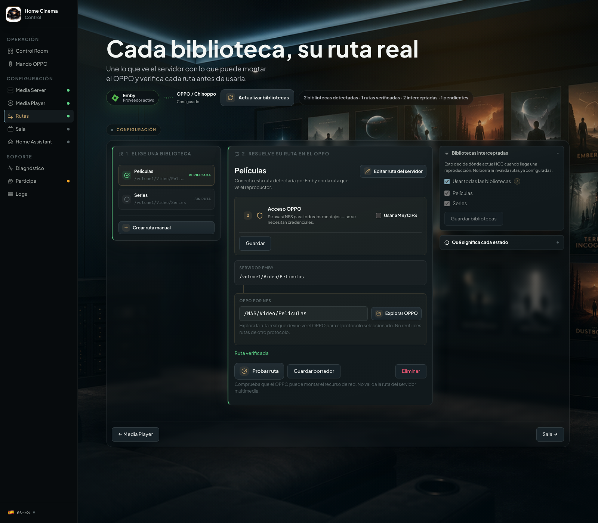
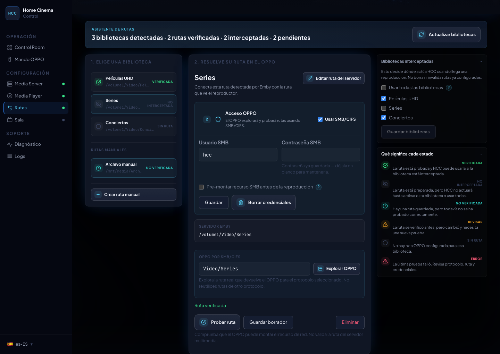
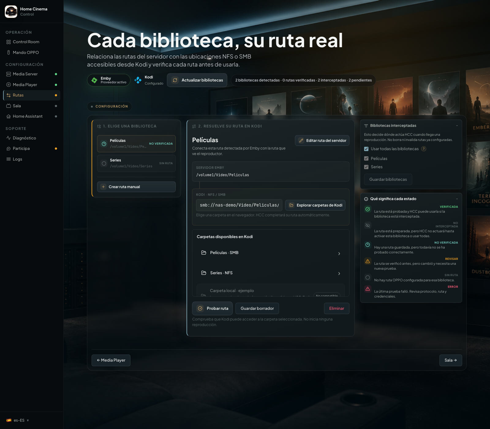
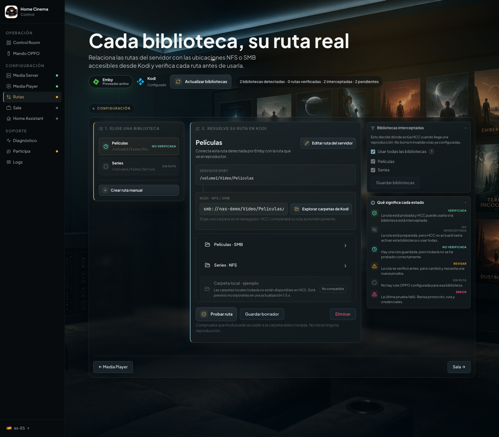
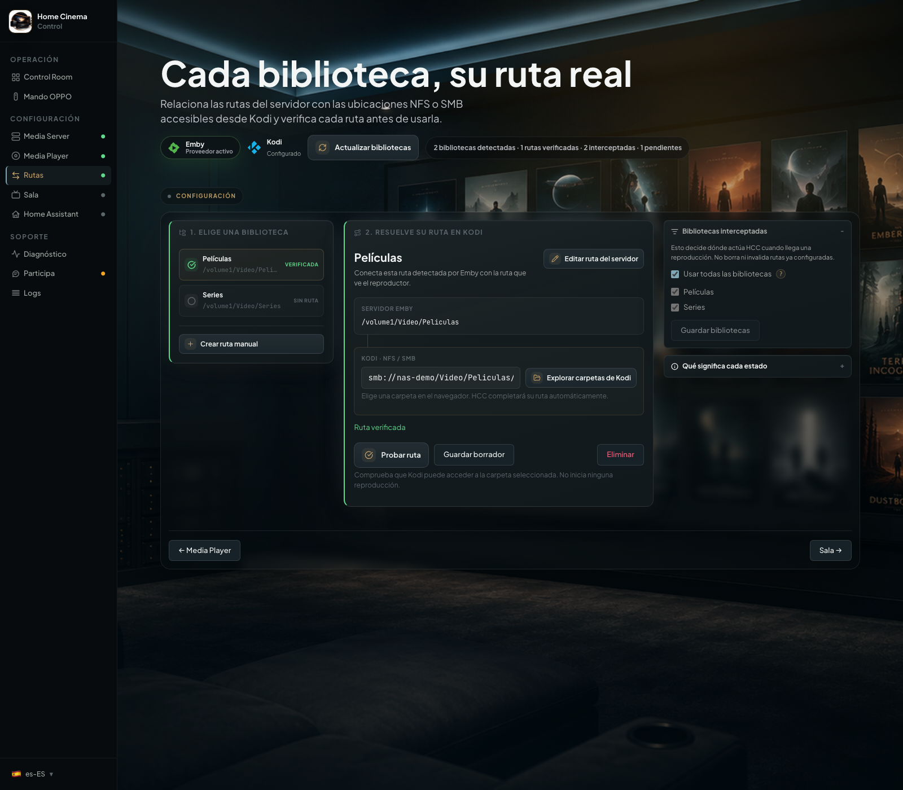
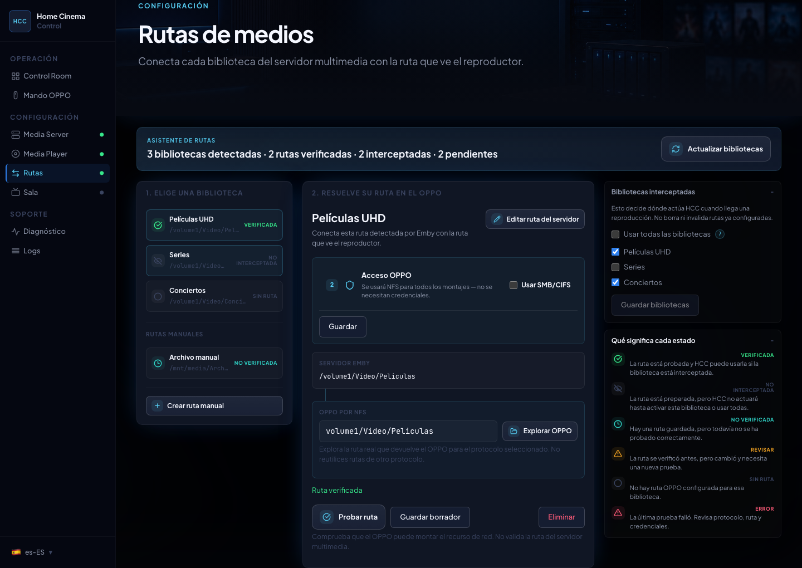

# Configura tus carpetas multimedia en HCC

[Inicio](../README.md) · [Instalación](../INSTALL.md) · [Primeros pasos](primeros-pasos.md) · [English](configure-media-paths.en.md)

Una película puede tener una dirección en Emby/Jellyfin y otra en el reproductor. HCC guarda la relación entre ambas
para abrir el mismo archivo. El navegador evita que tengas que adivinar la dirección del reproductor.

Por ejemplo, `/volume1/Video/Peliculas` y `smb://nas/Video/Peliculas/` pueden ser la misma carpeta vista desde dos
equipos. Son ejemplos, no valores que debas copiar.

Antes de empezar, conecta el servidor y el reproductor siguiendo los [primeros pasos](primeros-pasos.md). Comprueba que
el propio reproductor abre una película desde la carpeta compartida. Las instrucciones de Kodi corresponden a HCC 1.5.0,
pendiente de publicación.

## Configura una biblioteca

Sigue estos pasos para cada carpeta que quieras utilizar. Si una biblioteca incluye varias carpetas, configura cada una.

### 1. Elige tu biblioteca

1. Abre **Rutas** en HCC y confirma que has seleccionado el reproductor correcto en **Media Player**.
2. Pulsa **Actualizar bibliotecas** si faltan carpetas del servidor multimedia.
3. Elige la carpeta de la biblioteca, por ejemplo **Películas**. HCC ya conoce la ruta del servidor; normalmente no
   tienes que editarla.

La selección de bibliotecas determina cuáles puede controlar HCC. Para limitarlo a algunas, abre **Bibliotecas
interceptadas**, desmarca **Usar todas las bibliotecas**, elige las que quieras y pulsa **Guardar bibliotecas**. Una
biblioteca excluida seguirá reproduciéndose en Emby/Jellyfin.

  

### 2. Elige la carpeta del reproductor

Utiliza únicamente el apartado correspondiente a tu reproductor activo.

#### OPPO/Chinoppo

1. En **Acceso OPPO**, elige el protocolo que ya funciona desde el menú de red del reproductor: NFS o **Usar SMB/CIFS**.
   NFS y SMB son dos maneras de acceder a una carpeta compartida por tu NAS u ordenador.
2. Si SMB exige credenciales, introduce aquí el usuario y contraseña de esa carpeta y pulsa **Guardar** en el apartado
   de acceso.
3. Pulsa **Explorar OPPO**, junto a la ruta del reproductor. Entra en la carpeta compartida correspondiente a la
   biblioteca. HCC completa la dirección a medida que navegas.

No copies la ruta del servidor en el campo del OPPO: pueden ser diferentes aunque apunten a las mismas películas.

  

#### Kodi

Las credenciales HTTP guardadas en **Media Player** sirven para controlar Kodi. Las credenciales de la carpeta SMB se
configuran en Kodi, no en **Acceso OPPO**. Para NFS, el NAS debe permitir el acceso al equipo donde se ejecuta Kodi.

1. En Kodi, comprueba que la carpeta NFS o SMB está añadida en **Vídeos → Archivos** y que puedes abrirla. Si falta,
   utiliza **Añadir vídeos**. HCC explora estas fuentes de vídeo; no busca recursos del NAS por su cuenta.
2. En HCC, pulsa **Explorar carpetas de Kodi**. Se abre **Carpetas disponibles en Kodi** con las fuentes disponibles
   primero y los nombres ordenados alfabéticamente dentro de cada grupo.
3. Pulsa la fuente NFS/SMB y entra en la carpeta equivalente a la del servidor. Cada carpeta seleccionada completa la
   ruta y el protocolo automáticamente. **Volver** regresa a la ubicación anterior; no hay un segundo botón para
   confirmar la carpeta.
4. Comprueba el campo de ruta del reproductor. Debe empezar por `nfs://` o `smb://`, sin usuario ni contraseña en la
   dirección.
   Las capturas de Kodi utilizan fuentes y equipos simulados en una instancia real de HCC con datos de demostración.

  

  

Las fuentes locales de Kodi se muestran sin permitir su selección. Quedan fuera de la 1.5.0 y se reservan para una
actualización 1.5.x, sin fecha anunciada. Tampoco se admiten fuentes `plugin://` ni otros protocolos. Esta limitación de
HCC no impide usar esas fuentes directamente en Kodi.

  

Si HCC muestra una sugerencia basada en una relación de carpetas ya comprobada, puedes utilizarla como punto de partida.
Revisa que corresponde a esta biblioteca y pulsa **Probar ruta** igualmente.

### 3. Pulsa «Probar ruta»

Con la carpeta elegida, pulsa **Probar ruta**. Cuando aparece **Ruta verificada** en verde, HCC guarda la relación y
puedes utilizar esa carpeta. No hace falta volver a guardarla manualmente.

En Kodi, la prueba consulta el acceso a la carpeta y no inicia ninguna reproducción. Kodi abrirá las películas por su
propia conexión NFS/SMB; HCC no monta esa carpeta en Kodi. Una prueba de carpeta no garantiza la compatibilidad de todos
los archivos que contiene.

  

**Guardar borrador** conserva una relación todavía pendiente. No la habilita para reproducir: falta obtener una prueba
correcta.

  

## Cambiar entre OPPO y Kodi

HCC guarda rutas independientes para cada reproductor y servidor multimedia. Al elegir Kodi en **Media Player**,
aparecen sus rutas; al volver a OPPO, recuperas las del OPPO. Configurar uno no sustituye las carpetas del otro. Si
cambias de Emby a Jellyfin, cada servidor también conserva sus relaciones.

Las configuraciones anteriores de rutas sin reproductor asignado se conservan para OPPO durante la migración. Configura
y prueba las de Kodi por separado; no necesitas rehacer las del OPPO.

## ¿Qué significa cada estado?

El apartado **Qué significa cada estado** de Rutas explica qué falta para completar una carpeta.

| Estado              | Qué hacer                                                                  |
|---------------------|----------------------------------------------------------------------------|
| **Verificada**      | La prueba terminó correctamente.                                           |
| **No verificada**   | Pulsa **Probar ruta**.                                                     |
| **Revisar**         | Has modificado una relación verificada; vuelve a probarla.                 |
| **Sin ruta**        | Elige la carpeta del reproductor.                                          |
| **No interceptada** | Esa biblioteca no está seleccionada para que HCC controle su reproducción. |
| **Error**           | Lee el motivo y la recomendación de la última prueba.                      |

Sin una ruta configurada y verificada, HCC no entrega esa película al reproductor. Puede continuar en Emby/Jellyfin; la
visualización de avisos depende de su aplicación.

## Si la carpeta no aparece o la prueba falla

En Kodi, vuelve a **Vídeos → Archivos** y comprueba la misma carpeta. Si no se abre allí, revisa el recurso compartido y
sus permisos o credenciales en Kodi. Si no aparecen fuentes en HCC, confirma que son fuentes de vídeo NFS/SMB, no
entradas añadidas solo al gestor de archivos.

En OPPO, comprueba que está encendido y que el control IP está activo: **SETUP → Network Setup → IP Control → On** en
UDP-203/205, o su equivalente según el firmware del clon. Revisa el protocolo y las credenciales SMB. No repitas muchas
veces una prueba SMB fallida: algunos OPPO/Chinoppo necesitan reiniciarse después.

El modo avanzado/manual permite ajustar las rutas si el navegador no puede ayudarte. Modifica la ruta del reproductor;
utiliza **Editar ruta del servidor** solo si necesitas corregir también cómo la identifica el servidor. Después pulsa
**Probar ruta**.

Abre **Diagnóstico** y consulta [solución de problemas](solucionar-problemas.md) si el fallo continúa. Para pedir ayuda,
incluye el mensaje de la prueba sin publicar contraseñas.
