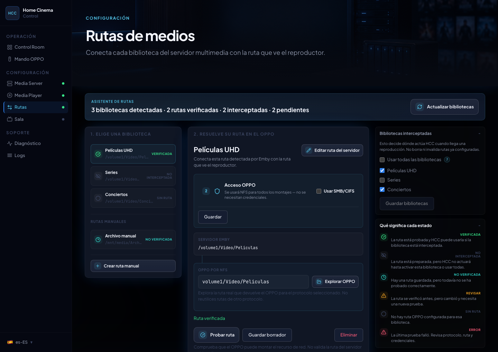
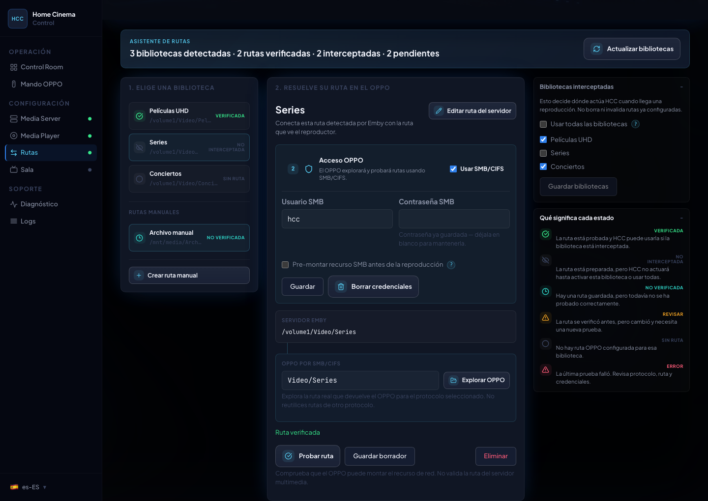
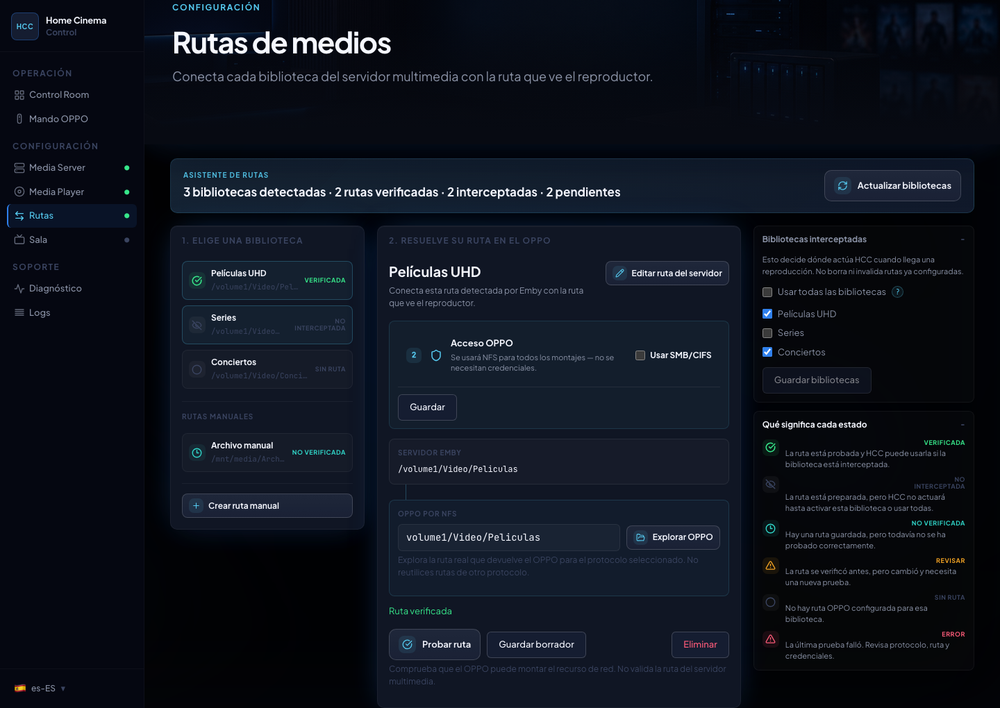
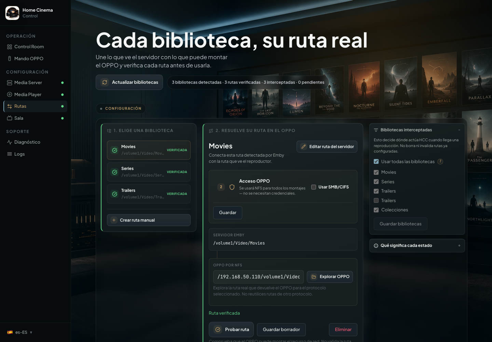

# Set up your media folders in HCC

[Home](../README.en.md) · [Installation](../INSTALL.en.md) · [First steps](getting-started.en.md) · [Español](configurar-rutas.md)

**You do not need to type paths manually.** HCC finds your Emby/Jellyfin libraries and provides a browser to select the matching folders on your OPPO/Chinoppo. Normally, just select, browse and test.

Before starting, your movies must already appear in Emby/Jellyfin, and the OPPO must be able to open the shared folder from its own network browser. Still setting up a NAS, PC or Raspberry Pi? Follow the [AVPasión guide](https://foro.avpasion.com/t/xnoppo-lo-mejor-de-emby-en-tu-oppo-203-205-y-chinoppo-clones-m9702-m9201-m9203-m9205.2779/page-21#post-73867) first.

## Set up one library

### 1. Choose a library

Open **Media Paths** in HCC. Your media server's library folders appear here. If you recently added a library, click **Refresh libraries**.

Select a library, such as **Movies**. HCC already knows the **server path**, so you do not need to enter or edit it.

  

You can use all libraries by default. To send only selected libraries through the OPPO, choose them in the library selection area and save.

  

### 2. Browse folders on the OPPO

Under **OPPO access**, use the protocol already working on your player: **NFS** or **Use SMB/CIFS**.

Click **Browse OPPO** beside the player path. **Open the folders shown by the browser until you reach the shared folder containing the library.** As you browse, HCC fills in the player path for you.

Do not copy the path reported by Emby/Jellyfin into this field: the two paths may be different even though they point to the same movies.

If you use SMB and the share needs a username and password, enter them under **OPPO access** and click **Save** under OPPO access before testing.

  

### 3. Click “Test path”

Once you have selected the folder, click **Test path**.

**When everything works, HCC displays “Path verified” in green and saves the mapping.** This library is now ready for OPPO playback. There is no need to create another manual path.

  

Repeat for the other libraries you want to use. If one library contains multiple folders, you may need more than one mapping.

## What if the path is not verified?

Open **What each state means** in Media Paths:

| State | What to do |
|---|---|
| **Verified** (green) | Ready: the path was successfully tested. |
| **Unverified** | The path has not passed a test yet. Click **Test path**. |
| **Review** | A previously verified path has changed. Test it again. |
| **No path** | No OPPO folder has been selected yet. |
| **Not intercepted** | The library is not enabled for HCC playback control. |
| **Error** | The last test failed. Follow HCC's reason and suggestion. |

  

**If the folder browser cannot open your share**, first make sure the OPPO is powered on and can browse it from its own menu. On **OPPO UDP-203/205**, check **SETUP → Network Setup → IP Control → On**; on clones, check the equivalent setting for your firmware. Check the selected protocol and SMB credentials, if applicable. Avoid repeatedly retrying a failing SMB test: some players may need a restart after several failures.

**If browsing is unavailable**, enter the OPPO path in **advanced/manual mode** instead:

1. Check the actual shared folder in the OPPO network browser.
2. Click **Edit server path** to open advanced mode, then enter or adjust the OPPO path for that library.
3. Click **Test path**. Only finish when HCC displays **Path verified**.

  

For example, the OPPO might see `Video/Movies` over SMB while Emby sees `/volume1/Video/Movies`. That is normal: **the browser helps you avoid guessing**.

If the issue persists, open **Diagnostics** to see the latest failure and suggested action. See [Troubleshooting](troubleshoot.en.md) for NFS, SMB and connectivity errors, including how to download logs and [contact support](troubleshoot.en.md#contact-and-support).
