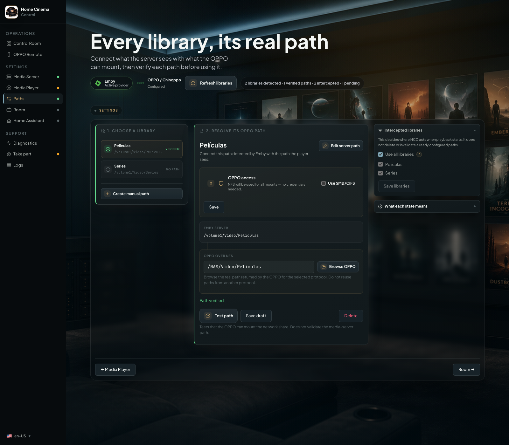
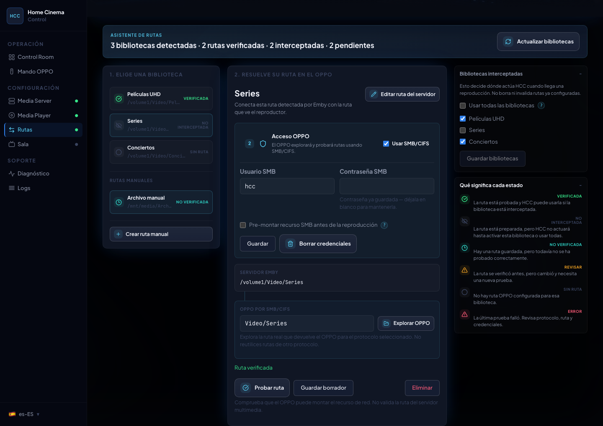
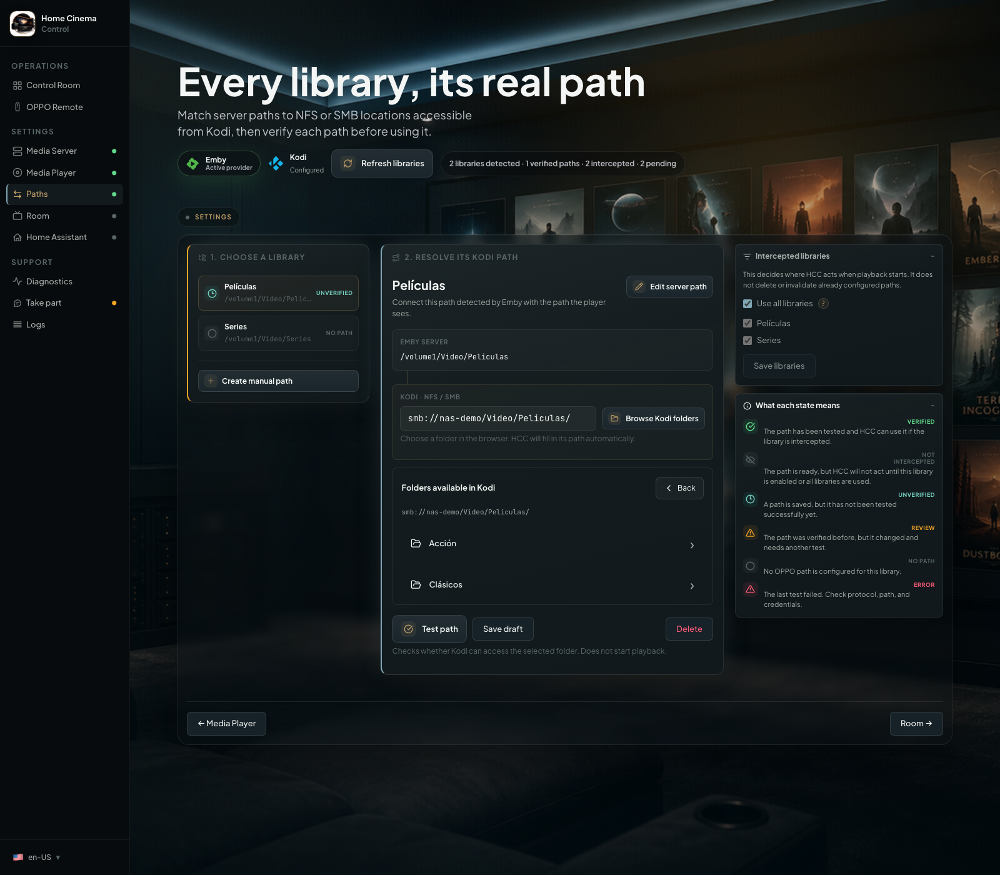
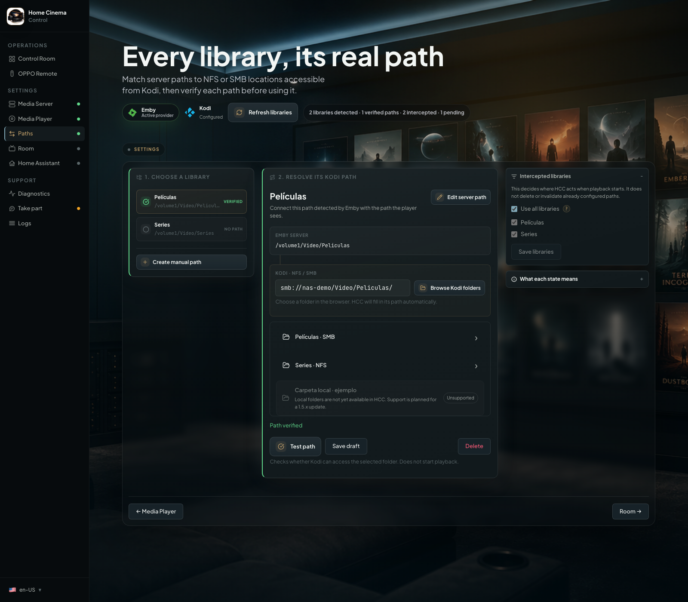
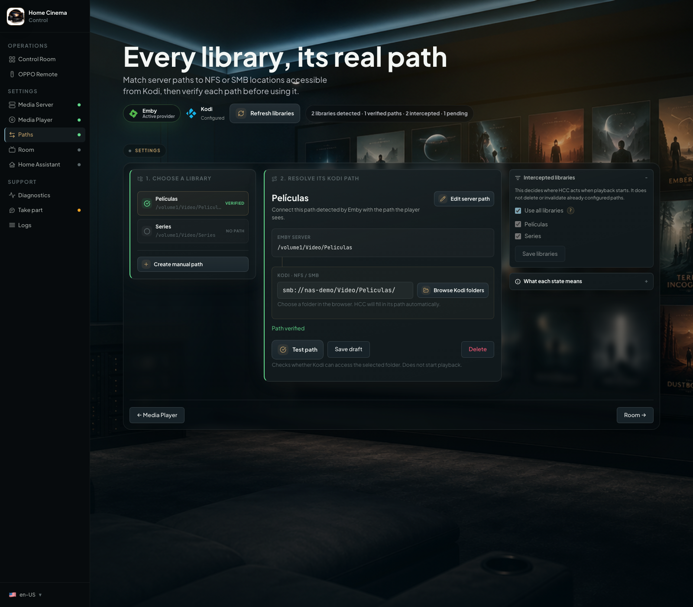
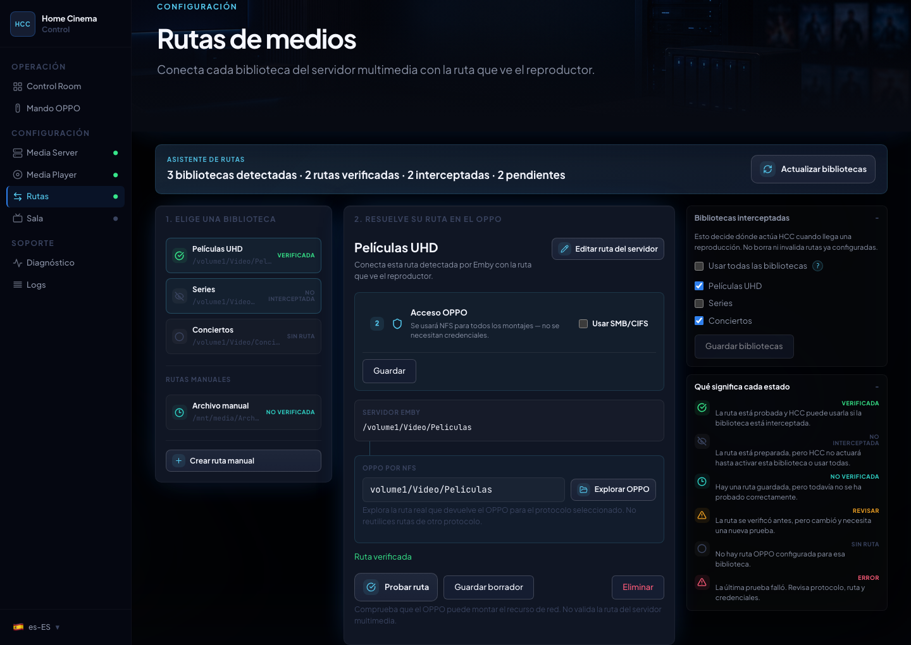

# Set up your media folders in HCC

[Home](../README.en.md) · [Installation](../INSTALL.en.md) · [First steps](getting-started.en.md) · [Español](configurar-rutas.md)

A movie may have one address in Emby/Jellyfin and another on the player. HCC saves the relationship so both open the
same file. The browser avoids having to guess the player's address.

For example, `/volume1/Video/Movies` and `smb://nas/Video/Movies/` may identify the same folder from two devices. These
are examples, not values to copy.

Before starting, connect your server and player using [first steps](getting-started.en.md). Check that the player itself
can open a movie from the share. Kodi instructions apply to HCC 1.5.0, pending publication.

## Set up a library

Repeat these steps for every folder you want to use. If a library has several folders, configure each one.

### 1. Choose your library

1. Open **Paths** and confirm that the correct player is selected in **Media Player**.
2. Click **Refresh libraries** if server folders are missing.
3. Select the library folder, such as **Movies**. HCC already knows the server path; you normally do not need to edit
   it.

Library selection determines which libraries HCC can control. To use only some, open **Intercepted libraries**, clear
**Use all libraries**, select those you want, and click **Save libraries**. Excluded libraries continue playing in
Emby/Jellyfin.

  

### 2. Choose the player folder

Use only the section for your active player.

#### OPPO/Chinoppo

1. In **OPPO access**, choose the protocol that already works in the player's network menu: NFS or **Use SMB/CIFS**. NFS
   and SMB are two ways to access a folder shared by your NAS or computer.
2. If SMB requires credentials, enter that folder's username and password here and click **Save** in the access section.
3. Click **Browse OPPO** beside the player path. Enter the share matching the library. HCC fills the address as you
   browse.

Do not copy the server path into the OPPO field: the names can differ even when they point to the same movies.

  

#### Kodi

The HTTP credentials saved in **Media Player** control Kodi. Set SMB folder credentials in Kodi, not in **OPPO access**.
For NFS, the NAS must permit access from the device running Kodi.

1. In Kodi, check that the NFS or SMB folder is added in **Videos → Files** and opens there. Use **Add videos** if it is
   missing. HCC browses these video sources; it does not discover NAS shares by itself.
2. In HCC, click **Browse Kodi folders**. **Folders available in Kodi** opens with available sources first and names
   sorted alphabetically within each group.
3. Click the NFS/SMB source and enter the folder matching the server folder. Each selected folder fills the path and
   protocol automatically. **Back** returns to the previous location; there is no second button to confirm the folder.
4. Check the player path field. It must start with `nfs://` or `smb://`, with no username or password in the address.
   The Kodi screenshots use simulated sources and devices in a running HCC instance with demonstration data.

  

  

Local Kodi sources are displayed but cannot be selected. They are outside 1.5.0 and reserved for a later 1.5.x update,
with no announced date. Sources using `plugin://` and other protocols are also unsupported. This HCC limitation does not
prevent using those sources directly in Kodi.

  

If HCC offers a suggestion based on a previously verified folder relationship, you can use it as a starting point. Check
that it matches this library and still click **Test path**.

### 3. Click “Test path”

With the folder selected, click **Test path**. When **Path verified** appears in green, HCC saves the mapping and the
folder is ready. No extra manual save is needed.

For Kodi, the test checks folder access without starting playback. Kodi opens movies using its own NFS/SMB connection;
HCC does not mount the folder on Kodi. A successful folder test does not guarantee support for every file it contains.

  

**Save draft** preserves a pending mapping. It does not enable playback: a successful test is still required.

  

## Switch between OPPO and Kodi

HCC stores independent paths for each player and media server. Select Kodi in **Media Player** to see its paths; switch
back to OPPO to recover OPPO's paths. Setting up one does not replace the other's folders. Emby and Jellyfin also retain
their own mappings when you switch servers.

Earlier paths without a player assignment are retained for OPPO during migration. Configure and test Kodi's paths
separately; you do not need to recreate OPPO's paths.

## What does each state mean?

The **What each state means** section in Paths explains what remains to be done.

| State               | Action                                                 |
|---------------------|--------------------------------------------------------|
| **Verified**        | The test completed successfully.                       |
| **Unverified**      | Click **Test path**.                                   |
| **Review**          | You changed a verified mapping; test it again.         |
| **No path**         | Choose the player's folder.                            |
| **Not intercepted** | This library is not selected for HCC playback control. |
| **Error**           | Read the last test's reason and recommendation.        |

Without a configured, verified path, HCC does not hand that movie to the player. Playback may continue in Emby/Jellyfin;
notification visibility depends on its app.

## If a folder is missing or testing fails

In Kodi, return to **Videos → Files** and check the same folder. If it will not open there, check the share and its
permissions or credentials in Kodi. If HCC shows no sources, check that they are NFS/SMB video sources, not entries
added only to Kodi's file manager.

On OPPO, check that it is powered on and IP control is enabled: **SETUP → Network Setup → IP Control → On** on
UDP-203/205, or the clone's firmware equivalent. Check the protocol and SMB credentials. Avoid repeatedly testing a
failing SMB connection: some OPPO/Chinoppo players need restarting afterwards.

Advanced/manual mode lets you adjust paths when browsing cannot help. Change the player path; use **Edit server path**
only if you also need to correct how the server identifies it. Then click **Test path**.

Open **Diagnostics** and see [troubleshooting](troubleshoot.en.md) if it keeps failing. When asking for help, include
the test message without sharing passwords.
