# First steps in HCC

[Home](../README.en.md) · [Installation](../INSTALL.en.md) · [Español](primeros-pasos.md)

Follow this walkthrough after installing HCC. Kodi features belong to the future 1.5.0, which is not published yet.
**Media Server**, **Media Player**, and **Paths** are the screens for your server, player, and folders. Updated OPPO,
Kodi, Paths, and Room screenshots show this branch running in an isolated instance with demonstration data and simulated
devices. They illustrate the interface, rather than certify physical hardware. The manual uses desktop captures with HCC
set to English.

Control Room offers **Continue setup** as the recommended next step. You can visit any section and prepare settings
while devices are off. TV, receiver, and Home Assistant are optional. **Configured** means saved details awaiting a
check; **Verified** means a valid saved check, without claiming the device is on now. **Review** means the previous
check no longer matches the current settings.

If continuing leaves a relevant limitation, HCC explains its consequences. **Review settings** returns to the relevant
section without sending commands; **Continue anyway** advances without marking anything verified. Escape or dismissing
the notice keeps the current screen. The same warning is not repeated during that tab session, including after reload,
unless the device identity or status changes. Reminders remain visible on the relevant screens.

  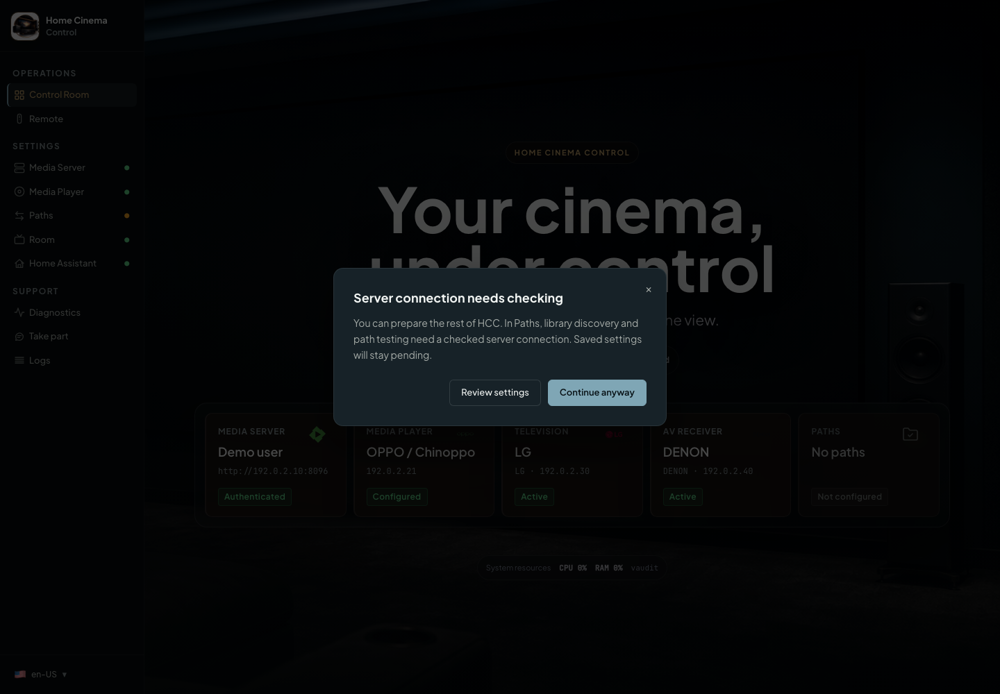

Use Tab to reach selectors and cards. In a selector, use arrow keys, Home or End, then Enter to choose; Escape cancels.
Errors stay visible until dismissed. Up to three notifications appear at once; identical errors share a repeat counter.
Success messages do not displace unresolved errors. If more distinct errors arrive, the three most recent are kept.

## Set up HCC in five steps

Server, player, TV, and receiver selectors show a logo beside each name. In Room, **Brand** lists manufacturers
alphabetically, with **Scripts** last for control
using custom commands.
Choosing a new brand or returning to an empty profile does not show a recovery
notice. **Saved settings restored** appears only when previous setup is recovered;
changing the brand does not test the connection.
The same rule applies when switching between Kodi/OPPO or Emby/Jellyfin:
an unconfigured destination does not show a success notice. Restoring settings
does not mean a new connection test has succeeded.

1. Authorise Emby or Jellyfin and choose the device HCC should monitor.
2. Prepare and connect your player, OPPO/Chinoppo or Kodi.
3. Match each server folder to its player folder and click **Test path**.
4. Optional: connect your TV and AV receiver in **Room**.
5. Play a movie from Emby/Jellyfin on the selected device.

Expected result: the movie opens on the selected player and the server receives its progress. Home Assistant is not
required.

## Step-by-step setup

### 1. New setup or migration

If HCC finds older settings, you can import them. For a new installation, choose **Configure from scratch**. If HCC
worked before and unexpectedly appears empty, follow [configuration recovery](recover-configuration.en.md) before
completing another setup.

  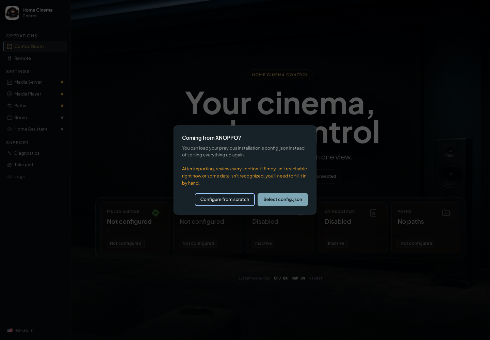

### 2. Connect Emby or Jellyfin

1. Open **Media Server** and choose **Emby** or **Jellyfin**.
2. Enter the server address, for example `http://192.168.1.10:8096`. Use your own server's address and port; the example
   does not identify a real device.
3. Under **Authorization**, enter your username and password and click **Authorize with Emby** or **Authorize with
   Jellyfin**. Wait for **Saved token**, which confirms saved access. Jellyfin needs administrator permissions to
   manage monitored sessions.
4. Click **Refresh devices** if needed. Select the device where you will press Play, such as the Emby app on your TV,
   and click **Save**. If it is missing, open that app and sign in to your server before refreshing the list again.

5. Click **Test Jellyfin connection** or **Test Emby connection**, depending on your selected server. If you cannot test
   it now, you can continue preparing settings. A saved token or address does not complete verification. A valid saved
   check is historical; it does not claim the server is online at this moment.

Expected result: your selected client and the physical folders reported by your server appear. HCC does not create
libraries or register clients for you. The following screenshot uses a simulated, prepared server:

  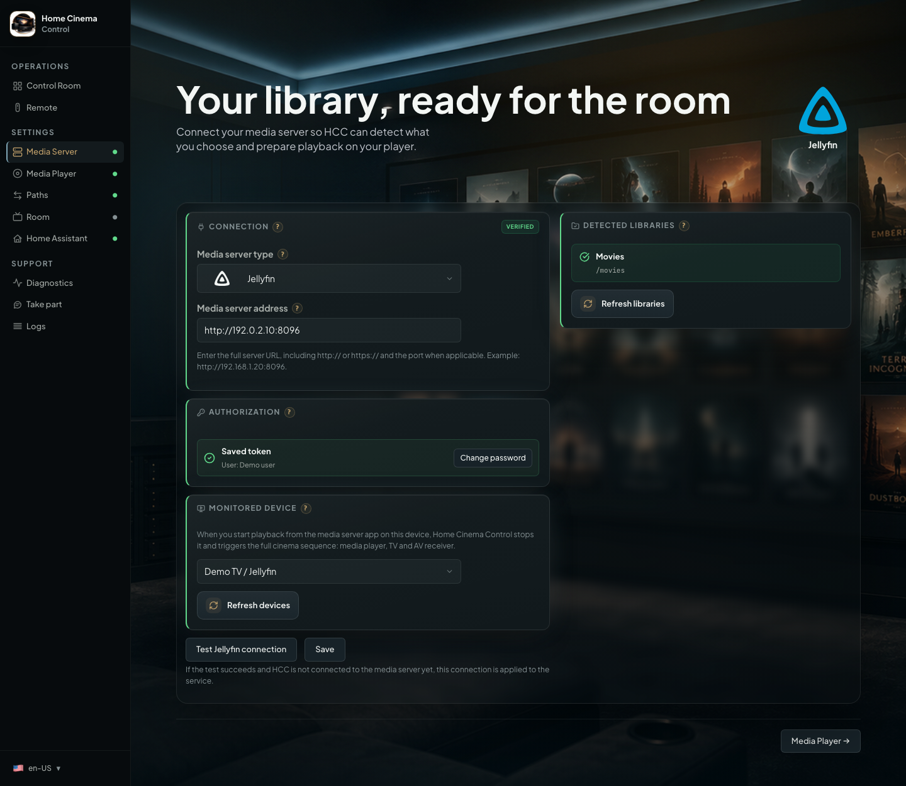

If there are no clients, open Emby/Jellyfin on the device where you will press Play, sign in and click **Refresh
devices** in HCC. If there are no folders, check the server's libraries and account permissions, then click **Refresh
libraries**. The empty state below is a recovery example, not a completed setup:

  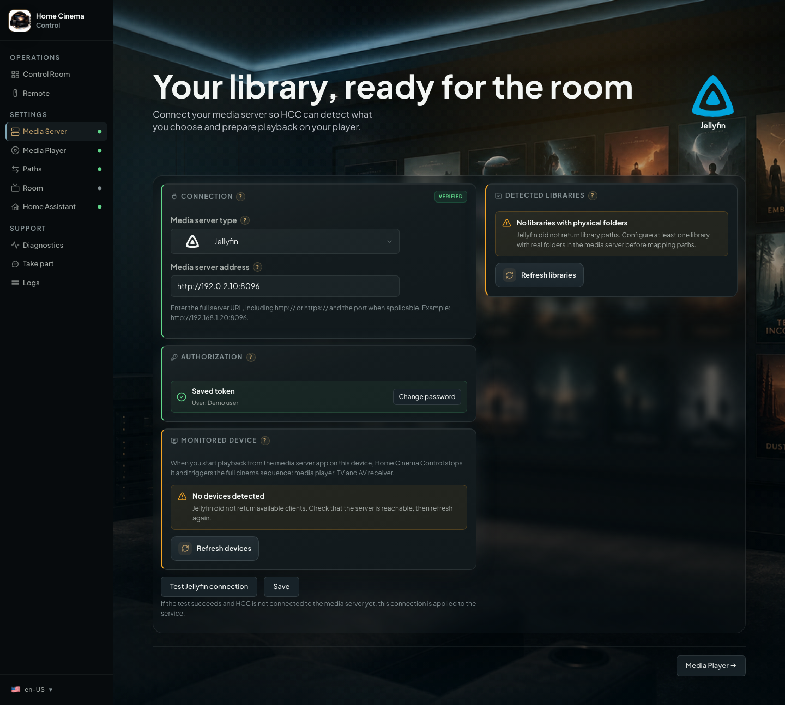

You can open **Paths** and save manual mappings without that check. Library discovery needs a checked server; folder
browsing needs a configured, reachable player. **Test path** and network-access changes need the saved server check and
the player address. When everything else is prepared, Control Room recommends returning to the pending check.

### 3. Connect your player

Follow only the section for the player you will use. OPPO and Kodi keep independent settings.

#### OPPO/Chinoppo

1. On an OPPO UDP-203/205, press **SETUP** on its remote and select **Network Setup → IP Control → On**. For
   Chinoppo/clones, find the equivalent IP control setting; its location depends on
   firmware. [Official OPPO support](https://www.oppodigital.com/blu-ray-udp-203/blu-ray-udp-203-Support.aspx) includes
   the UDP-203 manual.
2. In HCC, open **Media Player** and select **OPPO/Chinoppo**. Enter its IP address. If **Scan network** is available,
   you can use suggestions by address, name, or vendor.
3. Click **Test OPPO**, check the result, and save your changes.

**Automatic power on and off (experimental):** power on the OPPO **manually before first use**, enable **IP Control**
and **Network Standby** (or the firmware's equivalents), and confirm HCC can reach it. Then choose
**HCC options → Power management → Automatic power on and off** and select the grace period. On compatible devices,
HCC may wake the OPPO after HCC itself powered it off; this does not imply that a shutdown with the physical remote
is recoverable. **If you power it off using its physical remote, disconnect power, or the device becomes unreachable
over the network, automatic wake can stop working.** If HCC cannot recover, turn it on manually and retest the
connection. Compatibility depends on model and firmware.

If suggestions are missing, enter the address manually. Discovery depends on your network and Docker host. The player
must be able to open your movies from its own network menu before you configure HCC's folders.

The screenshot shows the player selector and example address in **Connection**.

  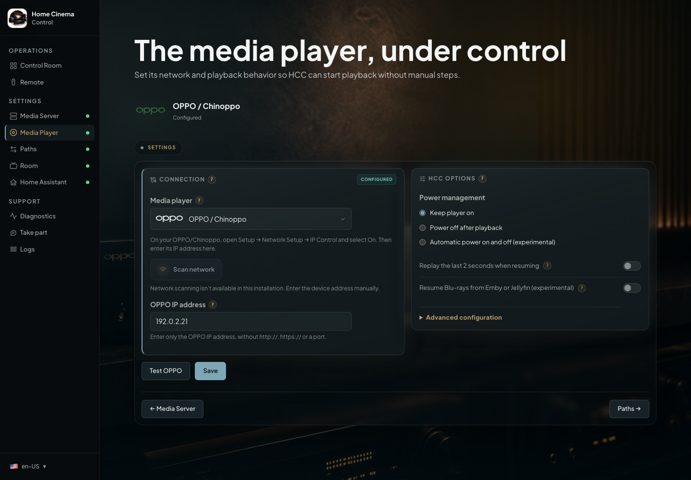

#### Kodi: prepare and test the connection

With Kodi off, you can save only the connection, without enabling power controls.

  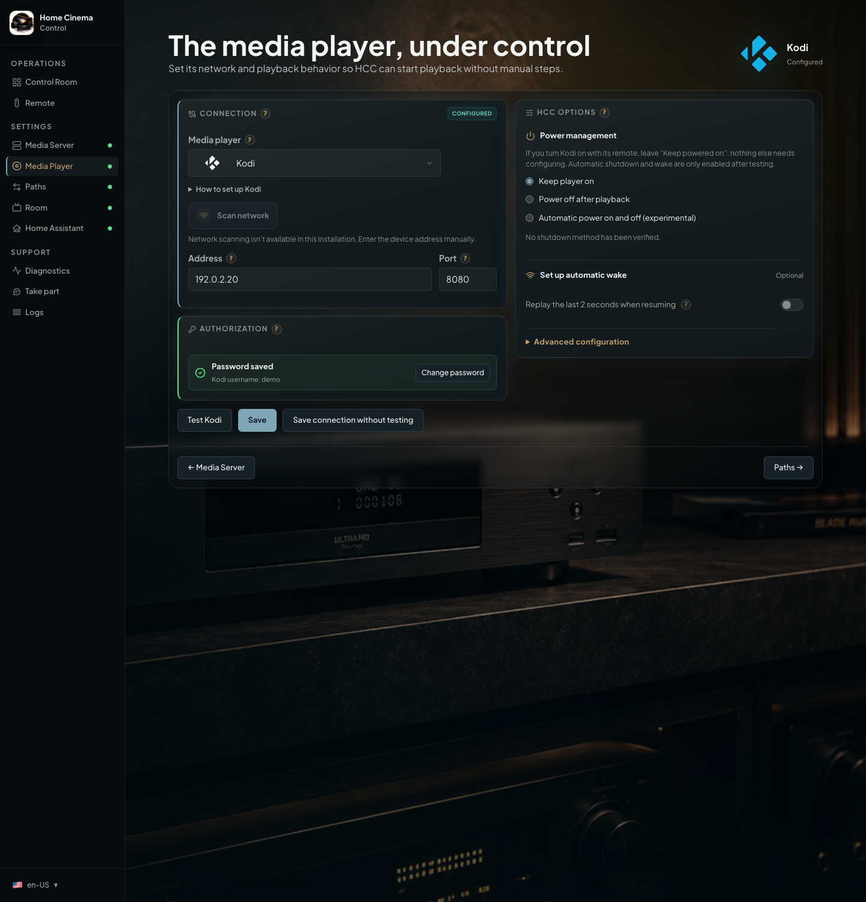

First configure Kodi on the device that will play your movies. HCC controls it through HTTP JSON-RPC: a network
connection for sending commands, without installing a Kodi add-on. HCC does not define a certified list of Kodi versions
or platforms; test the connection and a movie on your device.

1. In Kodi, open **Settings → Services → Control** and enable **Allow remote control via HTTP**. Note the displayed
   port, usually `8080`.
2. Enable **Require authentication** and set a username and password. If these options are missing, change Kodi's
   settings level to **Expert**. Labels may vary with language or skin;
   see [Kodi HTTP control](https://kodi.wiki/view/Settings/Services/Control).
3. In Kodi, open **Videos → Files → Add videos** and add the shared movie folder through NFS or SMB if it is not already
   added. For SMB, enter the share credentials in Kodi. Open the folder and check that a file plays. You do not need to
   scan the movies into Kodi's library for HCC to browse the source.
   See [Kodi's video sources guide](https://kodi.wiki/view/Adding_video_sources) for that screen.
4. In HCC, open **Media Player** and choose **Kodi** in **Connection**. Enter its address, for example `192.168.1.20`,
   without `http://`. In **Port**, to the right of the address, enter the HTTP port you noted.
5. In **Authorization**, enter Kodi's HTTP control username and password, which may differ from the NAS credentials.
   Click **Save** below Connection and Authorization. HCC checks the connection before saving; failure preserves the previous settings.
   If Kodi is off, use **Save connection without testing**: it saves only address, port, and authorization, without
   checking them or saving power settings. Power controls keep their own tests. Changing the password without testing
   invalidates the previous connection check.
6. Click **Test Kodi** when the device is available. It should confirm the connection without active playback. On
   failure, read the reason: invalid
   address or port, rejected credentials, unreachable Kodi, or a communication error. Correct that setting and retry.
   See [Kodi connection errors and an example screenshot](troubleshoot.en.md#test-kodi-or-saving-credentials-fails)
   if you need help identifying the result.

Expected result: Kodi's profile and credentials are saved. The screen shows the username and **Password saved**.
**Change password** opens editing; **Save** below both sections validates the new details and **Cancel** discards edits. Omitting a password
preserves the stored one. **Test Kodi** uses a newly entered password, or the stored one when none is entered.

  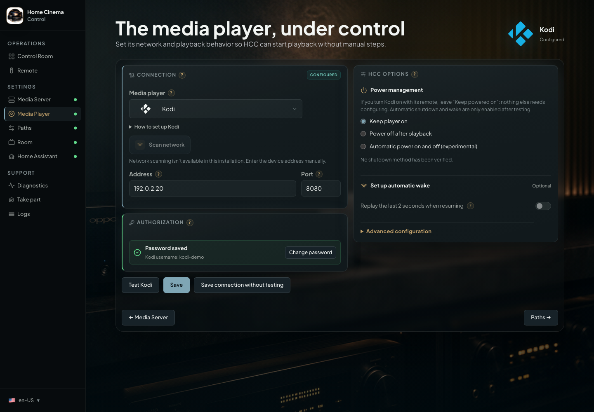

  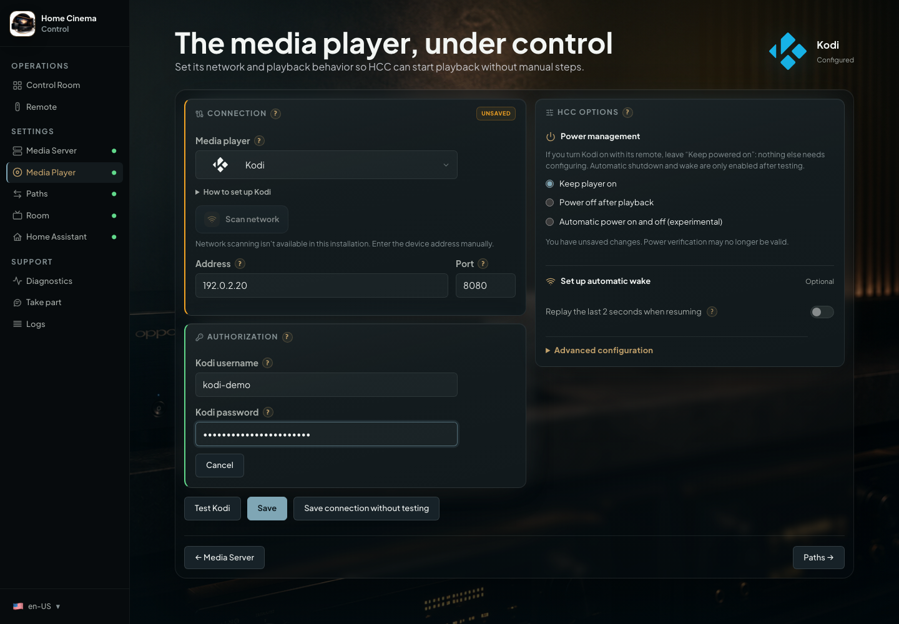

If Kodi allows anonymous access, HCC cannot verify a supplied username and password and does not declare them valid.
Enable authentication in Kodi and retry. The same **Save** button saves the other settings on this screen.

  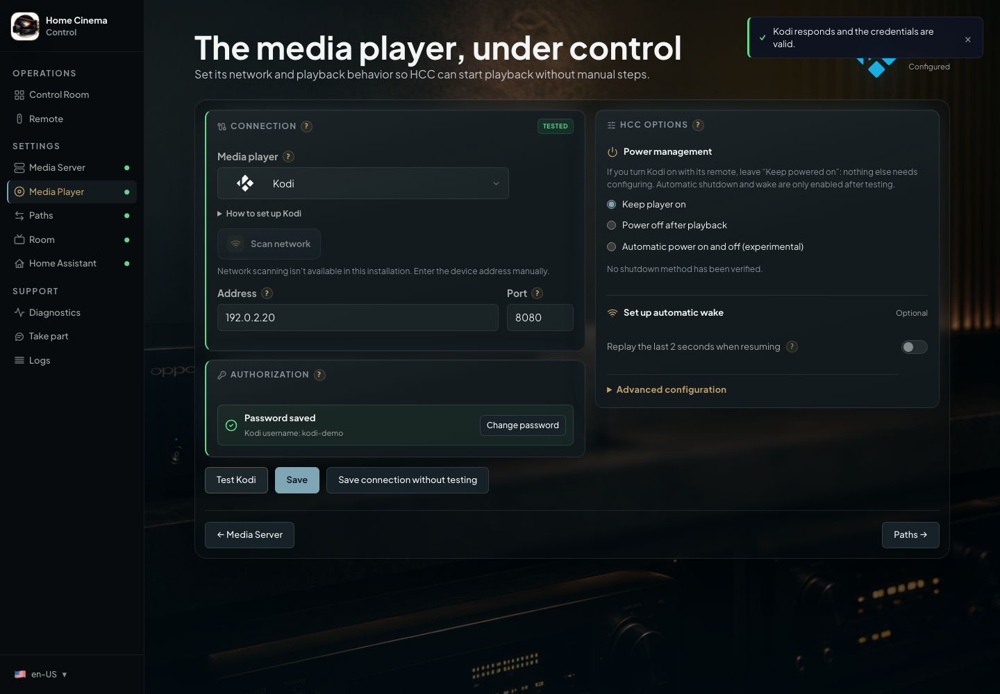

Power control is optional. Under **Options → Power management**, leave **Keep player on** selected if you use the
device's remote. The wizard tests shutdown and, for automatic mode, wake as well. WoL, Android TV Remote and ADB are
alternative wake methods; prepare only the one suitable for your device. Unverified experimental shutdown requires
explicit opt-in and manual wake. If HCC accepts cancellation before sending a command, that command is not sent.
Cancellation cannot undo a command that has already started. Compatibility with physical devices still needs validation.
Once saving has started, cancellation does not interrupt it: wait for the result and check the saved settings.

### 4. Connect your movie folders

HCC needs to match two names for the same folder: the one known to Emby/Jellyfin and the one your player can open. For
example, the server may see `/volume1/Video/Movies` while Kodi sees `smb://nas/Video/Movies/`. Do not copy one address
into the other field: use the browser.

1. Open **Paths** and choose a detected library folder. If it is missing, click **Refresh libraries**.
2. For OPPO, choose NFS or SMB in **OPPO access** and click **Browse OPPO**. If SMB needs a username and password, enter
   them and save that access before testing.
3. For Kodi, click **Browse Kodi folders**. In **Folders available in Kodi**, open the NFS/SMB source and enter the
   matching folder. Selecting a folder fills its path automatically; **Back** returns to the previous level. If HCC
   offers a suggestion based on another path, check that it matches this library before using it.
4. Click **Test path**. When **Path verified** appears, HCC saves the mapping and the folder is ready. Kodi's test
   checks the folder without starting playback. Repeat for other folders you want to use.

Local Kodi folders are not available in HCC 1.5.0; they are reserved for a later 1.5.x update, without a specific date.
Sources using `plugin://` and other protocols cannot be selected either. Use an NFS or SMB source. If none appear, add
them in Kodi's **Videos** section, not only its file manager.

**Save draft** lets you enter and save a manual path while devices are off; it does not replace testing. Click **Create
manual path**, enter a name and both paths, then save. For Kodi, use <code>nfs://</code> or <code>smb://</code>, without
passwords in the address. You can correct a draft later and recover it after reload. When connection prerequisites are
missing, this save preserves verified paths: it cannot overwrite, rename, or delete them. Other servers' and players'
paths are preserved. Return to the path and click **Test path** when connections are ready.

  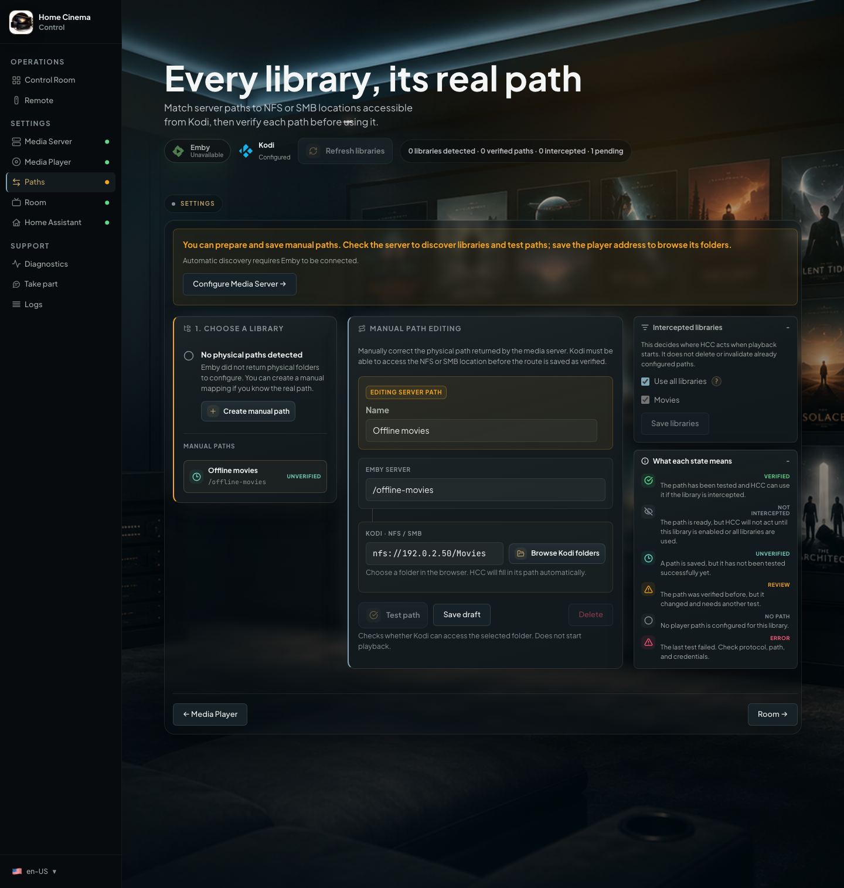

Switch from OPPO to Kodi or back to recover each
player's paths for the selected server. The [folder guide](configure-media-paths.en.md) explains states and advanced
options.

### 5. TV and AV receiver (optional)

HCC supports these layouts for an external player (OPPO/Chinoppo or Kodi). Choose inputs according to the actual cables;
the device must provide the outputs the layout requires.

| Wiring                                                                  | TV input               | AV receiver input                    |
|-------------------------------------------------------------------------|------------------------|--------------------------------------|
| Player → TV for video and player → receiver for audio, with two outputs | HDMI from the player   | Input from the player's audio output |
| Player → receiver → TV                                                  | HDMI from the receiver | Input from the player                |
| Player → TV, without a receiver                                         | HDMI from the player   | Leave the receiver unconfigured      |

Player → TV → receiver through ARC/eARC is outside this walkthrough. It is different from using two player outputs.
HDMI-CEC/ARC can switch inputs unexpectedly; disable only the conflicting function if necessary, not CEC/ARC
universally.

On first setup, the Room assistant lets you declare your cabling. **Save and set up my room** persists the selected
wiring layout and enables or disables TV/AV control accordingly, without changing existing HDMI inputs or credentials.
Then review the fields, test your devices, and save their settings separately. The assistant does not detect or verify
the physical cabling. **Change wiring layout** opens it again.

  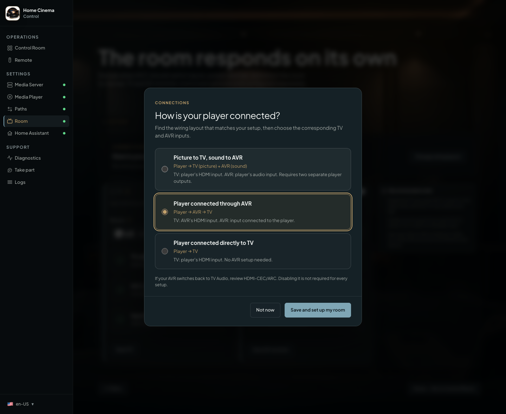

Open **Room** to configure your **TV, AV receiver or both**. First select the layout that matches your cables and
choose **Save and set up my room**. The layout is persisted even if you have not finished setting up either device.
You can revisit it with **Change wiring layout**. Select the **Brand** of each enabled device and confirm its IP
address on the device itself. **Find devices** only provides suggestions; it does not prove a connection.

#### LG and Sony TV: three steps

1. **TV address:** enter or select the IP address, then choose **Continue to connection**. This prepares the next
   step but does not test whether the TV responds. You can save the settings with **Save TV**.
2. **Connect to HCC:** with the TV powered on, choose **Test TV**. Approve the prompt on an LG if one appears; for
   Sony, prepare IP control and the PSK where applicable. Merely entering an IP address is not a connection test.
3. **Inputs and apps:** select the HDMI input receiving the player picture (or the AV receiver output), detect and
   test inputs when the controls are available, and set up the media-server app return where supported. **Save TV**
   saves settings, but saving an input does not prove HDMI switching or app launching works. Test those actions
   while the TV is available.

#### AV receiver: three steps

1. **Receiver address:** choose the model and IP address (or the power-on command for **Scripts**) and select
   **Save and continue**. Trinnov may also require its MAC address for power testing.
2. **Control test:** choose **Power on** or **Power off** if you want to verify these commands. Power tests are
   optional and do not prevent you from preparing the player's inputs.
3. **Player input:** choose the correct source and HDMI options. Use **Detect HDMI inputs** and **Switch to player**
   when their prerequisites are met, then choose **Save AV receiver**. For Trinnov, an available source list by
   itself does not prove that the receiver is connected.

You can expand or collapse each step. A **green tick** means either that settings were saved or that a test completed,
**as stated in that step**: “Address saved”, “Connection checked” and “Input saved” are not interchangeable. A
historically verified check does not mean the device is currently reachable; TV control actions may require a new
**Test TV** in the current session. Switching brands restores that brand's saved profile but does not contact the
device. Disabling and re-enabling a device can preserve compatible settings and historical verification. If you
have no AVR, set up only your TV. If an action is blocked or a step stays pending, see
[Room: TV/AV setup and tests](troubleshoot.en.md#room-tvav-setup-and-tests-in-150-rc2).

  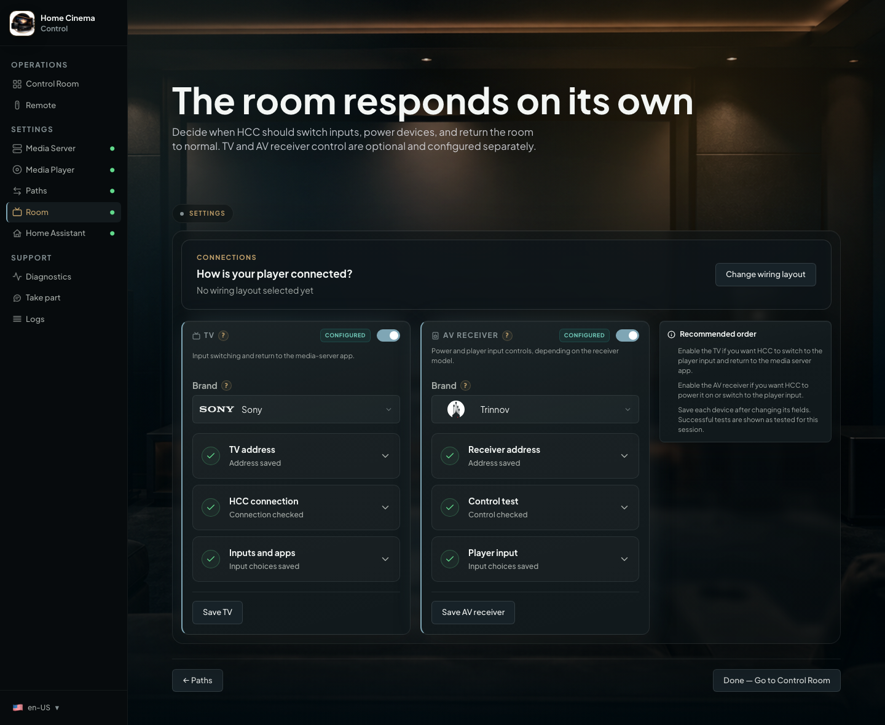

  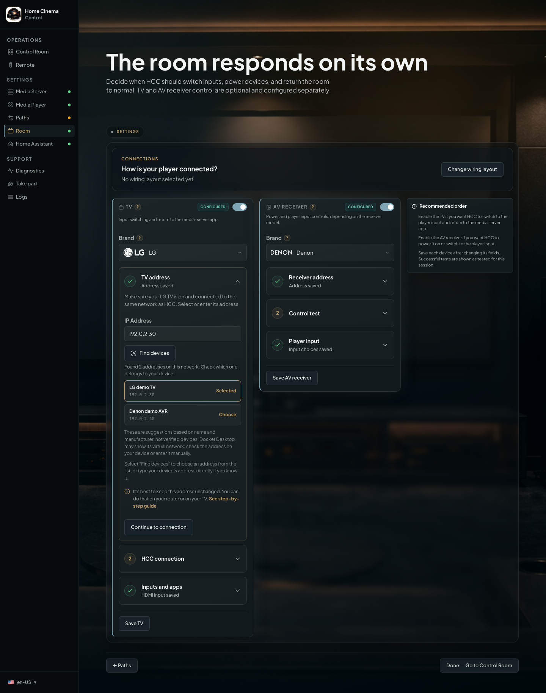

Discovery results are suggestions, not verified devices. Docker Desktop can show its virtual network instead of your
home LAN. Check the address on the device; enter it manually if it does not appear. HCC and your devices must be able to
communicate on the local network (keep **`network_mode: host`**). Names depend on what your router or network supplies.

On LG TVs, accept the pairing prompt if one appears. On Sony TVs, IP control/PSK may need enabling in the TV settings. For failed tests, check [Diagnostics](troubleshoot.en.md#check-hcc-diagnostics). If your receiver switches back to TV Audio, see [troubleshooting](troubleshoot.en.md#the-avr-changes-input-by-itself).

#### Samsung: connect your TV to HCC

**Before you start:** connect your Samsung TV and the device running HCC to the same local network. Turn on the TV and keep the remote nearby.

1. **Find your TV.** On the Samsung, open **All Settings → Connection → Network → Network Status → IP Settings** to find its address. In HCC, open **Room**, enable TV control, choose **Samsung** and follow **TV address**, the first step. Discover the TV on your network or enter its IP address, then select **Save TV address**.
2. **Connect HCC.** On the Samsung, go to **All Settings → Connection → Network → Expert Settings → IP Remote** and enable it (menu names may vary). In HCC's second step, select **I've enabled IP Remote** and **Pair Samsung**. Accept the connection request on the TV if it appears. Then select **Test TV** to check connectivity.
3. **Set up inputs and applications.** In **Inputs and apps**, the third step, choose the HDMI input connected to your player or AV receiver and select **Save HDMI**. With your devices powered on, select **Detect HDMI inputs** to check the available control options and **Switch to player** to test the chosen input. Confirm whether you can see the player's picture. Samsung's four HDMI choices are candidates, not proof that all four are connected.
4. **Optional: check return to Emby or Jellyfin.** If your media server is already configured in HCC and its app is installed on your Samsung, select **Open Emby** or **Open Jellyfin**, as appropriate. HCC uses a candidate identifier internally; you do not need to enter any code. Confirm whether the app is visible on the TV. Automatic return is enabled only after a positive confirmation.
5. **Optional: share compatibility.** **Share compatibility** is below the setup wizard. Sharing is optional and is not required to use Samsung.

**If HCC cannot connect**, make sure the TV is on, **IP Remote** is still enabled, and both devices are on the same network. Check that the IP address saved in HCC matches the one shown on the TV, then select **Pair Samsung** again.

### 6. Play your first movie

1. Leave the selected player powered on. For Kodi, keep Kodi open.
2. Check that the movie's folder is verified in **Paths** for that player.
3. Open Emby/Jellyfin on the device selected in **Media Server** and play a movie from that library. For your first Kodi
   test, use a regular video file such as MKV.
4. Check that the movie opens on the player, progress advances in Emby/Jellyfin, and you can stop playback. If you
   configured Room, also check TV and audio inputs.

If the path is missing or unverified, HCC does not hand that movie to the player and playback may continue in the source
app. Some clients show a notification with the reason and suggested action. For connection failures, open
**Diagnostics** and see [troubleshooting](troubleshoot.en.md).

### Resume options

You can turn on these settings under **Media Player → HCC options**. Both are off by default. Click **Save** after changing them.

- **Replay the last 2 seconds when resuming.** When you resume a supported video file from Emby or Jellyfin, playback starts up to two seconds before where you left off. Your saved progress stays the same.
- **Resume Blu-rays from Emby or Jellyfin (experimental).** On OPPO or Chinoppo, if your Blu-ray is stored as an ISO or BDMV folder, choose **Resume** in Emby or Jellyfin, then select **Play** in the disc menu. HCC tries to pick up where you left off. If the disc has already resumed on its own, HCC keeps that position. If you stop in the menu, your progress stays saved. To start over, choose **Play from beginning** in Emby or Jellyfin, then select **Start Over** in the disc menu if it offers that option.

If you choose **Resume** in Emby or Jellyfin and then **Start Over** on the disc, HCC can still apply the saved position from the server when playback begins.

On OPPO, some Blu-ray ISOs with disc menus may require continuing from the disc menu. If seeking from Emby/Jellyfin
restarts the title, use the OPPO remote. An equivalent ISO, Blu-ray folder, or menu experience is not guaranteed on
Kodi: it depends on the device and has not been verified as equivalent to OPPO.

You can stop here or set up optional [Home Assistant](home-assistant.en.md) events.
