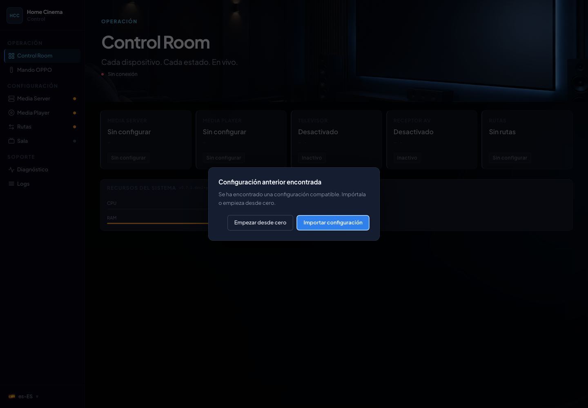
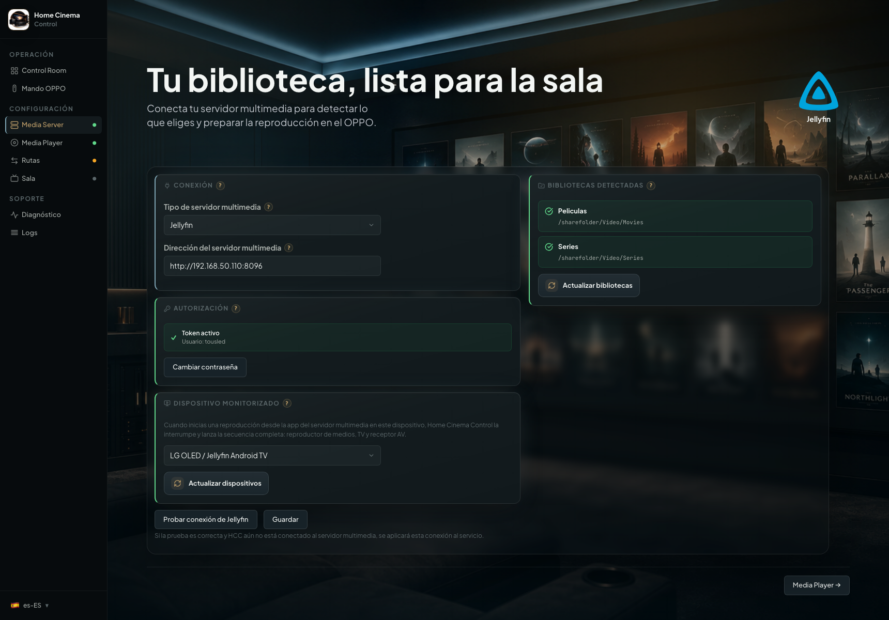
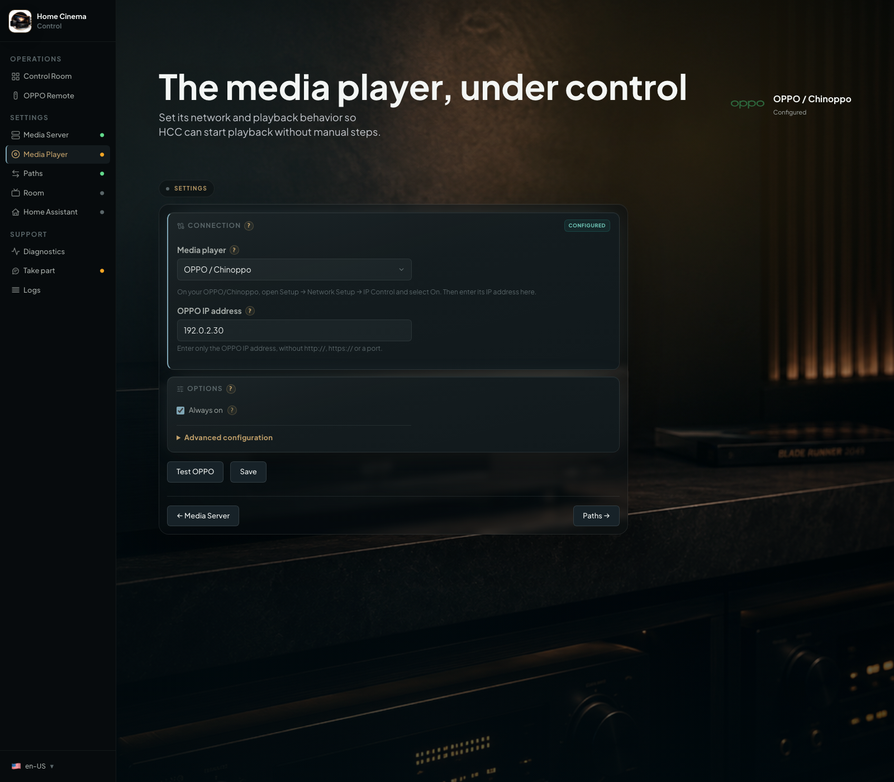
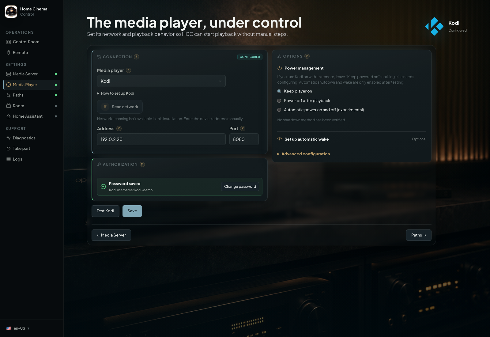
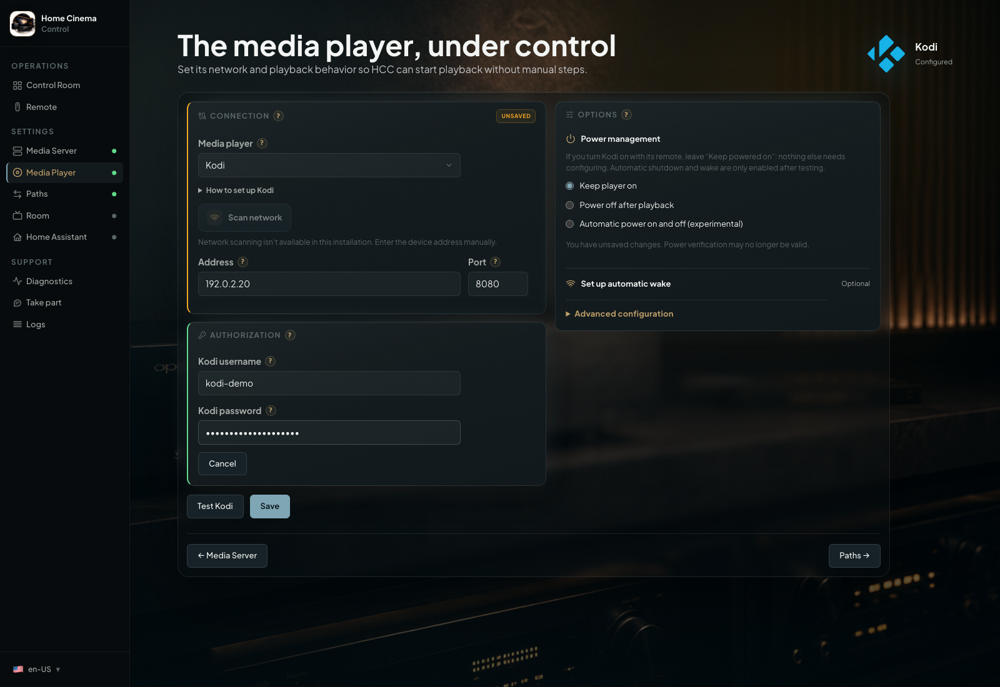
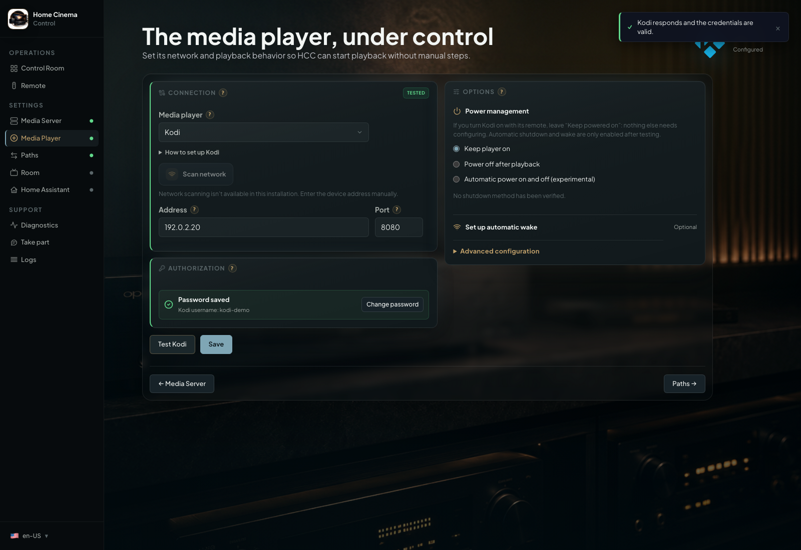
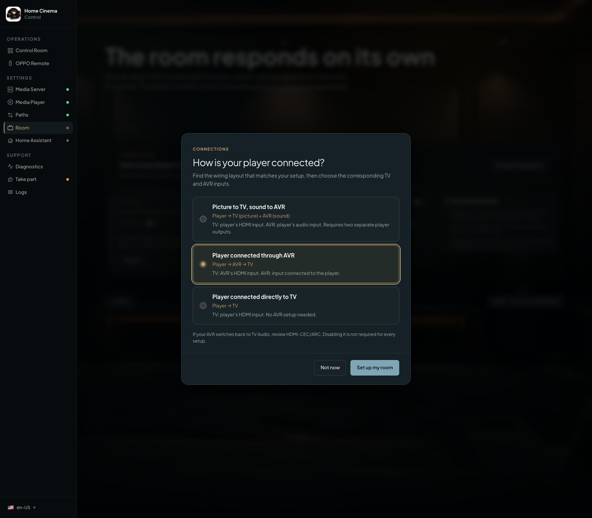
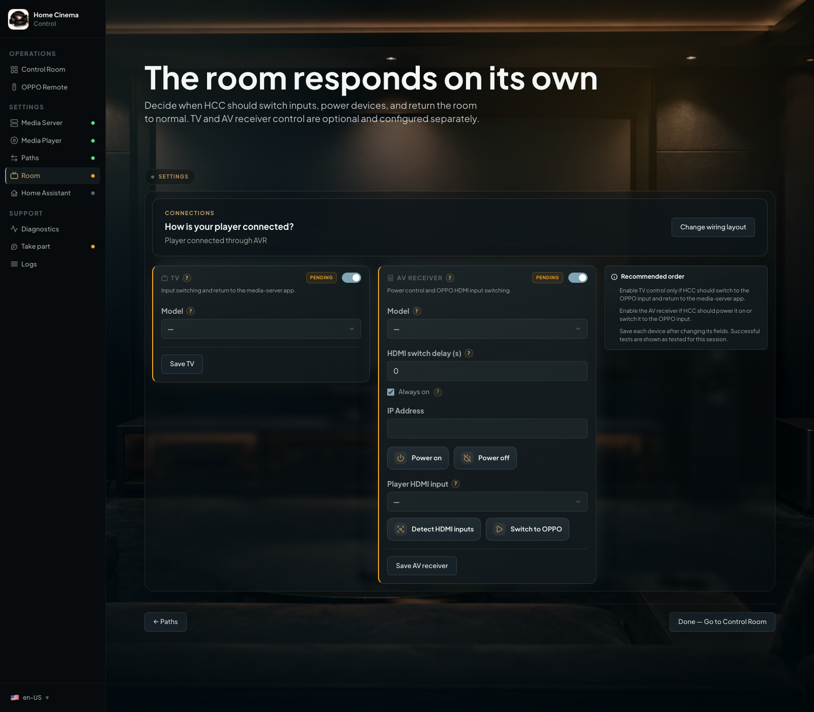
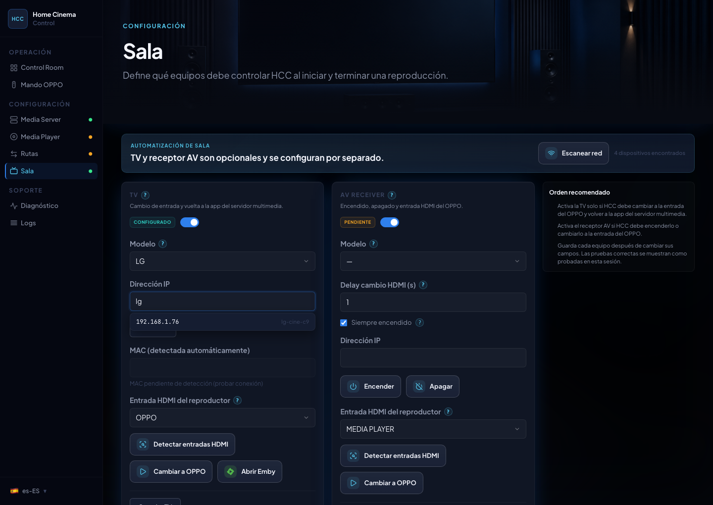

# First steps in HCC

[Home](../README.en.md) · [Installation](../INSTALL.en.md) · [Español](primeros-pasos.md)

Follow this walkthrough after installing HCC. Kodi features belong to the future 1.5.0, which is not published yet.
**Media Server**, **Media Player**, and **Paths** are the screens for your server, player, and folders. Updated OPPO,
Kodi, Paths, and Room screenshots show this branch running in an isolated instance with demonstration data and simulated
devices. They illustrate the interface, rather than certify physical hardware.

## Set up HCC in five steps

1. Authorise Emby or Jellyfin and choose the device HCC should monitor.
2. Prepare and connect your player, OPPO/Chinoppo or Kodi.
3. Match each server folder to its player folder and click **Test path**.
4. Optional: connect your TV and AV receiver in **Room**.
5. Play a movie from Emby/Jellyfin on the selected device.

Expected result: the movie opens on the selected player and the server receives its progress. Home Assistant is not
required.

## Step-by-step setup

### 1. New setup or migration

If HCC finds older settings, you can import them. For a new installation, choose **Configure from scratch**. If HCC
worked before and unexpectedly appears empty, follow [configuration recovery](recover-configuration.en.md) before
completing another setup.

  

### 2. Connect Emby or Jellyfin

1. Open **Media Server** and choose **Emby** or **Jellyfin**.
2. Enter the server address, for example `http://192.168.1.10:8096`. Use your own server's address and port; the example
   does not identify a real device.
3. Under **Authorization**, enter your username and password and click **Authorize with Emby** or **Authorize with
   Jellyfin**. Wait for **Token active**, which confirms saved access. Jellyfin needs administrator permissions to
   manage monitored sessions.
4. Click **Refresh devices** if needed. Select the device where you will press Play, such as the Emby app on your TV,
   and click **Save**. If it is missing, open that app and sign in to your server before refreshing the list again.

Expected result: HCC shows your libraries and monitored device. You do not need to recreate the server library. If the
status remains **pending**, finish authorisation first.

  

### 3. Connect your player

Follow only the section for the player you will use. OPPO and Kodi keep independent settings.

#### OPPO/Chinoppo

1. On an OPPO UDP-203/205, press **SETUP** on its remote and select **Network Setup → IP Control → On**. For
   Chinoppo/clones, find the equivalent IP control setting; its location depends on
   firmware. [Official OPPO support](https://www.oppodigital.com/blu-ray-udp-203/blu-ray-udp-203-Support.aspx) includes
   the UDP-203 manual.
2. In HCC, open **Media Player** and select **OPPO/Chinoppo**. Enter its IP address. If **Scan network** is available,
   you can use suggestions by address, name, or vendor.
3. Click **Test OPPO**, check the result, and save your changes.

If suggestions are missing, enter the address manually. Discovery depends on your network and Docker host. The player
must be able to open your movies from its own network menu before you configure HCC's folders.

The screenshot shows the player selector and example address in **Connection**.

  

#### Kodi: prepare and test the connection

First configure Kodi on the device that will play your movies. HCC controls it through HTTP JSON-RPC: a network
connection for sending commands, without installing a Kodi add-on. HCC does not define a certified list of Kodi versions
or platforms; test the connection and a movie on your device.

1. In Kodi, open **Settings → Services → Control** and enable **Allow remote control via HTTP**. Note the displayed
   port, usually `8080`.
2. Enable **Require authentication** and set a username and password. If these options are missing, change Kodi's
   settings level to **Expert**. Labels may vary with language or skin;
   see [Kodi HTTP control](https://kodi.wiki/view/Settings/Services/Control).
3. In Kodi, open **Videos → Files → Add videos** and add the shared movie folder through NFS or SMB if it is not already
   added. For SMB, enter the share credentials in Kodi. Open the folder and check that a file plays. You do not need to
   scan the movies into Kodi's library for HCC to browse the source.
   See [Kodi's video sources guide](https://kodi.wiki/view/Adding_video_sources) for that screen.
4. In HCC, open **Media Player** and choose **Kodi** in **Connection**. Enter its address, for example `192.168.1.20`,
   without `http://`. In **Port**, to the right of the address, enter the HTTP port you noted.
5. In **Authorization**, enter Kodi's HTTP control username and password, which may differ from the NAS credentials.
   Click **Save** below Connection and Authorization. HCC checks the connection before saving; failure preserves the previous settings.
6. Click **Test Kodi**. It should confirm the connection without active playback. On failure, read the reason: invalid
   address or port, rejected credentials, unreachable Kodi, or a communication error. Correct that setting and retry.
   See [Kodi connection errors and an example screenshot](troubleshoot.en.md#test-kodi-or-saving-credentials-fails)
   if you need help identifying the result.

Expected result: Kodi's profile and credentials are saved. The screen shows the username and **Password saved**.
**Change password** opens editing; **Save** below both sections validates the new details and **Cancel** discards edits. Omitting a password
preserves the stored one. **Test Kodi** uses a newly entered password, or the stored one when none is entered.

  

  

If Kodi allows anonymous access, HCC cannot verify a supplied username and password and does not declare them valid.
Enable authentication in Kodi and retry. The same **Save** button saves the other settings on this screen.

  

Power control is optional. Under **Options → Power management**, leave **Keep player on** selected if you use the
device's remote. The wizard tests shutdown and, for automatic mode, wake as well. WoL, Android TV Remote and ADB are
alternative wake methods; prepare only the one suitable for your device. Unverified experimental shutdown requires
explicit opt-in and manual wake. If HCC accepts cancellation before sending a command, that command is not sent.
Cancellation cannot undo a command that has already started. Compatibility with physical devices still needs validation.

### 4. Connect your movie folders

HCC needs to match two names for the same folder: the one known to Emby/Jellyfin and the one your player can open. For
example, the server may see `/volume1/Video/Movies` while Kodi sees `smb://nas/Video/Movies/`. Do not copy one address
into the other field: use the browser.

1. Open **Paths** and choose a detected library folder. If it is missing, click **Refresh libraries**.
2. For OPPO, choose NFS or SMB in **OPPO access** and click **Browse OPPO**. If SMB needs a username and password, enter
   them and save that access before testing.
3. For Kodi, click **Browse Kodi folders**. In **Folders available in Kodi**, open the NFS/SMB source and enter the
   matching folder. Selecting a folder fills its path automatically; **Back** returns to the previous level. If HCC
   offers a suggestion based on another path, check that it matches this library before using it.
4. Click **Test path**. When **Path verified** appears, HCC saves the mapping and the folder is ready. Kodi's test
   checks the folder without starting playback. Repeat for other folders you want to use.

Local Kodi folders are not available in HCC 1.5.0; they are reserved for a later 1.5.x update, without a specific date.
Sources using `plugin://` and other protocols cannot be selected either. Use an NFS or SMB source. If none appear, add
them in Kodi's **Videos** section, not only its file manager.

**Save draft** keeps a pending path; it does not replace testing. Switch from OPPO to Kodi or back to recover each
player's paths for the selected server. The [folder guide](configure-media-paths.en.md) explains states and advanced
options.

### 5. TV and AV receiver (optional)

HCC supports these layouts for an external player (OPPO/Chinoppo or Kodi). Choose inputs according to the actual cables;
the device must provide the outputs the layout requires.

| Wiring                                                                  | TV input               | AV receiver input                    |
|-------------------------------------------------------------------------|------------------------|--------------------------------------|
| Player → TV for video and player → receiver for audio, with two outputs | HDMI from the player   | Input from the player's audio output |
| Player → receiver → TV                                                  | HDMI from the receiver | Input from the player                |
| Player → TV, without a receiver                                         | HDMI from the player   | Leave the receiver unconfigured      |

Player → TV → receiver through ARC/eARC is outside this walkthrough. It is different from using two player outputs.
HDMI-CEC/ARC can switch inputs unexpectedly; disable only the conflicting function if necessary, not CEC/ARC
universally.

On first setup, the Room assistant can help prepare these fields. **Set up my room** fills the form; review it, test the
devices, and save. It does not detect your wiring or save immediately. **Change wiring layout** opens it again.

  

Open **Room** to set up your **TV, AV receiver or both**. Enable each device you have, choose its model and configure its IP address. If **Scan network** is available, click it and use the suggestions as you type, just as in Media Player. Click **Test connection** before selecting TV inputs or features. You can set up just your TV if you have no AV receiver.

  

  

If suggestions don't appear, enter the IP manually. HCC and your devices must be able to communicate on the local network (keep **`network_mode: host`**). Names depend on what your router or network supplies.

On LG TVs, accept the pairing prompt if one appears. On Sony TVs, IP control/PSK may need enabling in the TV settings. For failed tests, check [Diagnostics](troubleshoot.en.md#check-hcc-diagnostics). If your receiver switches back to TV Audio, see [troubleshooting](troubleshoot.en.md#the-avr-changes-input-by-itself).

### 6. Play your first movie

1. Leave the selected player powered on. For Kodi, keep Kodi open.
2. Check that the movie's folder is verified in **Paths** for that player.
3. Open Emby/Jellyfin on the device selected in **Media Server** and play a movie from that library. For your first Kodi
   test, use a regular video file such as MKV.
4. Check that the movie opens on the player, progress advances in Emby/Jellyfin, and you can stop playback. If you
   configured Room, also check TV and audio inputs.

If the path is missing or unverified, HCC does not hand that movie to the player and playback may continue in the source
app. Some clients show a notification with the reason and suggested action. For connection failures, open
**Diagnostics** and see [troubleshooting](troubleshoot.en.md).

On OPPO, some Blu-ray ISOs with disc menus may require continuing from the disc menu. If seeking from Emby/Jellyfin
restarts the title, use the OPPO remote. An equivalent ISO, Blu-ray folder, or menu experience is not guaranteed on
Kodi: it depends on the device and has not been verified as equivalent to OPPO.

You can stop here or set up optional [Home Assistant](home-assistant.en.md) events.
