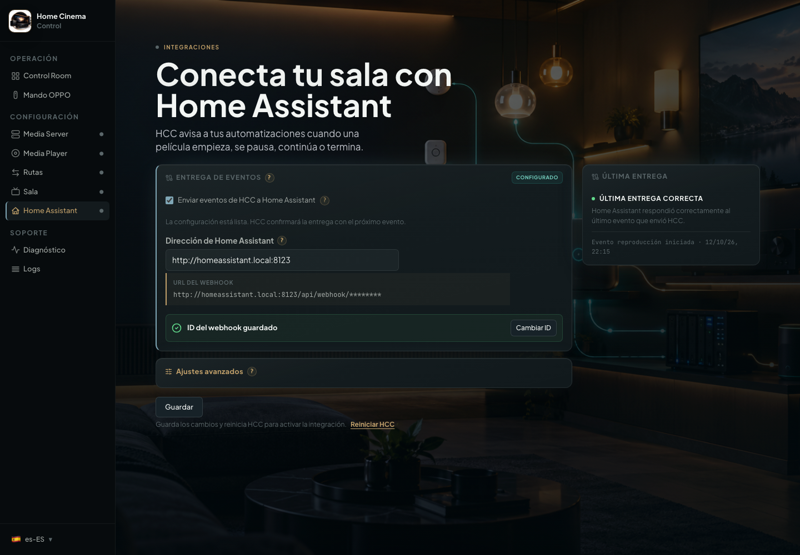

# Connect Home Assistant (optional)

[Home](../README.en.md) · [Installation](../INSTALL.en.md) · [First steps](getting-started.en.md) · [Español](home-assistant.md)

**You do not need Home Assistant to use HCC.** This optional integration sends playback events to Home Assistant so you can create lighting or room automations. Only continue if you already use Home Assistant.

## 9. Connect HCC to Home Assistant

With this integration, HCC tells Home Assistant when it detects playback, starts it, pauses, resumes, or stops. Home
Assistant then
decides
what to do: turn on lights, activate a scene, send an alert, or simply record the event. HCC does not create automations
on
its own; you choose the reaction in Home Assistant.

<p align="center">
  
</p>

### 9.1 Create the automation in Home Assistant

In Home Assistant, create an automation with a **Webhook** trigger. You can copy this complete example. It only writes
each
change to the Home Assistant logbook, so you can verify the connection before adding lights, scenes, or notifications.

```yaml
alias: HCC - playback events
triggers:
  - trigger: webhook
    webhook_id: replace-this-with-a-long-random-id
    allowed_methods:
      - POST
    local_only: true
conditions:
  - condition: template
    value_template: >-
      {{ trigger.json.event | default('') in ['detected', 'started', 'paused', 'resumed', 'stopped'] }}
actions:
  - choose:
      - conditions:
          - condition: template
            value_template: "{{ trigger.json.event == 'detected' }}"
        sequence:
          - action: logbook.log
            data:
              name: HCC
              message: "Playback detected: {{ trigger.json.title | default('') }}"
      - conditions:
          - condition: template
            value_template: "{{ trigger.json.event == 'started' }}"
        sequence:
          - action: logbook.log
            data:
              name: HCC
              message: "Playback started: {{ trigger.json.title | default('') }}"
      - conditions:
          - condition: template
            value_template: "{{ trigger.json.event == 'paused' }}"
        sequence:
          - action: logbook.log
            data:
              name: HCC
              message: "Playback paused: {{ trigger.json.title | default('') }}"
      - conditions:
          - condition: template
            value_template: "{{ trigger.json.event == 'resumed' }}"
        sequence:
          - action: logbook.log
            data:
              name: HCC
              message: "Playback resumed: {{ trigger.json.title | default('') }}"
      - conditions:
          - condition: template
            value_template: "{{ trigger.json.event == 'stopped' }}"
        sequence:
          - action: logbook.log
            data:
              name: HCC
              message: "Playback stopped: {{ trigger.json.title | default('') }}"
mode: queued
```

The text `replace-this-with-a-long-random-id` is only an example. Replace it with a new identifier and keep it private.
This
identifier is the code that allows HCC to send events to this automation, so treat it like a password.

Keep `local_only: true` when HCC and Home Assistant are on your local network. This prevents Home Assistant from
accepting
this webhook from the Internet. HCC sends the data with the `POST` method.

For general automation concepts, see
the [official Home Assistant documentation](https://www.home-assistant.io/docs/automation/).
For trigger options, see
the [official Webhook documentation](https://www.home-assistant.io/docs/automation/trigger/#webhook-trigger).

### 9.2 Configure HCC

In HCC's **Home Assistant** screen:

1. Enable **Send HCC events to Home Assistant**.
2. Enter your Home Assistant address, for example `http://homeassistant.local:8123`. Enter only the base address; do not
   add
   `/api/webhook`.
3. Enter the same code in **Webhook ID** that you used in the automation.
4. Click **Save**.
5. Click **Restart HCC** in the link below the button to apply the configuration.

You normally do not need to change the timeout under **Advanced settings**. Use it only if Home Assistant takes longer
than
usual to respond.

### 9.3 Check that it works

HCC sends five playback events:

- `detected`: HCC detected valid playback on the monitored device and accepted the handoff.
- `started`: playback has started.
- `paused`: playback is paused.
- `resumed`: playback has resumed.
- `stopped`: playback has ended or was stopped.

The event data looks like this:

```json
{
  "event": "started",
  "event_id": "57438c115b84467dafcf843368d9bef6",
  "session_id": "33feec42b11b48799f749bf6534e371c",
  "media_type": "movie",
  "title": "Interstellar",
  "source": "emby",
  "player": "oppo"
}
```

`event` tells you what happened. `event_id` identifies that delivery and `session_id` groups events from the same
playback.
The title, server, and player fields are included when HCC has that information.

To test the setup, start playback from the device monitored by HCC and check the Home Assistant **Logbook**. The HCC
screen
also shows the latest real delivery. Before the first event it shows pending; HCC does not send an artificial test
request.

If Home Assistant does not respond, HCC records the error and playback continues. If you change the address or webhook
ID,
the status returns to pending until HCC successfully sends an event with the new configuration.

If HCC cannot load this screen, it shows an actionable error with a **Try again** button instead of filling the form
with
values that may not be yours.