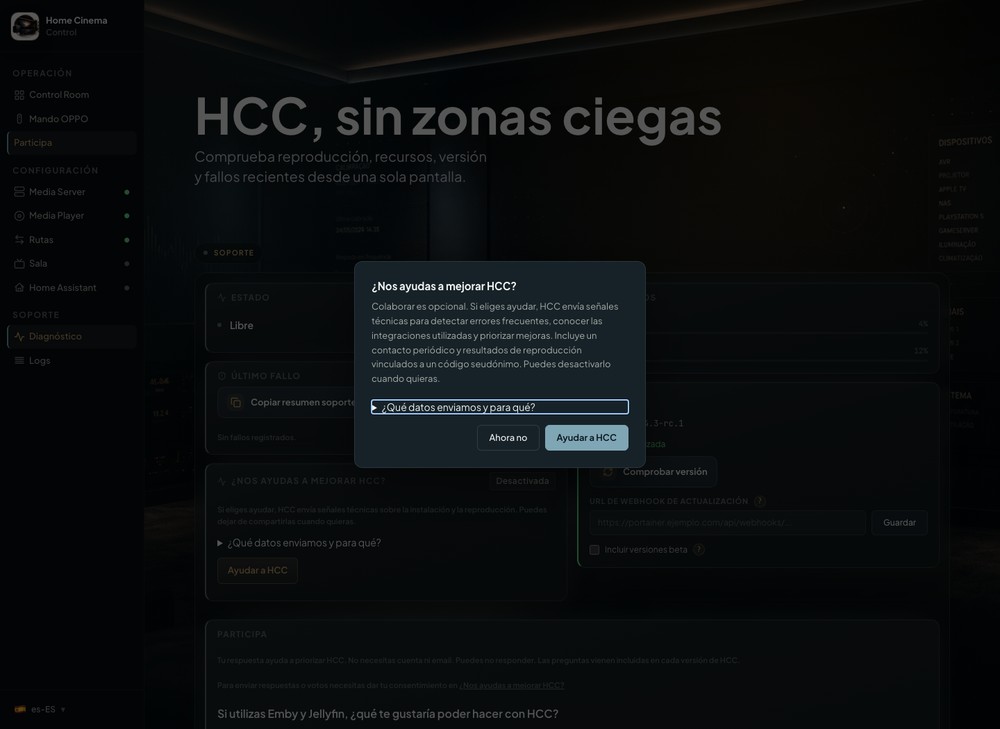

# Participar en las mejoras de HCC

[Inicio](../README.md) · [Privacidad](telemetry.md) · [English](participate.en.md)

**Participa** reúne preguntas breves e intereses para priorizar mejoras de HCC.
No necesitas cuenta ni email. Puedes usar HCC sin responder ni compartir señales.

## Elegir si quieres ayudar

El consentimiento para compartir señales técnicas es opcional y se conserva
al actualizar. Abrir **Participa** no lo activa ni repite una invitación rechazada.

1. Abre **Participa** en el menú de HCC.
2. Si quieres enviar respuestas o votos, entra en **Diagnóstico** y busca
   **¿Nos ayudas a mejorar HCC?**. El consentimiento se gestiona allí, por
   separado de las preguntas.
3. Amplía **¿Qué datos enviamos y para qué?** para revisar qué se comparte.
4. Pulsa **Ayudar a HCC** para activar el envío. En la invitación, **Ahora no**
   mantiene tu elección anterior sin volver a mostrar esa invitación.

La telemetría usa un código seudónimo que vincula señales de tu instalación.
No garantiza anonimato absoluto. Los informes de soporte que decides revisar
y compartir manualmente siguen un proceso independiente.

  

## Responder una pregunta breve

Las preguntas vienen incluidas en cada versión de HCC. Si hay respuestas pendientes,
Control Room muestra una invitación discreta fuera de la reproducción. No abre un modal.

1. Abre **Participa**.
2. Marca las opciones que utilizarías. En la pregunta sobre Emby y Jellyfin puedes elegir varias, pero **No lo necesito** excluye las demás.
   En las preguntas sobre cómo inicias una película y qué reproductor añadir, elige una sola respuesta.
3. Pulsa **Siguiente** para pasar a otra pregunta: HCC guarda automáticamente la respuesta elegida, si ha cambiado. **Anterior** hace lo mismo al retroceder. En la última, usa **Terminar**. Si dejas una pregunta sin contestar, puedes pasar a la siguiente sin enviarla. Si falla el guardado, permanecerás en esa pregunta con tu selección intacta.

**Ahora no** pospone la pregunta y mantiene el indicador. **No me interesa**
oculta solo esa pregunta. La decisión sobrevive a recargas, reinicios y
actualizaciones. Una pregunta con otro identificador puede mostrar su propio
indicador sin recuperar las descartadas.

Una respuesta guardada localmente no demuestra que el hub la haya recibido.
Si falla el envío, HCC usa su cola limitada y los reintentos existentes.
El hub conserva el historial y cuenta la última respuesta recibida por
instalación y pregunta, sin sumar una instalación por cada edición.

## Cambiar tus intereses

La lista describe mejoras posibles, no compatibilidad disponible ni promesas
de implementación. Actualmente distingue Samsung (prueba de concepto local
pendiente de validar por modelos), TCL, Hisense y Philips (viabilidad
condicionada al sistema operativo); también distingue Zidoo de Dune HD.
Panasonic, Xiaomi, Roku y Vizio no se ofrecen como candidatas inmediatas
por falta de una vía suficientemente priorizada y validada.
No muestra Sony TV, Home Assistant, OPPO ni Trinnov Altitude
como nuevas integraciones pendientes porque HCC ya las incluye.
Las opciones históricas agrupadas permanecen en los votos antiguos.

1. En **Participa**, marca o desmarca los intereses.
2. Pulsa **Guardar mi voto**, también si has desmarcado todas las opciones.

El último voto recibido sigue vigente hasta que lo cambies. Los votos de
categorías retiradas se mantienen en el histórico. Los votos siguen siendo opciones cerradas. Hue/Ambilight no se ofrece como interés
pendiente porque no hay una propuesta concreta en el roadmap.

## Proponer otra mejora

Debajo de las preguntas hay un campo opcional de hasta 400 caracteres.
Escribir en él **no** envía nada. Solo se comparte el comentario cuando pulsas
**Enviar comentario** y tienes habilitado el consentimiento de HCC.
Evita datos personales, IP, contraseñas o rutas. El texto puede quedar en
la cola local de reintentos y se conserva en el receptor únicamente en la vista
de administración privada. Se muestra como **guardado para enviar**, no como
entregado definitivamente.

## Dejar de compartir señales

En **¿Nos ayudas a mejorar HCC?**, pulsa **Desactivar**. HCC cancela los envíos
pendientes y vacía la cola local. Intenta comunicar la revocación una sola vez,
sin guardarla ni reintentar. Los datos ya recibidos por el hub no se borran.
Volver a abrir **Participa** no reenvía respuestas guardadas ni reactiva el
consentimiento. Consulta el [contrato de telemetría](telemetry.md) para conocer
los campos y los límites de retención.
