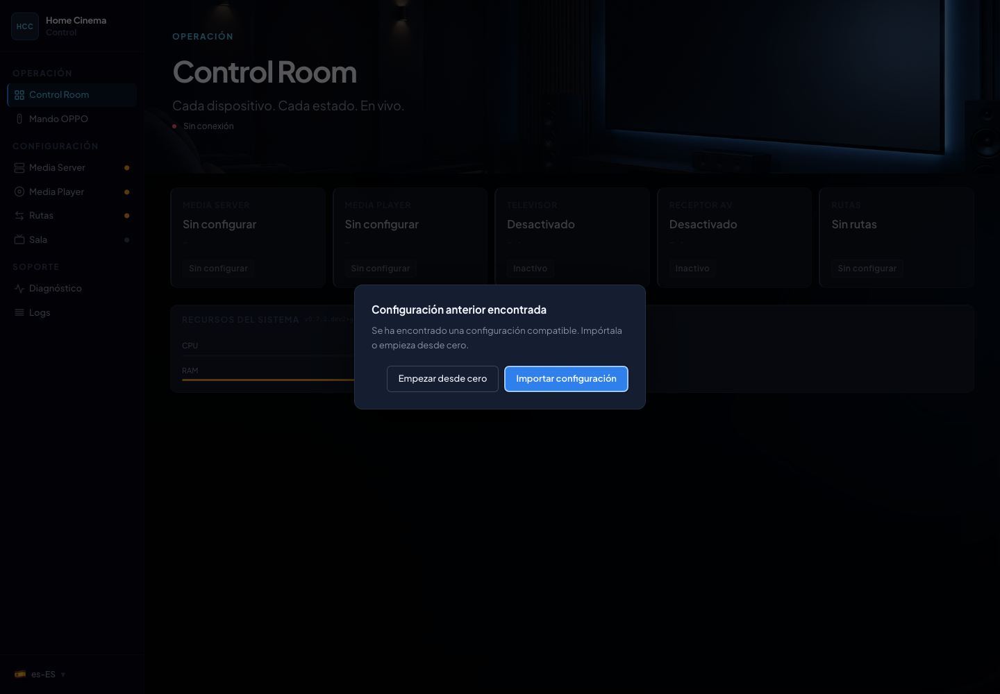
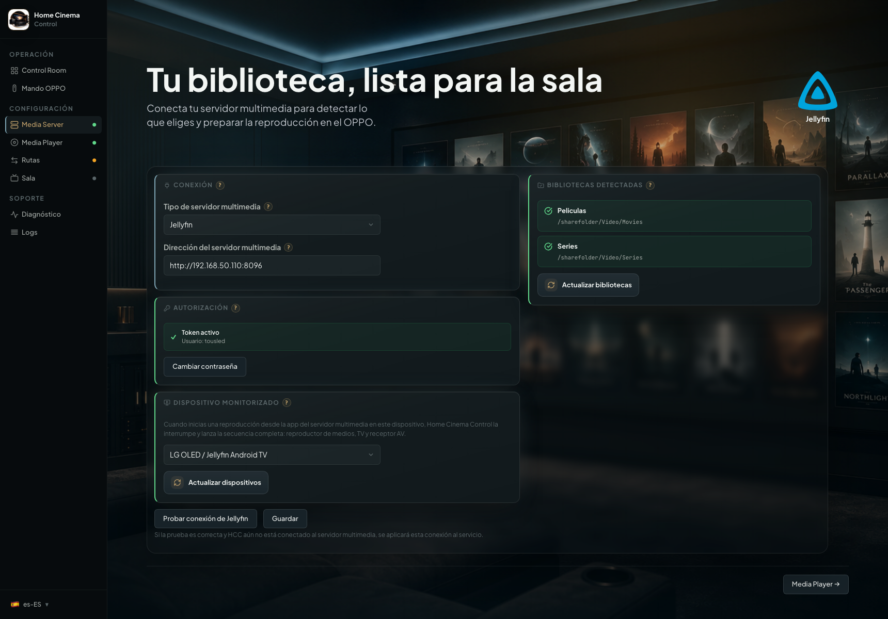
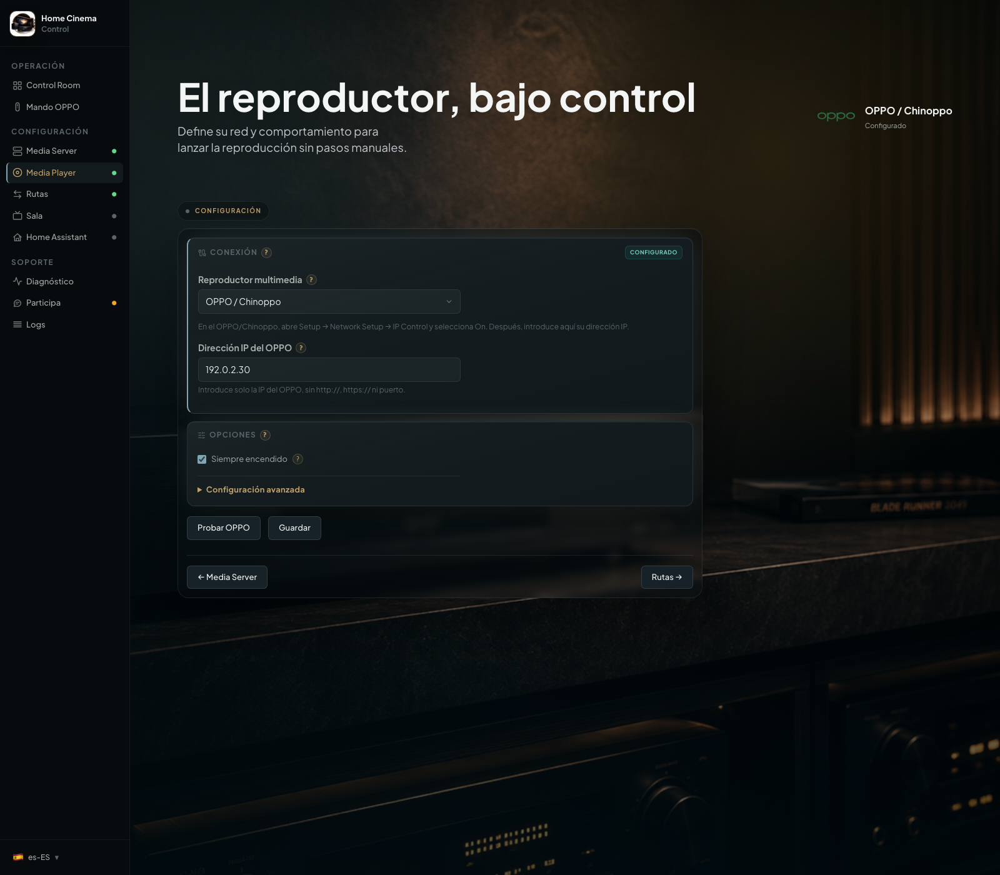
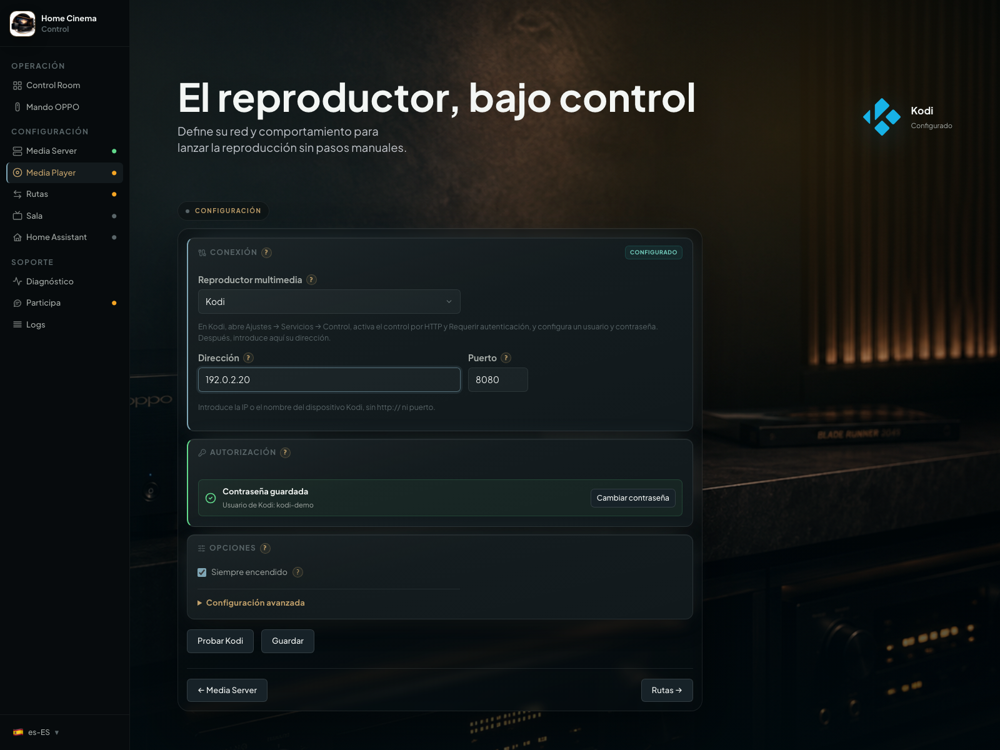
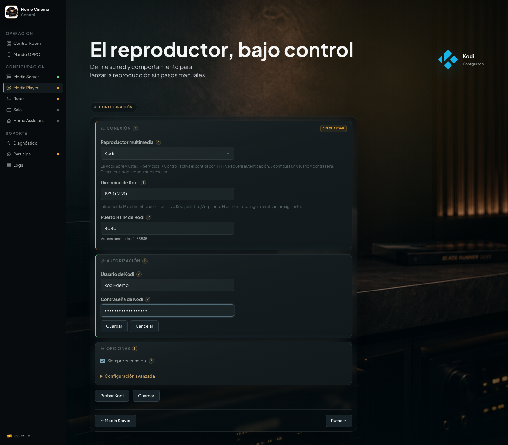
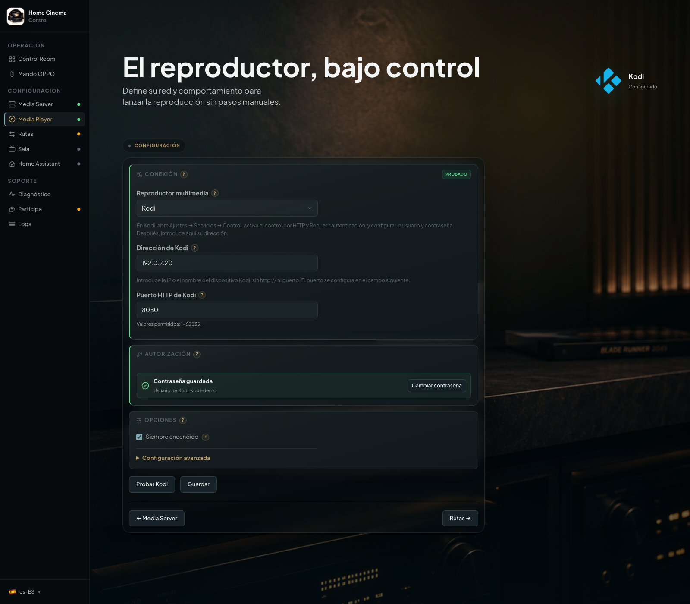
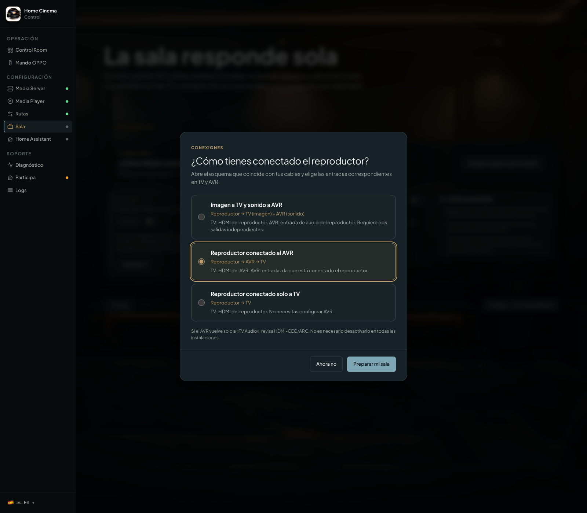
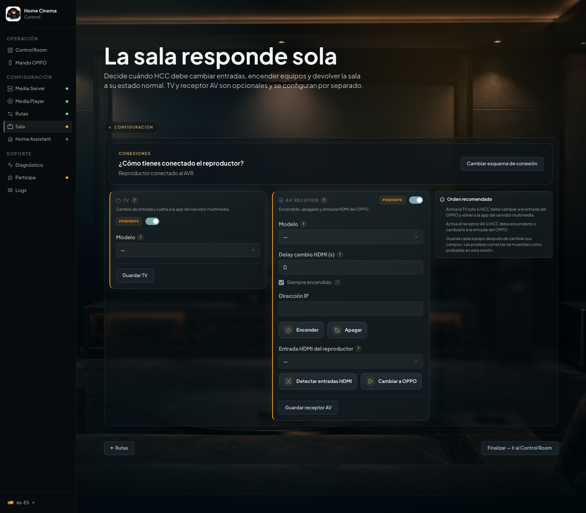
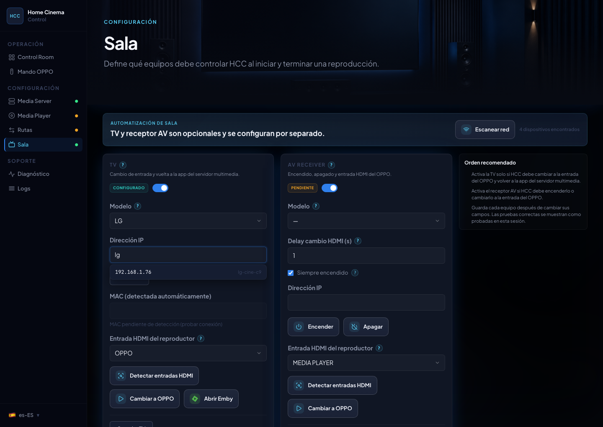

# Primeros pasos dentro de HCC

[Inicio](../README.md) · [Instalación](../INSTALL.md) · [English](getting-started.en.md)

Sigue este recorrido con HCC ya instalado. Las funciones de Kodi corresponden a la futura 1.5.0, todavía sin publicar.
Los nombres **Media Server**, **Media Player** y **Rutas** identifican las pantallas de servidor multimedia, reproductor
y carpetas. Las capturas actualizadas de OPPO, Kodi, Rutas y Sala muestran esta rama en una instancia aislada con datos
de demostración y equipos simulados. Sirven para seguir la interfaz, no como certificación con dispositivos físicos.

## Configura HCC en cinco pasos

1. Autoriza Emby o Jellyfin y elige el dispositivo que HCC debe supervisar.
2. Prepara y conecta tu reproductor, OPPO/Chinoppo o Kodi.
3. Relaciona cada carpeta del servidor con la carpeta del reproductor y pulsa **Probar ruta**.
4. Opcional: conecta la TV y el receptor AV en **Sala**.
5. Reproduce una película desde Emby/Jellyfin en el dispositivo elegido.

Resultado esperado: la película se abre en el reproductor seleccionado y el servidor recibe su progreso. No necesitas
configurar Home Assistant para completar estos pasos.

## Configuración paso a paso

### 1. Instalación nueva o migración

Si HCC encuentra datos anteriores, puedes importarlos. En una instalación nueva, elige **Configurar desde cero**. Si HCC
funcionaba y aparece vacío sin esperarlo, sigue [recuperar configuración](recuperar-configuracion.md) antes de completar
otro asistente.

  

### 2. Conecta Emby o Jellyfin

1. Abre **Media Server** y elige **Emby** o **Jellyfin**.
2. Introduce la dirección del servidor, por ejemplo `http://192.168.1.10:8096`. Utiliza la dirección y el puerto de tu
   servidor; el ejemplo no corresponde a un equipo real.
3. En **Autorización**, introduce tu usuario y contraseña y pulsa **Autorizar con Emby** o **Autorizar con Jellyfin**.
   Espera a ver **Token activo**, que confirma el acceso guardado. Jellyfin necesita permisos de administrador para
   gestionar las sesiones supervisadas.
4. Pulsa **Actualizar dispositivos** si hace falta. Selecciona el dispositivo desde el que vas a pulsar Play, por
   ejemplo la aplicación de Emby en tu TV, y pulsa **Guardar**. Si no aparece, abre esa aplicación e inicia sesión en tu
   servidor antes de actualizar la lista otra vez.

Resultado: HCC muestra tus bibliotecas y el dispositivo supervisado. No tienes que recrear la biblioteca del servidor.
Si sigue **pendiente**, termina la autorización antes de continuar.

  

### 3. Conecta el reproductor

Sigue únicamente el apartado del equipo que vas a utilizar. OPPO y Kodi conservan configuraciones independientes.

#### OPPO/Chinoppo

1. En un OPPO UDP-203/205, pulsa **SETUP** en el mando y entra en **Network Setup → IP Control → On**. En
   Chinoppo/clones busca el control IP equivalente; su ubicación depende del firmware.
   El [soporte oficial de OPPO](https://www.oppodigital.com/blu-ray-udp-203/blu-ray-udp-203-Support.aspx) incluye el
   manual del UDP-203.
2. En HCC, abre **Media Player** y selecciona **OPPO/Chinoppo**. Introduce su IP. Si está disponible **Escanear red**,
   puedes usar las sugerencias por IP, nombre o fabricante.
3. Pulsa **Probar OPPO** y comprueba el resultado. Guarda los cambios.

Si no hay sugerencias, introduce la IP manualmente. El descubrimiento depende de la red y del equipo que ejecuta Docker.
El reproductor debe poder abrir tus películas desde su menú de red antes de configurar las carpetas de HCC.

La captura muestra el selector de reproductor y la dirección de ejemplo en el bloque **Conexión**.

  

#### Kodi: preparar y comprobar la conexión

Configura primero Kodi en el dispositivo que reproducirá las películas. HCC lo controla a través de HTTP JSON-RPC: una
conexión de red para enviar órdenes, sin instalar un complemento en Kodi. No hay una lista de versiones o plataformas de
Kodi certificadas por HCC; comprueba la conexión y una película en tu equipo.

1. En Kodi, abre **Ajustes → Servicios → Control** y activa **Permitir control remoto a través de HTTP**. Anota el
   puerto mostrado, normalmente `8080`.
2. Activa **Requerir autenticación** e introduce un usuario y una contraseña. Si no ves estas opciones, cambia el nivel
   de ajustes de Kodi a **Experto**. Los nombres pueden variar según el idioma o la apariencia; consulta
   el [control HTTP de Kodi](https://kodi.wiki/view/Settings/Services/Control).
3. En Kodi, entra en **Vídeos → Archivos → Añadir vídeos** y añade la carpeta compartida de películas mediante NFS o SMB
   si aún no está añadida. En SMB, introduce las credenciales de la carpeta en Kodi. Entra en ella y comprueba que
   puedes reproducir un archivo. No necesitas volver a catalogar las películas para que HCC explore la fuente.
   La [guía de fuentes de Kodi](https://kodi.wiki/view/Adding_video_sources) explica esta pantalla.
4. En HCC, abre **Media Player** y elige **Kodi** en **Conexión**. Introduce su dirección, por ejemplo `192.168.1.20`,
   sin `http://`. En **Puerto**, a la derecha de la dirección, escribe el puerto HTTP que anotaste.
5. En **Autorización**, escribe el usuario y la contraseña del control HTTP de Kodi, que pueden ser distintos de los del
   NAS. Pulsa **Guardar** junto a los campos. HCC comprueba la conexión antes de guardar; si falla, conserva los ajustes
   anteriores.
6. Pulsa **Probar Kodi**. Debe confirmar la conexión sin necesitar una reproducción activa. Si falla, lee el motivo:
   dirección o puerto inválidos, credenciales rechazadas, Kodi inaccesible o error de comunicación. Corrige ese dato y
   repite.

Resultado: quedan guardados el perfil y las credenciales de Kodi. Verás el usuario y **Contraseña guardada**. **Cambiar
contraseña** abre la edición; **Guardar** valida los nuevos datos y **Cancelar** descarta la edición. Omitir una
contraseña conserva la existente. **Probar Kodi** usa una contraseña nueva si la has escrito y, en caso contrario, la
guardada.

  

  

Si Kodi permite entrar sin autenticación, HCC no puede confirmar un usuario y contraseña: no los declara válidos. Activa
la autenticación en Kodi y repite. Los demás ajustes de la pantalla se guardan con **Guardar** al final.

  

### 4. Conecta tus carpetas de películas

HCC necesita relacionar dos nombres de la misma carpeta: el que conoce Emby/Jellyfin y el que puede abrir tu
reproductor. Por ejemplo, el servidor puede verla como `/volume1/Video/Peliculas` y Kodi como
`smb://nas/Video/Peliculas/`. No copies una dirección en el otro campo: utiliza el navegador.

1. Abre **Rutas** y elige una carpeta de la biblioteca detectada. Si falta, pulsa **Actualizar bibliotecas**.
2. Con OPPO, elige NFS o SMB en **Acceso OPPO** y pulsa **Explorar OPPO**. Si SMB pide usuario y contraseña,
   introdúcelos y guarda ese acceso antes de probar.
3. Con Kodi, pulsa **Explorar carpetas de Kodi**. En **Carpetas disponibles en Kodi**, abre la fuente NFS/SMB y entra en
   la carpeta correspondiente. Cada carpeta elegida completa la ruta automáticamente; **Volver** regresa al nivel
   anterior. Si HCC ofrece una sugerencia basada en otra ruta, comprueba que corresponde a esta biblioteca antes de
   usarla.
4. Pulsa **Probar ruta**. Si aparece **Ruta verificada**, HCC guarda la relación y esa carpeta queda preparada. La
   prueba de Kodi consulta la carpeta y no reproduce nada. Repite con las demás carpetas que quieras utilizar.

Las fuentes locales de Kodi no están disponibles en HCC 1.5.0: se reservan para una actualización 1.5.x, sin fecha
concreta. Las fuentes `plugin://` y otros protocolos tampoco se pueden seleccionar. Usa una fuente NFS o SMB. Si no
aparecen fuentes, añádelas en **Vídeos** de Kodi, no solo en su gestor de archivos.

**Guardar borrador** permite conservar una ruta pendiente; no sustituye la prueba. Si cambias de OPPO a Kodi o vuelves a
OPPO, HCC recupera las rutas de cada reproductor para el servidor elegido. La [guía de carpetas](configurar-rutas.md)
explica los estados y las opciones avanzadas.

### 5. TV y receptor AV (opcional)

#### Antes de configurar Sala: comprueba el cableado

HCC contempla estas tres conexiones de un reproductor **externo** (OPPO/Chinoppo o Kodi). Elige las entradas según dónde llegan realmente la imagen y el sonido.

| Conexión | Entrada HDMI en TV | Entrada en AVR |
| --- | --- | --- |
| **1. Reproductor → TV (imagen) y reproductor → AVR (audio)**, usando dos salidas | HDMI al que llega directamente el reproductor | Entrada conectada a la salida de audio del reproductor |
| **2. Reproductor → AVR → TV** | HDMI al que está conectado el AVR | Entrada del AVR a la que está conectado el reproductor |
| **3. Reproductor → TV**, sin AVR | HDMI del reproductor | No configures AVR |

**HDMI-CEC/ARC:** la conmutación automática de fuentes puede interferir con HCC; por ejemplo, si el AVR vuelve a «TV Audio». Comprueba las entradas y revisa CEC/ARC si ocurre. Desactiva la función conflictiva en el AVR solo si es necesario; **no es un requisito universal desactivar CEC/ARC**. Consulta [El AVR cambia solo de entrada](solucionar-problemas.md#el-avr-cambia-solo-de-entrada).

**Fuera del alcance de esta guía:** reproductor → TV → AVR mediante ARC/eARC. No debe confundirse con el caso 1, que utiliza dos salidas del reproductor.

En la primera configuración, el asistente de Sala puede preparar los campos. **Preparar mi sala** rellena el formulario:
revisa los datos, prueba los dispositivos y guarda. No detecta el cableado ni guarda de inmediato. **Cambiar esquema de
conexión** permite abrirlo otra vez.

  

Entra en **Sala** para conectar tu **TV, el receptor AV o ambos**. Activa cada dispositivo que tengas, elige su modelo y configura la IP. Si aparece **Escanear red**, púlsalo y utiliza las sugerencias al escribir la dirección, igual que en Media Player. Pulsa **Probar conexión** antes de seleccionar entradas o funciones de la TV. Si no tienes receptor AV, configura solo la TV.

  

  

Si las sugerencias no aparecen, puedes escribir la IP manualmente; HCC y los dispositivos deben poder comunicarse en tu red local (mantén **`network_mode: host`**). El nombre visible depende de la información que facilite tu red o router.

En televisores LG, acepta el emparejamiento en pantalla si aparece. En Sony puede ser necesario activar el control IP/PSK en los ajustes de la TV. Si alguna prueba falla, consulta [Diagnóstico](solucionar-problemas.md#consulta-el-diagnóstico-de-hcc); si el receptor cambia solo a TV Audio, consulta [solución de problemas](solucionar-problemas.md#el-avr-cambia-solo-de-entrada).

### 6. Reproduce tu primera película

1. Deja encendido el reproductor seleccionado. Si utilizas Kodi, mantén Kodi abierto.
2. Comprueba que la carpeta de la película figura como verificada en **Rutas** para ese reproductor.
3. Abre Emby/Jellyfin en el dispositivo seleccionado en **Media Server** y reproduce una película de esa biblioteca.
   Para la primera prueba de Kodi utiliza un archivo de vídeo habitual, por ejemplo MKV.
4. Comprueba que la película se abre en el reproductor, que el progreso avanza en Emby/Jellyfin y que puedes detenerla.
   Si configuraste Sala, comprueba también las entradas de TV y sonido.

Si la ruta no está configurada o verificada, HCC no entrega esa película al reproductor y puede continuar en la
aplicación de origen. Algunos clientes muestran un aviso con el motivo y la recomendación. Si falla la conexión, abre
**Diagnóstico** y consulta [solución de problemas](solucionar-problemas.md).

En OPPO, ciertas imágenes Blu-ray ISO con menús pueden requerir continuar desde el propio menú. Si avanzar desde
Emby/Jellyfin reinicia el título, usa el mando del OPPO. No se garantiza esa misma experiencia de ISO, carpetas Blu-ray
o menús en Kodi: depende de su dispositivo y no está verificada como equivalente a OPPO.

Puedes terminar aquí o configurar los eventos opcionales de [Home Assistant](home-assistant.md).
