# Primeros pasos dentro de HCC

[Inicio](../README.md) · [Instalación](../INSTALL.md) · [English](getting-started.en.md)

Sigue este recorrido con HCC ya instalado. Las funciones de Kodi corresponden a la futura 1.5.0, todavía sin publicar.
Los nombres **Media Server**, **Media Player** y **Rutas** identifican las pantallas de servidor multimedia, reproductor
y carpetas. Las capturas actualizadas de OPPO, Kodi, Rutas y Sala muestran esta rama en una instancia aislada con datos
de demostración y equipos simulados. Sirven para seguir la interfaz, no como certificación con dispositivos físicos.

Control Room ofrece **Continuar configuración** como siguiente paso recomendado. Puedes visitar cualquier sección y
preparar datos aunque los equipos estén apagados. TV, receptor y Home Assistant son opcionales. **Configurado** indica
datos guardados pendientes de comprobar; **Verificado** acredita una comprobación guardada válida, sin afirmar que el
equipo esté encendido ahora. **Revisar** indica que la comprobación anterior ya no corresponde a los datos actuales.

Si avanzar deja una limitación relevante pendiente, HCC explica sus consecuencias. **Revisar configuración** vuelve al
apartado correspondiente sin enviar comandos; **Continuar de todos modos** permite avanzar sin marcar nada como
verificado. Escape o cerrar el aviso conserva la pantalla. La misma advertencia no se repite durante esa sesión de
pestaña, ni tras recargar, salvo que cambien el estado o la identidad del equipo. Los recordatorios de cada pantalla
siguen visibles.

  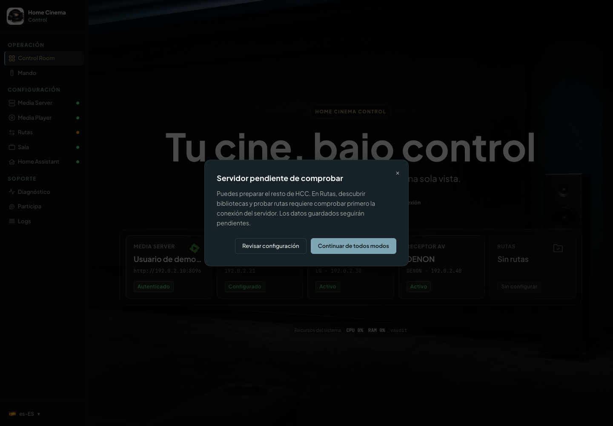

Usa Tab para llegar a selectores y tarjetas. En un selector, usa las flechas, Inicio o Fin y confirma con Intro; Escape
cancela. Los errores permanecen visibles hasta cerrarlos. Se muestran hasta tres avisos; los errores iguales comparten
un contador de repeticiones. Los éxitos no desplazan errores pendientes. Si llegan más errores distintos, se conservan
los tres más recientes.

## Configura HCC en cinco pasos

Los selectores de servidor, reproductor, TV y receptor muestran el logotipo junto
al nombre. En Sala, **Marca** ordena los fabricantes alfabéticamente y deja **Scripts** al final para el control con
comandos personalizados.
Elegir una marca nueva o volver a un perfil vacío no muestra un aviso de
recuperación. **Configuración guardada recuperada** aparece solo si se recuperan
ajustes anteriores; el cambio de marca no prueba la conexión.
El mismo criterio se aplica al cambiar entre Kodi/OPPO o Emby/Jellyfin: un
destino sin configurar no muestra un aviso de éxito. Recuperar ajustes no
significa que se haya realizado una nueva prueba de conexión.

1. Autoriza Emby o Jellyfin y elige el dispositivo que HCC debe supervisar.
2. Prepara y conecta tu reproductor, OPPO/Chinoppo o Kodi.
3. Relaciona cada carpeta del servidor con la carpeta del reproductor y pulsa **Probar ruta**.
4. Opcional: conecta la TV y el receptor AV en **Sala**.
5. Reproduce una película desde Emby/Jellyfin en el dispositivo elegido.

Resultado esperado: la película se abre en el reproductor seleccionado y el servidor recibe su progreso. No necesitas
configurar Home Assistant para completar estos pasos.

## Configuración paso a paso

### 1. Instalación nueva o migración

Si HCC encuentra datos anteriores, puedes importarlos. En una instalación nueva, elige **Configurar desde cero**. Si HCC
funcionaba y aparece vacío sin esperarlo, sigue [recuperar configuración](recuperar-configuracion.md) antes de completar
otro asistente.

  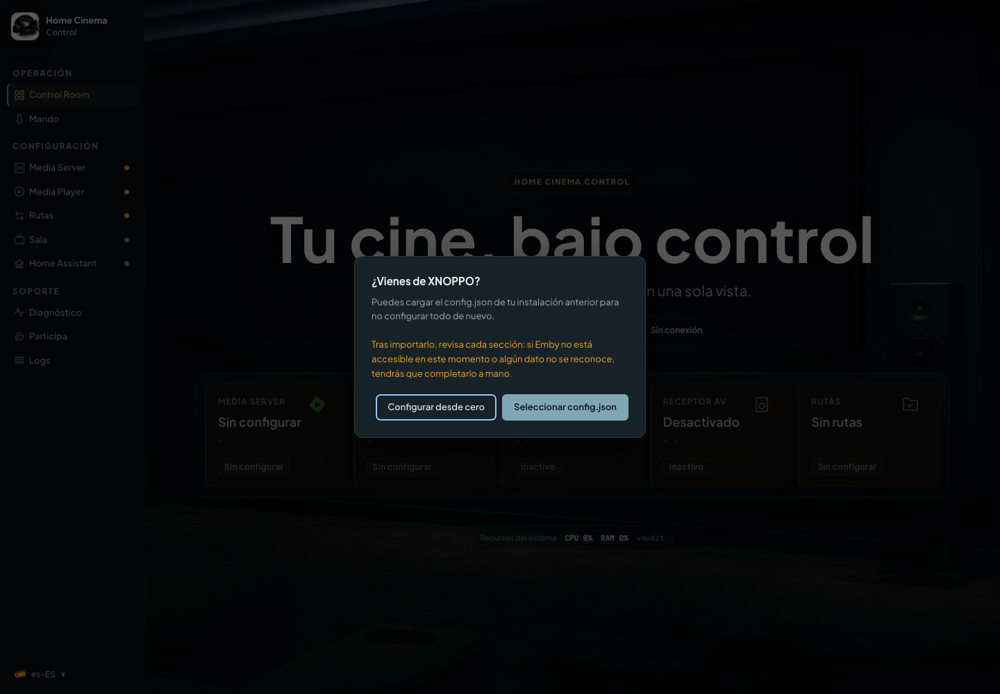

### 2. Conecta Emby o Jellyfin

1. Abre **Media Server** y elige **Emby** o **Jellyfin**.
2. Introduce la dirección del servidor, por ejemplo `http://192.168.1.10:8096`. Utiliza la dirección y el puerto de tu
   servidor; el ejemplo no corresponde a un equipo real.
3. En **Autorización**, introduce tu usuario y contraseña y pulsa **Autorizar con Emby** o **Autorizar con Jellyfin**.
   Espera a ver **Token guardado**, que confirma el acceso guardado. Jellyfin necesita permisos de administrador para
   gestionar las sesiones supervisadas.
4. Pulsa **Actualizar dispositivos** si hace falta. Selecciona el dispositivo desde el que vas a pulsar Play, por
   ejemplo la aplicación de Emby en tu TV, y pulsa **Guardar**. Si no aparece, abre esa aplicación e inicia sesión en tu
   servidor antes de actualizar la lista otra vez.

5. Pulsa **Probar conexión de Jellyfin** o **Probar conexión de Emby**, según el servidor elegido. Si no puedes probarla
   ahora, puedes continuar con la preparación. Una dirección o un token guardados no completan la verificación. Una
   comprobación guardada válida es histórica; no afirma que el servidor esté conectado en este momento.

Resultado: aparecen el cliente seleccionado y las carpetas físicas que devuelve tu servidor. HCC no crea bibliotecas ni
registra clientes por ti. Esta captura muestra un servidor preparado y simulado:

  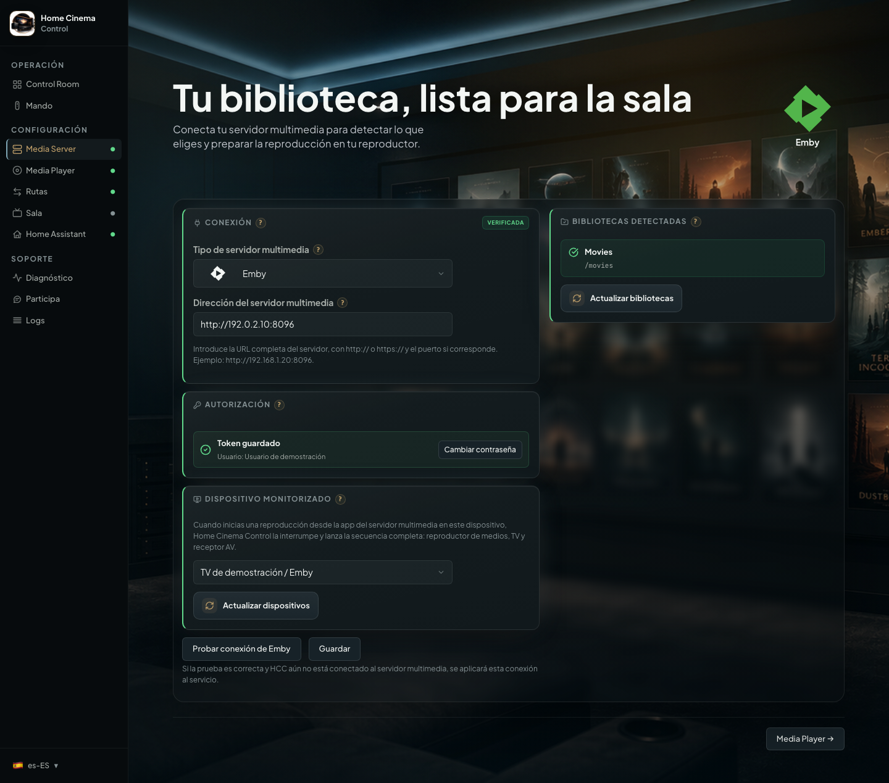

Si no hay clientes, abre Emby/Jellyfin en el equipo desde el que pulsarás Play, inicia sesión y pulsa **Actualizar
dispositivos** en HCC. Si no hay carpetas, revisa las bibliotecas del servidor y los permisos de la cuenta y pulsa
**Actualizar bibliotecas**. Este estado vacío es un ejemplo de recuperación, no una configuración terminada:

  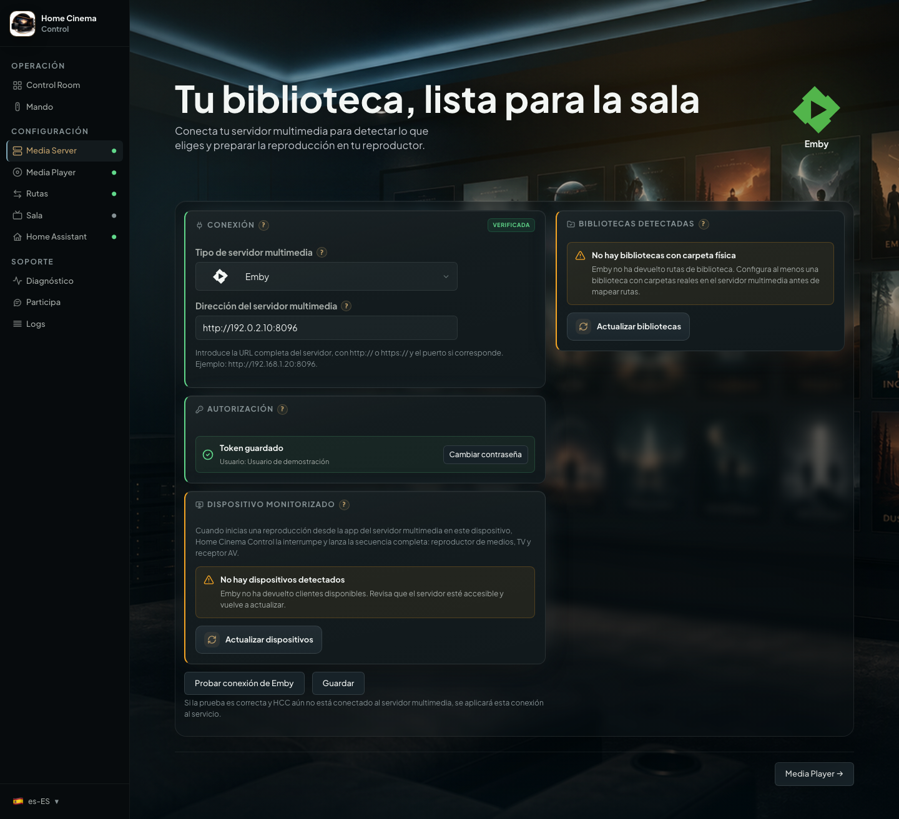

Puedes abrir **Rutas** y guardar correspondencias manuales sin esa prueba. Descubrir bibliotecas requiere comprobar el
servidor; explorar carpetas requiere un reproductor configurado y accesible. **Probar ruta** y los cambios de acceso de
red requieren la comprobación guardada del servidor y la dirección del reproductor. Si todo lo demás está preparado,
Control Room te recomendará volver a la comprobación pendiente.

### 3. Conecta el reproductor

Sigue únicamente el apartado del equipo que vas a utilizar. OPPO y Kodi conservan configuraciones independientes.

#### OPPO/Chinoppo

1. En un OPPO UDP-203/205, pulsa **SETUP** en el mando y entra en **Network Setup → IP Control → On**. En
   Chinoppo/clones busca el control IP equivalente; su ubicación depende del firmware.
   El [soporte oficial de OPPO](https://www.oppodigital.com/blu-ray-udp-203/blu-ray-udp-203-Support.aspx) incluye el
   manual del UDP-203.
2. En HCC, abre **Media Player** y selecciona **OPPO/Chinoppo**. Introduce su IP. Si está disponible **Escanear red**,
   puedes usar las sugerencias por IP, nombre o fabricante.
3. Pulsa **Probar OPPO** y comprueba el resultado. Guarda los cambios.

**Encendido y apagado automáticos (experimental):** enciende el OPPO **manualmente la primera vez**, activa
**IP Control** y **Red en espera** (o sus equivalentes según firmware) y confirma que HCC puede comunicarse con él.
Después podrás elegir **Opciones de HCC → Encendido y apagado → Encendido y apagado automáticos** y configurar el
periodo de gracia. En equipos compatibles, HCC puede volver a encender el OPPO tras apagarlo por su cuenta; esto no
equivale al apagado con el mando físico. **Si lo apagas con su mando, se corta la corriente o el equipo deja de
responder por la red, el encendido automático puede dejar de funcionar**. Si HCC no consigue recuperarlo, enciéndelo
de nuevo manualmente y comprueba la conexión. No se garantiza para todos los modelos ni firmwares.

Si no hay sugerencias, introduce la IP manualmente. El descubrimiento depende de la red y del equipo que ejecuta Docker.
El reproductor debe poder abrir tus películas desde su menú de red antes de configurar las carpetas de HCC.

La captura muestra el selector de reproductor y la dirección de ejemplo en el bloque **Conexión**.

  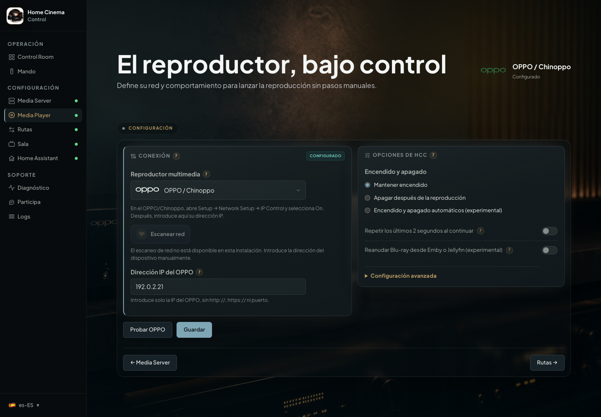

#### Kodi: preparar y comprobar la conexión

Con Kodi apagado, puedes guardar únicamente la conexión, sin activar controles de energía.

  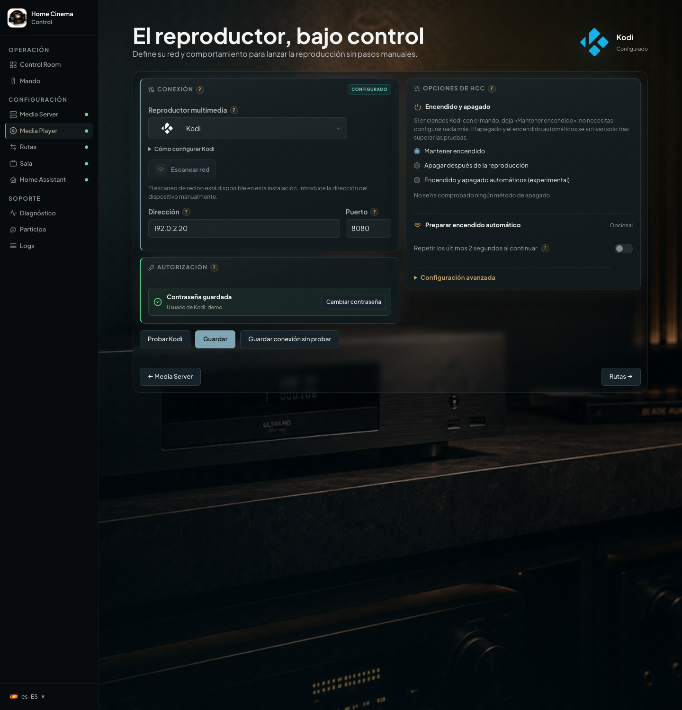

Configura primero Kodi en el dispositivo que reproducirá las películas. HCC lo controla a través de HTTP JSON-RPC: una
conexión de red para enviar órdenes, sin instalar un complemento en Kodi. No hay una lista de versiones o plataformas de
Kodi certificadas por HCC; comprueba la conexión y una película en tu equipo.

1. En Kodi, abre **Ajustes → Servicios → Control** y activa **Permitir control remoto a través de HTTP**. Anota el
   puerto mostrado, normalmente `8080`.
2. Activa **Requerir autenticación** e introduce un usuario y una contraseña. Si no ves estas opciones, cambia el nivel
   de ajustes de Kodi a **Experto**. Los nombres pueden variar según el idioma o la apariencia; consulta
   el [control HTTP de Kodi](https://kodi.wiki/view/Settings/Services/Control).
3. En Kodi, entra en **Vídeos → Archivos → Añadir vídeos** y añade la carpeta compartida de películas mediante NFS o SMB
   si aún no está añadida. En SMB, introduce las credenciales de la carpeta en Kodi. Entra en ella y comprueba que
   puedes reproducir un archivo. No necesitas volver a catalogar las películas para que HCC explore la fuente.
   La [guía de fuentes de Kodi](https://kodi.wiki/view/Adding_video_sources) explica esta pantalla.
4. En HCC, abre **Media Player** y elige **Kodi** en **Conexión**. Introduce su dirección, por ejemplo `192.168.1.20`,
   sin `http://`. En **Puerto**, a la derecha de la dirección, escribe el puerto HTTP que anotaste.
5. En **Autorización**, escribe el usuario y la contraseña del control HTTP de Kodi, que pueden ser distintos de los del
   NAS. Pulsa **Guardar**, debajo de Conexión y Autorización. HCC comprueba la conexión antes de guardar; si falla, conserva los ajustes
   anteriores.
   Si Kodi está apagado, utiliza **Guardar conexión sin probar**: guarda solo dirección, puerto y autorización, sin
   comprobarlos ni guardar ajustes de encendido/apagado. Los controles de energía mantienen sus propias pruebas. Al
   cambiar la contraseña sin probarla, la verificación anterior deja de ser válida.
6. Pulsa **Probar Kodi** cuando el equipo esté disponible. Debe confirmar la conexión sin necesitar una reproducción
   activa. Si falla, lee el motivo:
   dirección o puerto inválidos, credenciales rechazadas, Kodi inaccesible o error de comunicación. Corrige ese dato y
   repite. Consulta
   los [errores de conexión de Kodi y su captura de ejemplo](solucionar-problemas.md#probar-kodi-o-guardar-credenciales-falla)
   si necesitas identificar el resultado.

Resultado: quedan guardados el perfil y las credenciales de Kodi. Verás el usuario y **Contraseña guardada**. **Cambiar
contraseña** abre la edición; el botón **Guardar** bajo ambos bloques valida los nuevos datos y **Cancelar** descarta la edición. Omitir una
contraseña conserva la existente. **Probar Kodi** usa una contraseña nueva si la has escrito y, en caso contrario, la
guardada.

  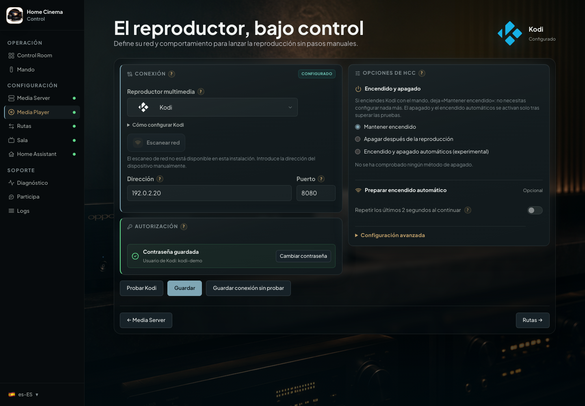

  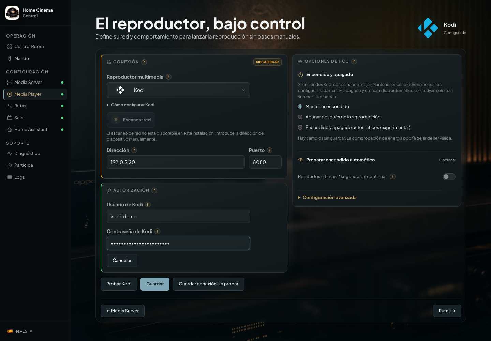

Si Kodi permite entrar sin autenticación, HCC no puede confirmar un usuario y contraseña: no los declara válidos. Activa
la autenticación en Kodi y repite. El mismo botón **Guardar** conserva los demás ajustes de la pantalla.

  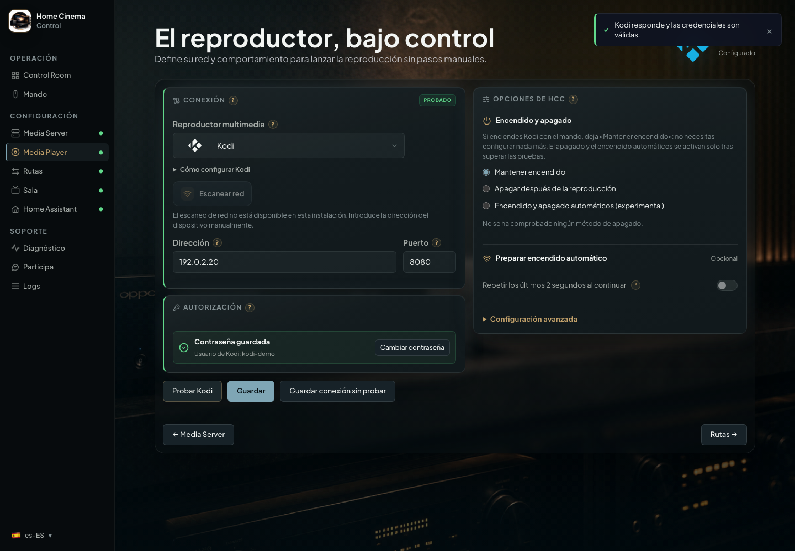

El control de energía es opcional. En **Opciones → Encendido y apagado**, deja **Mantener encendido** si utilizas el
mando del dispositivo. El asistente prueba el apagado y, para el modo automático, también el encendido. WoL, Android TV
Remote y ADB son alternativas de encendido; prepara solo la que corresponda a tu equipo. Un apagado experimental sin
verificar requiere tu aceptación expresa y encendido manual. Si HCC acepta la cancelación antes del envío, la orden no
se envía. Cancelar no deshace una orden que ya haya empezado. La compatibilidad con dispositivos físicos sigue pendiente
de validación.
Si el guardado ya ha comenzado, cancelar no lo interrumpe: espera el resultado y comprueba los ajustes guardados.

### 4. Conecta tus carpetas de películas

HCC necesita relacionar dos nombres de la misma carpeta: el que conoce Emby/Jellyfin y el que puede abrir tu
reproductor. Por ejemplo, el servidor puede verla como `/volume1/Video/Peliculas` y Kodi como
`smb://nas/Video/Peliculas/`. No copies una dirección en el otro campo: utiliza el navegador.

1. Abre **Rutas** y elige una carpeta de la biblioteca detectada. Si falta, pulsa **Actualizar bibliotecas**.
2. Con OPPO, elige NFS o SMB en **Acceso OPPO** y pulsa **Explorar OPPO**. Si SMB pide usuario y contraseña,
   introdúcelos y guarda ese acceso antes de probar.
3. Con Kodi, pulsa **Explorar carpetas de Kodi**. En **Carpetas disponibles en Kodi**, abre la fuente NFS/SMB y entra en
   la carpeta correspondiente. Cada carpeta elegida completa la ruta automáticamente; **Volver** regresa al nivel
   anterior. Si HCC ofrece una sugerencia basada en otra ruta, comprueba que corresponde a esta biblioteca antes de
   usarla.
4. Pulsa **Probar ruta**. Si aparece **Ruta verificada**, HCC guarda la relación y esa carpeta queda preparada. La
   prueba de Kodi consulta la carpeta y no reproduce nada. Repite con las demás carpetas que quieras utilizar.

Las fuentes locales de Kodi no están disponibles en HCC 1.5.0: se reservan para una actualización 1.5.x, sin fecha
concreta. Las fuentes `plugin://` y otros protocolos tampoco se pueden seleccionar. Usa una fuente NFS o SMB. Si no
aparecen fuentes, añádelas en **Vídeos** de Kodi, no solo en su gestor de archivos.

**Guardar borrador** permite escribir y guardar una ruta manual con los equipos apagados; no sustituye la prueba. Pulsa
**Crear ruta manual**, completa nombre y ambas rutas y guarda. Para Kodi, utiliza <code>nfs://</code> o <code>
smb://</code>, sin contraseñas en la dirección. Puedes corregir después un borrador y recuperarlo al recargar. Cuando
faltan requisitos de conexión, este guardado conserva las rutas ya verificadas: no permite sobrescribirlas, renombrarlas
ni borrarlas. No modifica las rutas de otros servidores o reproductores. Vuelve a la ruta y pulsa **Probar ruta** cuando
las conexiones estén preparadas.

  

Si cambias de OPPO a Kodi o vuelves a
OPPO, HCC recupera las rutas de cada reproductor para el servidor elegido. La [guía de carpetas](configurar-rutas.md)
explica los estados y las opciones avanzadas.

### 5. TV y receptor AV (opcional)

#### Antes de configurar Sala: comprueba el cableado

HCC contempla estas tres conexiones de un reproductor **externo** (OPPO/Chinoppo o Kodi). Elige las entradas según dónde llegan realmente la imagen y el sonido.

| Conexión | Entrada HDMI en TV | Entrada en AVR |
| --- | --- | --- |
| **1. Reproductor → TV (imagen) y reproductor → AVR (audio)**, usando dos salidas | HDMI al que llega directamente el reproductor | Entrada conectada a la salida de audio del reproductor |
| **2. Reproductor → AVR → TV** | HDMI al que está conectado el AVR | Entrada del AVR a la que está conectado el reproductor |
| **3. Reproductor → TV**, sin AVR | HDMI del reproductor | No configures AVR |

**HDMI-CEC/ARC:** la conmutación automática de fuentes puede interferir con HCC; por ejemplo, si el AVR vuelve a «TV Audio». Comprueba las entradas y revisa CEC/ARC si ocurre. Desactiva la función conflictiva en el AVR solo si es necesario; **no es un requisito universal desactivar CEC/ARC**. Consulta [El AVR cambia solo de entrada](solucionar-problemas.md#el-avr-cambia-solo-de-entrada).

**Fuera del alcance de esta guía:** reproductor → TV → AVR mediante ARC/eARC. No debe confundirse con el caso 1, que utiliza dos salidas del reproductor.

En la primera configuración, el asistente de Sala permite declarar el cableado. **Guardar y preparar mi sala** guarda
el esquema elegido y activa o desactiva los controles de TV y AVR según esa elección, sin modificar las entradas HDMI
ni las credenciales existentes. Después revisa los campos, prueba los dispositivos y guarda sus ajustes por separado.
El asistente no detecta físicamente el cableado ni verifica las conexiones. **Cambiar esquema de conexión** permite
abrirlo otra vez.

  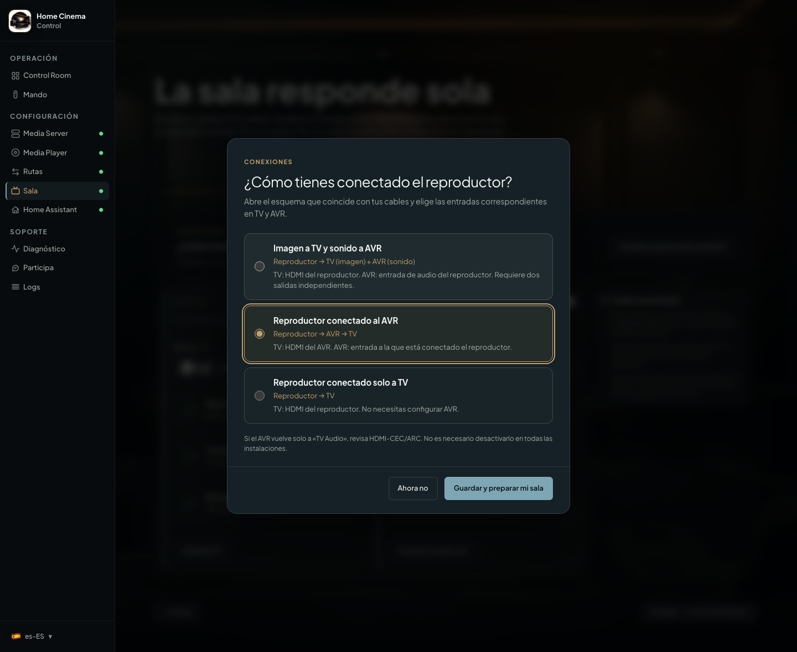

Entra en **Sala** para configurar tu **TV, el receptor AV o ambos**. Elige primero el esquema real de conexión y pulsa
**Guardar y preparar mi sala**. La selección se guarda aunque todavía no hayas terminado de configurar los equipos.
Puedes modificarla más adelante con **Cambiar esquema de conexión**. Selecciona la **Marca** de cada equipo activo y
comprueba su IP en el propio dispositivo. **Buscar dispositivos** ofrece sugerencias, no confirma conexiones.

#### TV LG y Sony: tres pasos

1. **Dirección del televisor:** introduce o selecciona la IP y pulsa **Continuar a la conexión**. Esta acción prepara
   el siguiente paso, pero no comprueba que la TV responda. Puedes guardar los ajustes con **Guardar TV**.
2. **Conexión con HCC:** con la TV encendida, pulsa **Probar TV**. Acepta el permiso en la LG si aparece; en Sony,
   configura el control IP y la clave PSK cuando corresponda. Una IP escrita no sustituye la prueba.
3. **Entradas y aplicaciones:** selecciona el HDMI por el que llega la imagen del reproductor (o del receptor AV),
   utiliza las acciones para detectar o probar las entradas y configura el regreso a la aplicación del servidor
   multimedia si está disponible. **Guardar TV** conserva los ajustes; guardar una entrada no demuestra que el cambio
   HDMI o la apertura de la aplicación funcionen. Realiza esas pruebas con el equipo disponible.

#### Receptor AV: tres pasos

1. **Dirección del receptor:** selecciona la marca y la IP (o el comando de encendido si utilizas **Scripts**) y pulsa
   **Guardar y continuar**. En Trinnov también puedes necesitar la MAC para probar la energía.
2. **Prueba de control:** utiliza **Encender** o **Apagar** si quieres verificar esas órdenes. Las pruebas de energía
   son opcionales y no impiden preparar las entradas del reproductor.
3. **Entrada del reproductor:** selecciona la fuente adecuada y ajusta las opciones HDMI. Puedes usar **Detectar
   entradas HDMI** y **Cambiar al reproductor** cuando se cumplan sus requisitos. Termina con **Guardar receptor AV**.
   En Trinnov, una lista de fuentes no prueba por sí sola la conexión.

Los pasos se pueden abrir y plegar. Un **tick verde** significa que se ha guardado un dato o que una prueba se ha
completado, **según el texto de ese paso**: «Dirección guardada», «Conexión comprobada» y «Entrada guardada» no son
equivalentes. Un resultado guardado de una prueba anterior no confirma disponibilidad en este momento. Para las
acciones de control de TV puede ser necesaria una nueva prueba **Probar TV** en la sesión actual. Cambiar de marca
recupera el perfil guardado de esa marca, no establece una conexión nueva. Si desactivas y reactivas un equipo, sus
datos y verificaciones históricas compatibles pueden conservarse. Si no tienes AVR, configura solo la TV.
Si algo queda bloqueado o pendiente, consulta [Sala: problemas frecuentes](solucionar-problemas.md#sala-tvav-problemas-frecuentes-en-150-rc2).

  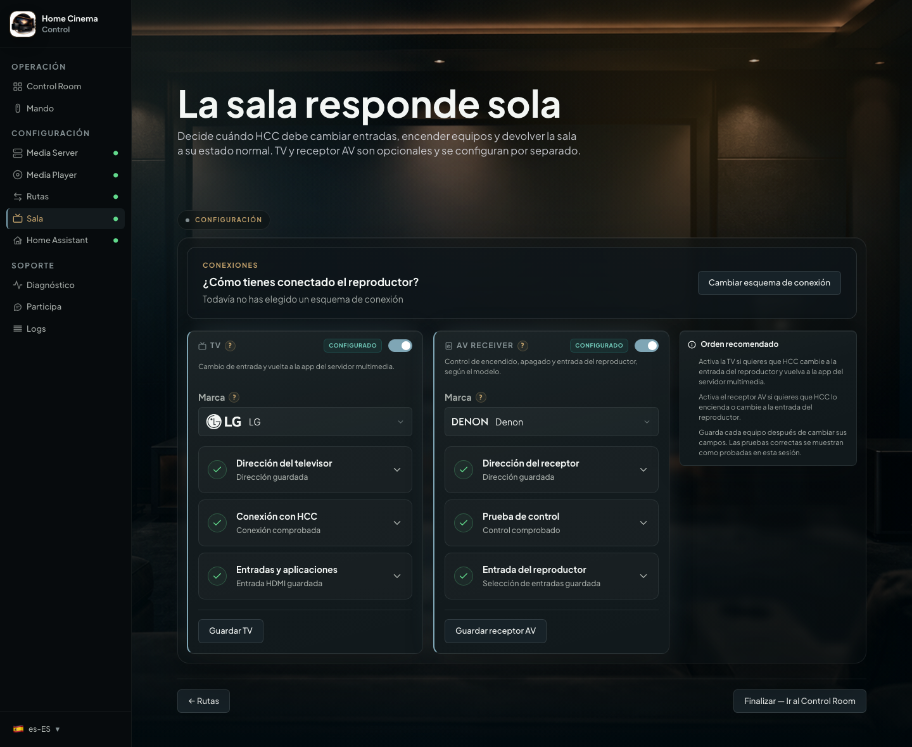

  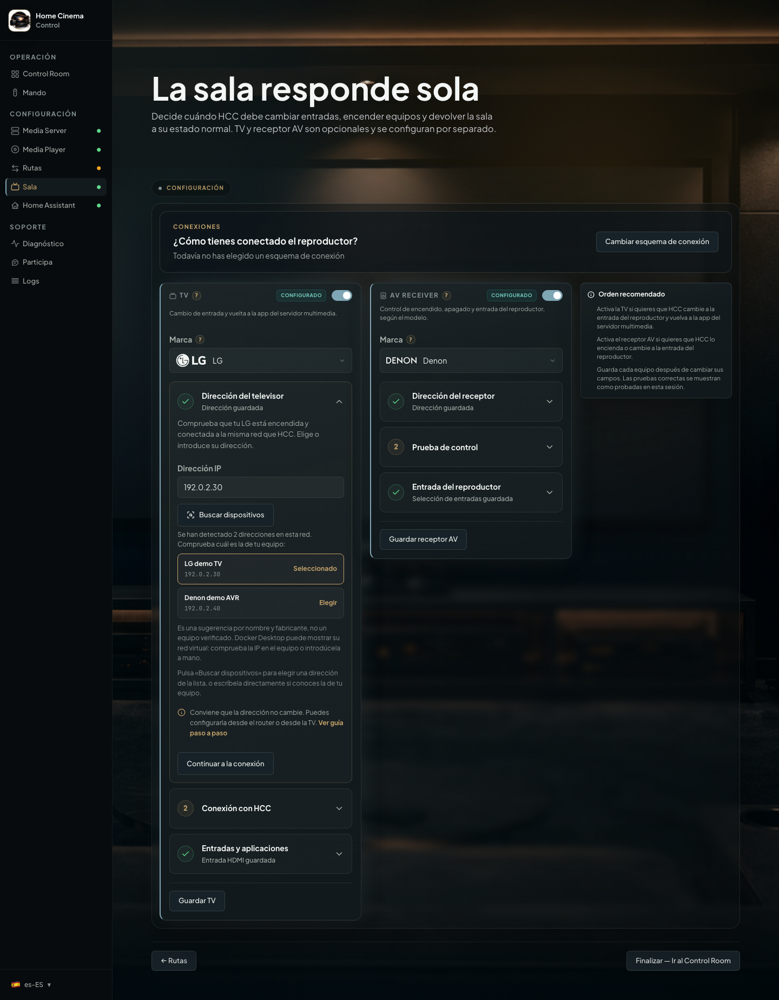

Los resultados son sugerencias, no equipos verificados. Docker Desktop puede mostrar su red virtual en vez de tu red
local. Comprueba la IP en el propio equipo y escríbela manualmente si no aparece; HCC y los dispositivos deben poder
comunicarse en tu red local (mantén **`network_mode: host`**). El nombre visible depende de la información que facilite
tu red o router.

En televisores LG, acepta el emparejamiento en pantalla si aparece. En Sony puede ser necesario activar el control IP/PSK en los ajustes de la TV. Si alguna prueba falla, consulta [Diagnóstico](solucionar-problemas.md#consulta-el-diagnóstico-de-hcc); si el receptor cambia solo a TV Audio, consulta [solución de problemas](solucionar-problemas.md#el-avr-cambia-solo-de-entrada).

#### Samsung: conecta tu TV a HCC

**Antes de empezar:** conecta la Samsung y el equipo donde está instalado HCC a la misma red local. Enciende el televisor y ten su mando a mano.

1. **Encuentra el televisor.** En la Samsung, abre **Todos los ajustes → Conexión → Red → Estado de red → Ajustes IP** para consultar su dirección. En HCC, entra en **Sala**, activa la TV, selecciona **Samsung** y sigue el primer paso **Dirección del televisor**. Puedes buscarla en la red o introducir la IP; pulsa **Guardar dirección**.
2. **Conecta HCC.** En la Samsung, abre **Todos los ajustes → Conexión → Red → Configuración para expertos → Control IP** y actívalo (los nombres pueden variar según el modelo). En el segundo paso de HCC, pulsa **Ya he activado Control IP** y **Vincular Samsung**. Si aparece una solicitud de conexión en la TV, acéptala con el mando. Después pulsa **Probar TV** para comprobar la conexión.
3. **Configura entradas y aplicaciones.** En el tercer paso **Entradas y aplicaciones**, elige el HDMI conectado al reproductor o al receptor AV y pulsa **Guardar HDMI**. Con los equipos encendidos, usa **Detectar entradas HDMI** para comprobar las opciones de control disponibles y **Cambiar al reproductor** para probar la entrada elegida. Confirma si ves la imagen. Las cuatro entradas HDMI que muestra Samsung son opciones posibles, no una garantía de que estén conectadas.
4. **Opcional: comprueba el regreso a Emby o Jellyfin.** Si ya has configurado ese servidor multimedia en HCC y tienes su aplicación instalada en la Samsung, pulsa **Abrir Emby** o **Abrir Jellyfin**, según corresponda. HCC utiliza internamente un identificador candidato; no tienes que introducir ningún código. Confirma si la aplicación aparece en la TV. Solo tras una confirmación positiva podrá utilizarse para el regreso automático.
5. **Opcional: comparte compatibilidad.** Debajo del asistente encontrarás **Compartir compatibilidad**. Puedes activarlo o dejarlo desactivado; no es necesario para usar Samsung.

**Si HCC no consigue conectarse**, comprueba que la TV esté encendida, que **Control IP** siga activado y que ambos equipos estén en la misma red. Revisa también que la dirección IP guardada en HCC coincida con la que muestra el televisor y vuelve a pulsar **Vincular Samsung**.

### 6. Reproduce tu primera película

1. Deja encendido el reproductor seleccionado. Si utilizas Kodi, mantén Kodi abierto.
2. Comprueba que la carpeta de la película figura como verificada en **Rutas** para ese reproductor.
3. Abre Emby/Jellyfin en el dispositivo seleccionado en **Media Server** y reproduce una película de esa biblioteca.
   Para la primera prueba de Kodi utiliza un archivo de vídeo habitual, por ejemplo MKV.
4. Comprueba que la película se abre en el reproductor, que el progreso avanza en Emby/Jellyfin y que puedes detenerla.
   Si configuraste Sala, comprueba también las entradas de TV y sonido.

Si la ruta no está configurada o verificada, HCC no entrega esa película al reproductor y puede continuar en la
aplicación de origen. Algunos clientes muestran un aviso con el motivo y la recomendación. Si falla la conexión, abre
**Diagnóstico** y consulta [solución de problemas](solucionar-problemas.md).

### Opciones para continuar

En **Media Player → Opciones de HCC** puedes activar estos ajustes. Ambos vienen desactivados por defecto. Pulsa **Guardar** después de cambiarlos.

- **Repetir los últimos 2 segundos al continuar.** Al retomar un archivo de vídeo compatible desde Emby o Jellyfin, la reproducción empieza hasta dos segundos antes de donde te quedaste. Tu progreso guardado se mantiene.
- **Reanudar Blu-ray desde Emby o Jellyfin (experimental).** Con OPPO o Chinoppo, si tu Blu-ray está guardado como ISO o carpeta BDMV, elige **Continuar** en Emby o Jellyfin y después **Reproducir** en el menú del disco. HCC intenta retomar lo que estabas viendo donde te quedaste. Si el disco ya ha retomado la reproducción por su cuenta, HCC respeta ese punto. Si paras en el menú, se conserva tu progreso. Para empezar de cero, elige **Reproducir desde el principio** en Emby o Jellyfin y, si el disco te lo ofrece, selecciona también **Start Over** en su menú.

Si eliges **Continuar** en Emby o Jellyfin y después **Start Over** en el disco, HCC todavía puede aplicar el punto guardado del servidor cuando empiece la reproducción.

En OPPO, ciertas imágenes Blu-ray ISO con menús pueden requerir continuar desde el propio menú. Si avanzar desde
Emby/Jellyfin reinicia el título, usa el mando del OPPO. No se garantiza esa misma experiencia de ISO, carpetas Blu-ray
o menús en Kodi: depende de su dispositivo y no está verificada como equivalente a OPPO.

Puedes terminar aquí o configurar los eventos opcionales de [Home Assistant](home-assistant.md).
