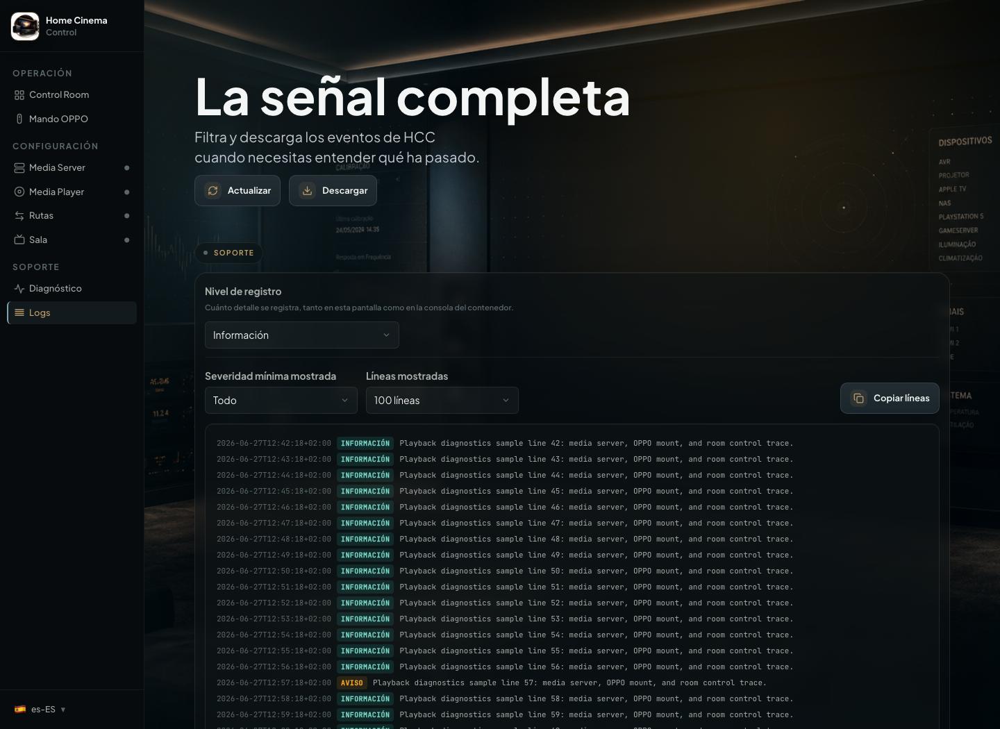

# Solucionar problemas de HCC

[Inicio](../README.md) · [Instalación](../INSTALL.md) · [English](troubleshoot.en.md)

Busca el síntoma que estás viendo. **Solo necesitas leer el apartado que coincida con tu problema.**

Si HCC aparece sin tus ajustes después de actualizar, empieza por [recuperar la configuración](recuperar-configuracion.md).

## Consulta el diagnóstico de HCC

Abre **Diagnóstico** en HCC. Ahí puedes comprobar conexiones, ver el último error y consultar la versión instalada.

  

Si necesitas pedir ayuda, utiliza **Enviar diagnóstico**: HCC prepara un resumen sin rutas, IP ni credenciales, que puedes revisar antes de compartir. Nada se envía automáticamente.

## Consulta los logs solo si hace falta

Abre **Logs** y filtra los errores o avisos recientes. Copia las líneas relevantes para soporte, revisando antes que no incluyan información privada.

  

La [telemetría opcional](https://github.com/tousled/home-cinema-control/blob/main/docs/telemetry.md) es independiente de los diagnósticos que decides compartir.

## Problemas frecuentes

### Jellyfin: no aparecen dispositivos ni bibliotecas al pulsar "Actualizar"

- La cuenta de Jellyfin con la que autorizas HCC debe tener permisos de **administrador**. Jellyfin protege la lista de
  dispositivos (`/Devices`) y la de carpetas de biblioteca (`/Library/VirtualFolders`) para cuentas con privilegios
  elevados — una cuenta normal recibe un error 403 al cargarlas, aunque el login en sí (autorizar, reproducir,
  reportar progreso) funcione con normalidad.
- Si Jellyfin muestra errores `401` o `403` al recargar dispositivos o bibliotecas, actualiza HCC y vuelve a autorizar
  Jellyfin desde la pantalla **Media Server**.
- Si solo tienes un usuario en tu Jellyfin, normalmente ya es el administrador y no tienes que hacer nada. Si usas un
  usuario secundario para HCC, dale permisos de administrador desde el panel de Jellyfin.

### HCC no llega al reproductor

- Comprueba la IP del OPPO/Chinoppo.
- Comprueba `network_mode: host`.
- Comprueba firewall.
- Despierta el reproductor y repite la prueba.

### El montaje NFS falla

- Verifica que el export NFS existe.
- Comprueba que el reproductor lo ve manualmente.
- Reinicia físicamente el reproductor si el navegador de red funciona pero el montaje sigue bloqueado.

### SMB devuelve `id_error`

- Revisa nombre de recurso, usuario, contraseña y permisos.
- Si tu combinación NAS/reproductor necesita preparar la sesión SMB, comprueba que las credenciales estén guardadas en
  HCC y vuelve a probar la ruta.
- Si se repite `id_error`, evita pulsar "Probar ruta" muchas veces seguidas: algunos OPPO/Chinoppo degradan su API de
  control tras demasiados montajes SMB fallidos. Reinicia físicamente el reproductor antes de volver a probar.
- Si esa biblioteca ya está verificada por NFS y SMB sigue fallando, usa NFS para ese mapeo.
- No esperes fallback a NFS: corrige SMB o cambia explícitamente esa ruta a NFS.

### SMB da timeout con carpetas de nombre largo o con caracteres especiales

Algunos reproductores OPPO/Chinoppo dan timeout al montar por SMB una carpeta cuyo nombre es muy largo o
incluye paréntesis, corchetes o el símbolo `+` (típico en nombres de release de series y películas, por
ejemplo `The Veil red de mentiras (2024) S01 [PACK][DSNP WEB-DL 1080p AVC ES DD+ 5.1][HDO]`). El mismo
contenido, en la misma carpeta NAS, monta y reproduce sin problema por NFS, y por SMB si se acorta o
simplifica el nombre de la carpeta/fichero. Si una biblioteca concreta te da timeouts SMB recurrentes y el
resto de bibliotecas SMB funcionan bien, sospecha primero de la longitud/caracteres del nombre antes de
revisar red o NAS:

- Cambia esa ruta concreta a NFS si el NAS lo expone (la forma más rápida de seguir viendo ese contenido).
- O renombra la carpeta/fichero a algo más corto y sin paréntesis/corchetes si quieres seguir usando SMB.

### El AVR cambia solo de entrada

- Revisa CEC/ARC.
- Desactiva CEC/ARC en el AVR si fuerza TV Audio.
- Aumenta el delay de cambio HDMI si el receptor necesita más tiempo al salir de standby.
