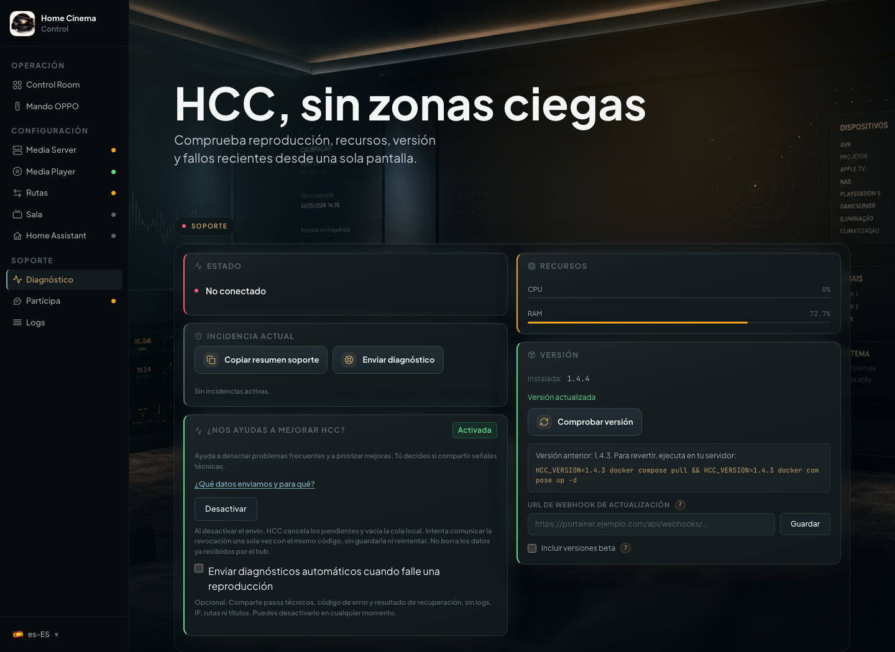
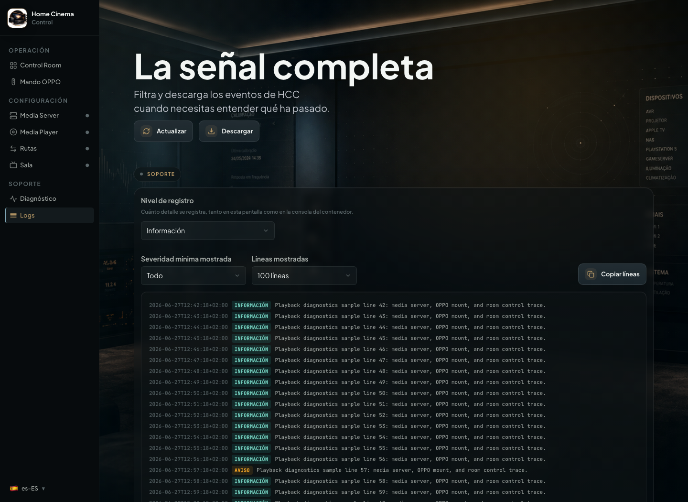
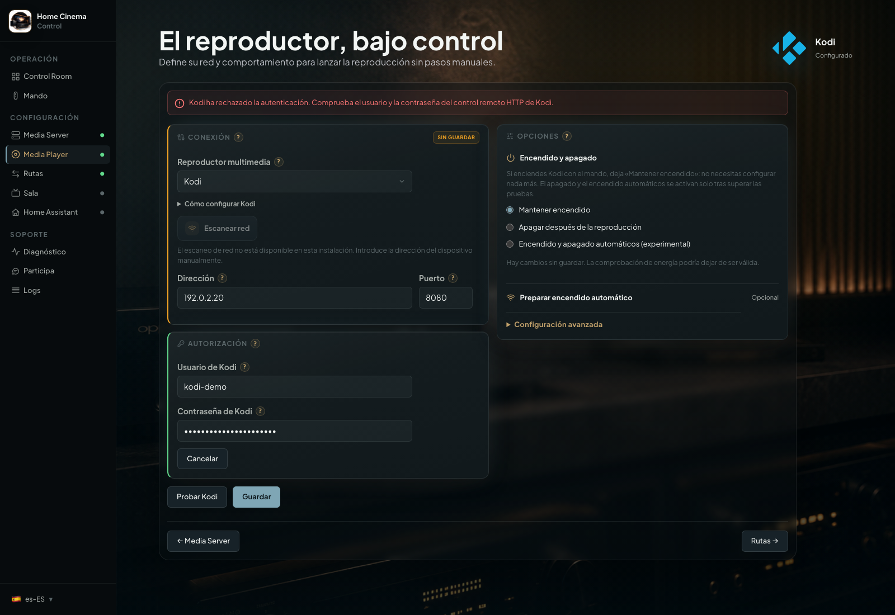

# Solucionar problemas de HCC

[Inicio](../README.md) · [Instalación](../INSTALL.md) · [English](troubleshoot.en.md)

Busca el síntoma que estás viendo. **Solo necesitas leer el apartado que coincida con tu problema.**

Si HCC aparece sin tus ajustes después de actualizar, empieza por [recuperar la configuración](recuperar-configuracion.md).

## Consulta el diagnóstico de HCC

Abre **Diagnóstico** en HCC. Ahí puedes comprobar conexiones, ver la **Incidencia actual** y consultar la versión instalada. **Sin incidencias activas** describe el estado actual, no un historial sin errores. Un sondeo vacío de Emby/Jellyfin o la desaparición del cliente durante la reproducción en el OPPO no generan por sí solos un aviso de dispositivo ausente.

<p align="center">
  
</p>

Si necesitas ayuda, pulsa **Enviar diagnóstico**. HCC prepara un informe con el estado del sistema y hasta **200 líneas recientes de logs** (por defecto); oculta las credenciales, IP, MAC y rutas conocidas de tu configuración, además de las direcciones IPv4 encontradas. **Puedes leerlo y corregirlo antes de compartirlo.** Al pulsar **Copiar y abrir GitHub**, HCC copia el informe y abre un issue: **tú debes pegarlo** y decidir si publicarlo; no se envía automáticamente.

## Consulta los logs solo si hace falta

Abre **Logs** y filtra errores o avisos recientes. HCC evita registrar credenciales en las peticiones al OPPO, pero **el log original puede mostrar IP y nombres de carpetas**. Para un informe de soporte con ocultación adicional, utiliza **Enviar diagnóstico**. También puedes copiar las líneas visibles o descargar `hcc.log`.

<p align="center">
  
</p>

La [telemetría opcional](https://github.com/tousled/home-cinema-control/blob/main/docs/telemetry.md) es independiente de los diagnósticos que decides compartir.

## Contacto y soporte

¿Algo no funciona? Si sospechas que has encontrado un **fallo de HCC**, [abre un issue en el repositorio público](https://github.com/tousled/home-cinema-control/issues/new). Así podemos reproducirlo y compartir la solución con otros usuarios.

Para pedir **ayuda con tu instalación**, escribe a [llorente.software.solutions@gmail.com](mailto:llorente.software.solutions@gmail.com). No hace falta saber programar.

### Cómo enviar el log de una prueba fallida

1. Repite la acción que falla una vez, por ejemplo **Probar conexión** o **Probar ruta**. Apunta qué esperabas que ocurriese y qué mensaje apareció.
2. Abre **Diagnóstico** y revisa el último fallo. Pulsa **Enviar diagnóstico** para crear un informe con datos conocidos ocultos. Revísalo y pulsa **Copiar y abrir GitHub**: el informe queda copiado, **pero debes pegarlo tú** en el issue. No se publica automáticamente.
3. Abre **Logs**, pulsa **Actualizar** si necesitas cargar las últimas líneas y filtra **Error** o **Aviso**. Pulsa **Copiar líneas** para compartir las líneas visibles relevantes. Si necesitas el archivo completo, pulsa **Descargar**: obtendrás `hcc.log`.
4. En el issue o correo incluye la **versión de HCC** (en Diagnóstico), el dispositivo y servidor multimedia que utilizas, los **pasos para reproducir el error**, el mensaje que viste y las líneas del log correspondientes a esa prueba.

**Privacidad:** HCC evita escribir credenciales en las peticiones al reproductor y el informe de **Enviar diagnóstico** aplica un filtrado adicional. Aun así, antes de publicar un registro revisa si aparecen nombres de carpetas, direcciones u otros datos propios. **Descargar** guarda el `hcc.log` completo, no solo las líneas filtradas en pantalla. Para un issue público es preferible compartir el informe de Diagnóstico o las líneas necesarias.

## Problemas frecuentes

### Error de descarga desde GHCR (`denied` o `403 Forbidden`)

Si Docker no consigue descargar `ghcr.io/tousled/home-cinema-control` al instalar o actualizar, utiliza Docker Hub sin reinstalar HCC. En el archivo Compose **de tu instalación actual**, sustituye únicamente la línea:

```yaml
image: ghcr.io/tousled/home-cinema-control:latest
```

por:

```yaml
image: tousled/home-cinema-control:latest
```

**Conserva el resto del archivo y el volumen de `/config`.** Si usas una versión fija, conserva el mismo tag cuando esté publicado en Docker Hub. Si utilizas la variable `HCC_VERSION`, consérvala también. Para completar la actualización utiliza la [guía Docker Compose](actualizar-compose.md) o la [guía Portainer](actualizar-portainer.md) sobre tu instalación existente. No borres el volumen ni crees otro stack.

### Jellyfin: no aparecen dispositivos ni bibliotecas al pulsar "Actualizar"

- La cuenta de Jellyfin con la que autorizas HCC debe tener permisos de **administrador**. Jellyfin protege la lista de
  dispositivos (`/Devices`) y la de carpetas de biblioteca (`/Library/VirtualFolders`) para cuentas con privilegios
  elevados — una cuenta normal recibe un error 403 al cargarlas, aunque el login en sí (autorizar, reproducir,
  reportar progreso) funcione con normalidad.
- Si Jellyfin muestra errores `401` o `403` al recargar dispositivos o bibliotecas, actualiza HCC y vuelve a autorizar
  Jellyfin desde la pantalla **Media Server**.
- Si solo tienes un usuario en tu Jellyfin, normalmente ya es el administrador y no tienes que hacer nada. Si usas un
  usuario secundario para HCC, dale permisos de administrador desde el panel de Jellyfin.

### Kodi: conexión y carpetas en 1.5.0

Identifica primero si falla el control de Kodi o el acceso de Kodi a las películas. Son conexiones y credenciales
diferentes.

#### «Probar Kodi» o guardar credenciales falla

1. Abre **Media Player → Conexión**. Comprueba la dirección de Kodi sin `http://` y su puerto HTTP, normalmente `8080`.
   No uses `8090`, que pertenece a HCC.
2. En Kodi, abre **Ajustes → Servicios → Control**. Activa el control remoto HTTP y **Requerir autenticación**. Mantén
   Kodi abierto y comprueba que el equipo es accesible desde el servidor Docker.
3. En **Autorización** de HCC, usa **Cambiar contraseña**, introduce los datos del control HTTP y pulsa **Guardar**. Una
   contraseña incorrecta rechaza el guardado; no sustituye la anterior. **Probar Kodi** prueba los valores nuevos del
   formulario o utiliza la contraseña guardada si no escribes otra.

| Resultado | Qué revisar |
| --- | --- |
| Falta dirección o puerto/parámetros inválidos | Corrige los campos de conexión indicados. |
| Credenciales rechazadas | Comprueba el usuario y contraseña HTTP de Kodi, no los de la carpeta del NAS. |
| Kodi inaccesible | Comprueba que Kodi está abierto, su IP, puerto y el acceso de red o firewall. |
| Error de comunicación | Confirma que el puerto pertenece al control HTTP de Kodi y revisa el error en Diagnóstico. |
| Autenticación no exigida | Kodi permite acceso anónimo; HCC no puede validar las credenciales suministradas. Activa la autenticación en Kodi. |

Ejemplo de rechazo de credenciales con el servicio Kodi simulado de demostración:

<p align="center">
  
</p>

La prueba no necesita una película activa. Los ajustes avanzados de OPPO no deben bloquearla. Si aparece un error ajeno
a Kodi, incluye el mensaje y la versión instalada en tu consulta a soporte.

#### No aparecen fuentes o una fuente no se puede seleccionar

Añade la carpeta en **Vídeos → Archivos → Añadir vídeos** de Kodi, mediante NFS o SMB. Añadirla solo al gestor de
archivos no crea una fuente de vídeo. Vuelve a pulsar **Explorar carpetas de Kodi** en HCC.

Las carpetas locales están reservadas para una actualización 1.5.x, sin fecha anunciada. Las fuentes `plugin://` y otros
protocolos tampoco están disponibles en HCC 1.5.0. Aparecen sin permitir selección; utiliza NFS o SMB.

#### Kodi conecta, pero «Probar ruta» falla

Abre la misma carpeta desde Kodi. Para SMB, corrige las credenciales del NAS en Kodi; para NFS, comprueba los permisos
del recurso para el dispositivo Kodi. Los datos HTTP de HCC no autorizan acceso al NAS. El navegador rellena la ruta al
pulsar la carpeta; después utiliza **Probar ruta**, sin buscar un botón adicional para confirmarla.

Si la carpeta se verifica pero una película no se abre, prueba primero ese archivo directamente en Kodi. Una prueba de
carpeta no comprueba todos los formatos, códecs ni menús. Empieza por un MKV para separar los problemas de conexión de
las limitaciones del archivo o dispositivo.

#### Al volver a OPPO o Kodi parecen faltar carpetas

Comprueba el reproductor activo y el servidor multimedia elegido. Cada combinación conserva sus propias rutas. Las rutas
antiguas sin reproductor se mantienen para OPPO; las de Kodi se configuran aparte. No borres el volumen ni copies
secretos entre archivos. Consulta [recuperar configuración](recuperar-configuracion.md).

### La reproducción no cambia al OPPO y aparece un aviso

HCC muestra primero **qué ha ocurrido** y después **qué hacer**, en dos avisos separados cuando el cliente Emby/Jellyfin admite notificaciones remotas:

- **«El OPPO no responde.»** Después: «Comprueba que esté encendido y conectado a la red.» Ve a **Media Player → Probar conexión** y revisa el control IP. Si no se confirma que el OPPO esté disponible, no se cambian las entradas de TV y receptor.
- **«Ruta sin verificar. La reproducción continúa en Emby.»** (o Jellyfin). Después: «Verifica la ruta en Rutas
  multimedia de HCC.» Utiliza **Rutas → Probar ruta**.
- **«Ruta sin configurar. La reproducción continúa en Jellyfin.»** (o Emby). Después: «Configura la ruta en Rutas multimedia de HCC.» Elige la carpeta del OPPO y compruébala.

Si falta una ruta válida, HCC no inicia el contenido en el OPPO y la reproducción puede continuar en Emby/Jellyfin. Si la aplicación ya estaba reproduciendo cuando se detectó que el OPPO no respondía, tal vez necesites detenerla manualmente. Algunos clientes no muestran todas las notificaciones remotas.

### Un Blu-ray ISO se reinicia al avanzar desde Emby/Jellyfin

Algunas imágenes Blu-ray ISO tienen menús interactivos y sus propias reglas de reanudación. Al volver a iniciar la imagen, puede aparecer primero el menú del disco con una opción de **Continuar**. Esto es distinto de la reanudación directa de un archivo MKV.

Si al **avanzar desde la aplicación** la película vuelve al principio, utiliza provisionalmente el **mando del OPPO** para avanzar y no repitas el salto desde Emby/Jellyfin. Estamos investigando la diferencia entre comandos de búsqueda por tiempo de HCC y los controles nativos en discos Blu-ray. Si puedes reproducirlo, comparte un diagnóstico y los logs correspondientes a ese intento.

### La película tarda mucho en empezar

Una espera aislada puede deberse a la activación de la API del OPPO, al montaje NFS/SMB, al menú del Blu-ray o a la comprobación de reproducción. No cambies los tiempos de espera sin saber qué fase es lenta. En **Logs**, busca los registros `Playback startup timing` y el paso con mayor duración; compártelos mediante **Enviar diagnóstico** si el problema se repite.

### HCC no llega al reproductor

Este apartado se refiere a OPPO/Chinoppo. Para Kodi, consulta su apartado de conexión y carpetas.

- Comprueba la IP del OPPO/Chinoppo y que el reproductor esté encendido.
- En **OPPO UDP-203/205**, abre **SETUP → Network Setup → IP Control → On**. En un Chinoppo/clon, busca la opción equivalente de control IP en los ajustes de red; el nombre y la ruta pueden variar según su firmware.
- Comprueba `network_mode: host`.
- Comprueba firewall.
- Despierta el reproductor y repite la prueba.

### El Chinoppo da timeout al montar la carpeta o al reproducir

Un timeout no significa siempre lo mismo:

- **`Timeout in Mount Request`:** el reproductor no completó el montaje NFS/SMB. **Puede aparecer al navegar carpetas, usar Probar ruta o iniciar una película**, porque HCC utiliza el mismo servicio de montaje en las tres operaciones. En un caso real, después de encender el Chinoppo fallaba la API de red; entrar una vez en su menú de carpetas NFS permitía continuar. Comprueba que **IP Control** está activo, espera a que el reproductor termine de arrancar y prueba de nuevo una sola vez.
- **`Timeout in Play Request`:** el reproductor no respondió a tiempo a la orden de reproducción. **No demuestra que la ruta sea incorrecta.**
- **Timeout esperando que comience la reproducción:** la película no llega a confirmarse como activa. No es necesariamente un problema de mapeo; revisa el estado del reproductor y el último error de HCC.

Si se repite, abre **Diagnóstico** y envía el informe junto al log de la prueba, siguiendo [Contacto y soporte](#contacto-y-soporte). HCC prepara la API de control antes del montaje y reintenta una vez un montaje NFS que falle por timeout; si vuelve a fallar, hace falta analizar ese caso concreto, no aumentar los tiempos a ciegas.

### El montaje NFS falla

- Verifica que el export NFS existe.
- Comprueba que el reproductor lo ve manualmente.
- Reinicia físicamente el reproductor si el navegador de red funciona pero el montaje sigue bloqueado.

### SMB devuelve `id_error`

Este apartado se refiere a OPPO/Chinoppo. Para Kodi, consulta su apartado de conexión y carpetas.

- Revisa nombre de recurso, usuario, contraseña y permisos.
- Si tu combinación NAS/reproductor necesita preparar la sesión SMB, comprueba que las credenciales estén guardadas en
  HCC y vuelve a probar la ruta.
- Si se repite `id_error`, evita pulsar "Probar ruta" muchas veces seguidas: algunos OPPO/Chinoppo degradan su API de
  control tras demasiados montajes SMB fallidos. Reinicia físicamente el reproductor antes de volver a probar.
- Si esa biblioteca ya está verificada por NFS y SMB sigue fallando, usa NFS para ese mapeo.
- No esperes fallback a NFS: corrige SMB o cambia explícitamente esa ruta a NFS.

### SMB da timeout con carpetas de nombre largo o con caracteres especiales

Algunos reproductores OPPO/Chinoppo dan timeout al montar por SMB una carpeta cuyo nombre es muy largo o
incluye paréntesis, corchetes o el símbolo `+` (típico en nombres de release de series y películas, por
ejemplo `The Veil red de mentiras (2024) S01 [PACK][DSNP WEB-DL 1080p AVC ES DD+ 5.1][HDO]`). El mismo
contenido, en la misma carpeta NAS, monta y reproduce sin problema por NFS, y por SMB si se acorta o
simplifica el nombre de la carpeta/fichero. Si una biblioteca concreta te da timeouts SMB recurrentes y el
resto de bibliotecas SMB funcionan bien, sospecha primero de la longitud/caracteres del nombre antes de
revisar red o NAS:

- Cambia esa ruta concreta a NFS si el NAS lo expone (la forma más rápida de seguir viendo ese contenido).
- O renombra la carpeta/fichero a algo más corto y sin paréntesis/corchetes si quieres seguir usando SMB.

### El AVR cambia solo de entrada

- Revisa CEC/ARC.
- Desactiva CEC/ARC en el AVR si fuerza TV Audio.
- Aumenta el delay de cambio HDMI si el receptor necesita más tiempo al salir de standby.
