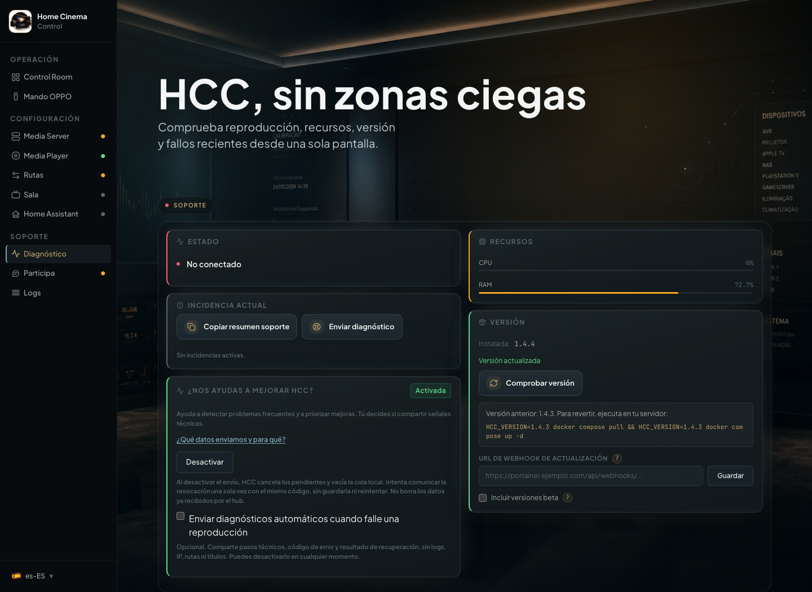
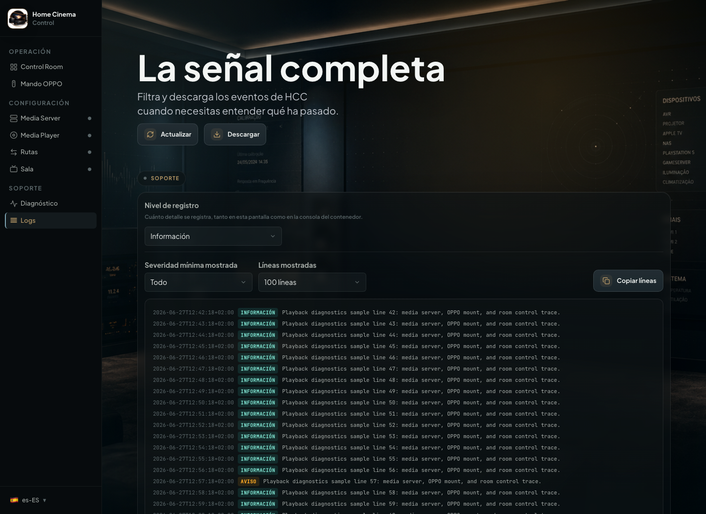
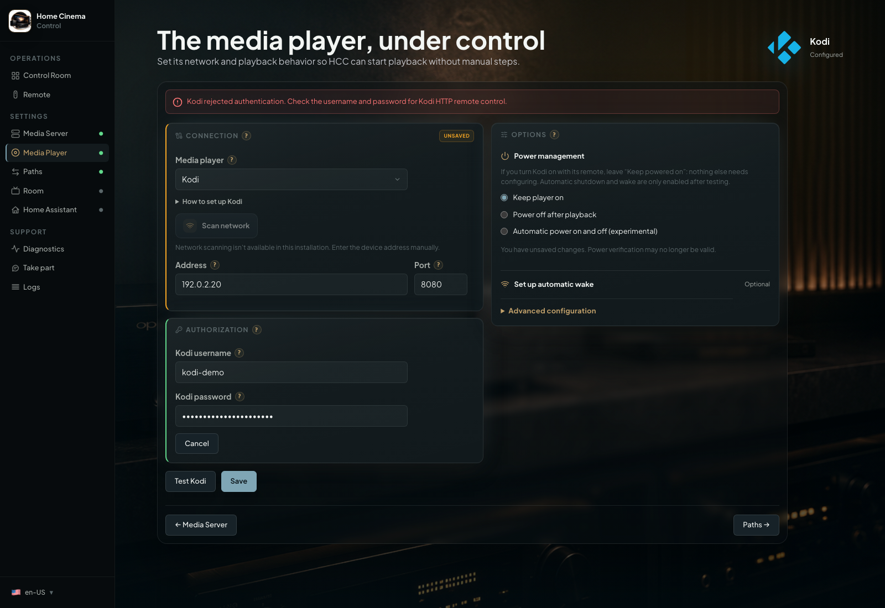

# Troubleshoot HCC

[Home](../README.en.md) · [Installation](../INSTALL.en.md) · [Español](solucionar-problemas.md)

Find the symptom you're experiencing. **You only need the section that matches your problem.**

If HCC appears to have lost its settings after an update, start with [configuration recovery](recover-configuration.en.md).

## Check HCC diagnostics

Open **Diagnostics** in HCC to check connections, see the **Current issue** and find the installed version. **No active issues** describes the current state, not an error-free history. An empty Emby/Jellyfin session snapshot or the client's disappearance during OPPO playback does not by itself trigger a missing-device warning.

<p align="center">
  
</p>

For help, click **Send diagnostics**. HCC prepares a status summary and up to **200 recent log lines** by default. It redacts credentials, IPs, MACs and paths known from your configuration, plus IPv4 addresses found in the text. **Review the report** before sharing. **Copy & open GitHub** copies it and opens an issue, but **you must paste it**; nothing is submitted automatically.

## Read logs only when needed

Open **Logs** and filter recent errors or warnings. HCC avoids logging credentials in OPPO requests, but **the original log may include IP addresses and folder names**. For an extra-redacted support report, use **Send diagnostics**. You can also copy the visible lines or download `hcc.log`.

<p align="center">
  
</p>

[Optional telemetry](telemetry.en.md) is separate from diagnostics you choose to share.

## Contact and support

If you think you've found an **HCC bug**, [open an issue in the public repository](https://github.com/tousled/home-cinema-control/issues/new). This makes it easier to reproduce the issue and share a fix.

For **installation help**, email [llorente.software.solutions@gmail.com](mailto:llorente.software.solutions@gmail.com). Programming knowledge isn't required.

### How to share a failed test log

1. Repeat the failing action once, such as **Test connection** or **Test path**. Note what you expected and what error appeared.
2. Open **Diagnostics** and check the latest failure. Click **Send diagnostics** for a report with known private values redacted. Review it, then click **Copy & open GitHub**. The report is copied, **but you must paste it yourself** into the issue. It is not posted automatically.
3. Open **Logs**. Click **Refresh** if needed and filter for **Error** or **Warning**. Click **Copy lines** to share the relevant visible entries. To save the full file, click **Download**; this saves `hcc.log`.
4. In the issue or email, include your **HCC version** (under Diagnostics), media server and device, **steps to reproduce**, the displayed error, and the relevant log entries from the test.

**Privacy:** HCC avoids writing credentials in player requests and **Send diagnostics** applies additional redaction. Still, check for device addresses, folder names or other personal details before posting publicly. **Download** saves the complete `hcc.log`, not just the lines filtered on screen. For public issues, prefer the redacted Diagnostics report or the relevant log lines.

## Frequent Issues

### GHCR pull fails (`denied` or `403 Forbidden`)

If Docker cannot pull `ghcr.io/tousled/home-cinema-control` when installing or updating HCC, use Docker Hub without reinstalling HCC. In **your existing Compose file**, replace only:

```yaml
image: ghcr.io/tousled/home-cinema-control:latest
```

with:

```yaml
image: tousled/home-cinema-control:latest
```

**Keep everything else, including the `/config` volume.** If you pin a release, retain its version tag when the same release is available on Docker Hub. If using `HCC_VERSION`, keep that variable too. Finish using the [Docker Compose guide](update-compose.en.md) or [Portainer guide](update-portainer.en.md) for your existing installation. Do not delete the volume or create a new stack.

### Jellyfin: devices and libraries don't show up when you click "Reload"

- The Jellyfin account you authorize HCC with must be an **administrator**. Jellyfin restricts the device list
  (`/Devices`) and the library/virtual-folder list (`/Library/VirtualFolders`) to elevated accounts — a regular
  account gets a 403 error loading them, even though login itself (authorizing, playing, reporting progress) works
  normally.
- If Jellyfin returns `401` or `403` while reloading devices or libraries, update HCC and re-authorize Jellyfin from
  **Media Server**.
- If you only have one Jellyfin user, it's almost certainly already the administrator and there's nothing to change.
  If HCC uses a secondary account, grant it administrator rights from the Jellyfin dashboard.

### Playback is not transferred to the OPPO and a notice appears

HCC shows **what happened** first, then **what to do** in a separate message, if the Emby/Jellyfin client supports remote notifications:

- **“OPPO isn't responding.”** Then: “Make sure it's powered on and connected to the network.” Check **Media Player → Test connection** and IP control. When the OPPO isn't available, HCC doesn't switch TV or receiver inputs.
- **“Path not verified. Playback continues in Emby.”** (or Jellyfin). Then: “Verify the path in HCC Paths.” Open
  **Paths → Test path**.
- **“Path not configured. Playback continues in Jellyfin.”** (or Emby). Then: “Configure the path in HCC Paths.” Choose
  and verify the correct OPPO folder.

Without a valid media path, HCC won't start the content on the OPPO, and native playback may continue in Emby/Jellyfin. If the source app had already started playing when HCC detected that the OPPO was unreachable, you might need to stop it manually. Some clients don't show every remote message.

### A Blu-ray ISO restarts when seeking from Emby/Jellyfin

Some Blu-ray ISOs have interactive menus and their own resume logic. Starting the image again may open the disc menu with a **Continue** option; this differs from a direct MKV resume.

If seeking **from the app** restarts playback, use the **OPPO remote** for now rather than repeatedly seeking through Emby/Jellyfin. We are investigating the interaction between HCC time-based seek commands and native Blu-ray controls. If reproducible, share a diagnostic and the logs from that attempt.

### A movie takes unusually long to start

A single delay might be caused by OPPO API activation, an NFS/SMB mount, a Blu-ray menu, or playback-start confirmation. Avoid increasing timeouts blindly. In **Logs**, look for `Playback startup timing` and which step took the longest; share it through **Send diagnostics** if delays recur.

### HCC cannot reach the player

This section applies to OPPO/Chinoppo. For Kodi, use its connection and folders section.

- Check the OPPO/Chinoppo IP address and make sure the player is powered on.
- On **OPPO UDP-203/205**, open **SETUP → Network Setup → IP Control → On**. On a Chinoppo/clone, look for the equivalent IP/network-control option; wording and location may vary by firmware.
- Check `network_mode: host`.
- Check firewall rules.
- Wake the player and test again.

### Chinoppo times out while mounting a folder or starting playback

Different timeouts have different causes:

- **`Timeout in Mount Request`:** the player did not complete an NFS/SMB mount. **This may affect folder browsing, Test path and playback**, which share the same mount service. In one reported case, the Chinoppo's network API was not ready after power-up; opening its NFS browser once allowed the mount to complete. Check that **IP Control** is enabled, let the player finish starting, and retry once.
- **`Timeout in Play Request`:** the player did not answer the play command in time. **This does not prove the media path is wrong.**
- **Playback startup timeout:** HCC did not confirm active playback after starting the handoff. This is not necessarily a path-mapping problem; inspect the player state and the latest diagnostic.

If it happens again, open **Diagnostics** and share the report and test log as explained in [Contact and support](#contact-and-support). HCC prepares the control API before mounting and retries one timed-out NFS mount; if the retry fails, investigate the specific cause instead of increasing timeouts blindly.

### NFS mount fails

This section applies to OPPO/Chinoppo. For Kodi, use its connection and folders section.

- Verify that the NFS export exists.
- Confirm the player can browse it manually.
- Physically restart the player if its browser works but the mount remains stuck.

### SMB returns `id_error`

This section applies to OPPO/Chinoppo. For Kodi, use its connection and folders section.

- Check share name, username, password, and permissions.
- If your NAS/player combination needs SMB session preparation, check that the credentials are saved in HCC and test
  the path again.
- If `id_error` repeats, avoid pressing "Test path" many times in a row: some OPPO/Chinoppo players degrade their
  control API after too many failed SMB mounts. Physically restart the player before testing again.
- If that library is already verified through NFS and SMB keeps failing, use NFS for that mapping.
- Do not expect fallback to NFS: fix SMB or explicitly change that mapping to NFS.

### SMB times out on long folder names or names with special characters

This section applies to OPPO/Chinoppo. For Kodi, use its connection and folders section.

Some OPPO/Chinoppo players time out mounting an SMB folder whose name is very long or includes
parentheses, brackets, or a `+` sign (common in release-style names for movies and TV episodes, e.g.
`The Veil red de mentiras (2024) S01 [PACK][DSNP WEB-DL 1080p AVC ES DD+ 5.1][HDO]`). The same content,
in the same NAS folder, mounts and plays fine over NFS, and over SMB too once the folder/file name is
shortened or simplified. If one specific library keeps timing out over SMB while your other SMB
libraries work fine, suspect the name length/characters first, before checking the network or the NAS:

- Switch that specific mapping to NFS if your NAS exposes it (the fastest way to keep watching that
  content).
- Or rename the folder/file to something shorter without parentheses/brackets if you want to keep
  using SMB.

### The AVR changes input by itself

- Review CEC/ARC.
- Disable CEC/ARC on the AVR if it forces TV Audio.
- Increase HDMI switch delay if the receiver needs more time after standby.

### Kodi: connection and folders in 1.5.0

First identify whether Kodi control or Kodi's access to movies is failing. They use different connections and
credentials.

#### “Test Kodi” or saving credentials fails

1. Open **Media Player → Connection**. Check Kodi's address without `http://` and its HTTP port, usually `8080`. Do not
   use `8090`, which belongs to HCC.
2. In Kodi, open **Settings → Services → Control**. Enable HTTP remote control and **Require authentication**. Keep Kodi
   open and check that the Docker host can reach it.
3. In HCC's **Authorization**, use **Change password**, enter the HTTP control credentials, and click **Save**. An
   incorrect password rejects the save and leaves the previous one intact. **Test Kodi** tests newly entered values, or
   uses the stored password if no new one is entered.

| Result                                     | What to check                                                                                            |
|--------------------------------------------|----------------------------------------------------------------------------------------------------------|
| Missing address or invalid port/parameters | Correct the highlighted connection fields.                                                               |
| Rejected credentials                       | Check Kodi's HTTP username and password, not the NAS folder credentials.                                 |
| Kodi unreachable                           | Check that Kodi is open, its IP and port, and network or firewall access.                                |
| Communication error                        | Confirm that the port serves Kodi's HTTP control and check the error in Diagnostics.                     |
| Authentication not required                | Kodi permits anonymous access, so HCC cannot verify supplied credentials. Enable authentication in Kodi. |

If the configured address returns an HTTP authentication error, first check that it belongs to Kodi. Another program
may be responding at that address or port. That error alone does not prove the Kodi password is incorrect. The remote
does not send a Wake-on-LAN signal in response to that error.

Example credential rejection using the simulated Kodi demonstration service:

<p align="center">
  
</p>

The test does not need an active movie. OPPO advanced settings must not block it. If an unrelated error appears, include
the message and installed version when contacting support.

#### The shutdown test cannot check playback

If HCC cannot read Kodi's playback state, it stops the test without sending a shutdown command. Check the address and
HTTP remote control port, then try again. An unreadable response does not confirm that Kodi is idle. Check the logs if
the error continues.

Availability checks distinguish available Kodi, network unavailability and an indeterminate state. An HTTP 401/403,
another communication error or an invalid Ping leaves the state indeterminate: it does not establish shutdown and
cannot verify shutdown or start a wake test. Check HTTP access, credentials and the address before retrying.

A capability-query failure before sending does not count as a shutdown attempt either. Correct the problem and retry;
that failure cannot enable experimental shutdown. An uncertain outcome is only possible after HCC starts the command
and cannot determine its result.

If Kodi settings change during testing or just before saving, HCC rejects the earlier result. Reopen the wizard and
test the current settings. This also applies when another browser changes the selected player: saving an old test
must not select Kodi again.

Leaving **Media Player** cancels the wizard session when HCC can receive the request. A command that has already
started may continue; cancellation does not wake or power off the device. You can start another test when you return.
If the connection is lost before cancellation, the server session expires after 15 minutes.

Pre-send checks do not block cancellation. If cancellation is accepted before the command starts, HCC does not start
it; a command whose send has already started may continue even when the session is cancelled.

#### Kodi responds, but wake is not verified

If Kodi responds before HCC sends the Wake-on-LAN signal, the device is available, but the test does not establish
that this method woke it. HCC does not save that method as verified. Suspend or power off the device manually and
repeat the test from another device. Kodi responding again for another reason is insufficient.

After sending Wake-on-LAN, HCC requires the Ping response to be exactly `pong`. A different response cannot verify
wake, even if the HTTP server answered.

#### Android TV pairing does not complete

Enter the code while the test is active. If it expires, select **Pair Android TV** to start a new attempt; you do not
need to restart HCC. Use the code from the new attempt. A code or result from an expired attempt cannot complete the
new one. Pairing alone does not verify wake support: complete the wizard's wake test.

If you change the profile or Android device during pairing, HCC does not confirm the earlier attempt as valid.
Start pairing again with the current settings.

#### Sources are missing or cannot be selected

Add the folder in Kodi's **Videos → Files → Add videos**, through NFS or SMB. Adding it only to the file manager does
not create a video source. Click **Browse Kodi folders** again in HCC.

Local folders are reserved for a later 1.5.x update without an announced date. Sources using `plugin://` and other
protocols are also unavailable in HCC 1.5.0. They appear without allowing selection; use NFS or SMB.

#### Kodi connects, but “Test path” fails

Open the same folder in Kodi. For SMB, correct the NAS credentials in Kodi; for NFS, check share permissions for the
Kodi device. HCC's HTTP credentials do not authorise NAS access. Clicking a folder fills its path; then use **Test
path**, without looking for an extra confirmation button.

If the folder verifies but a movie does not open, first try that file directly in Kodi. A folder test does not check
every format, codec, or disc menu. Start with an MKV to separate connection problems from file or device limitations.

#### Folders seem missing after switching back to OPPO or Kodi

Check the active player and media server. Each combination retains its own paths. Older paths without a player remain
assigned to OPPO; Kodi paths are configured separately. Do not delete the volume or copy secrets between files.
See [configuration recovery](recover-configuration.en.md).
